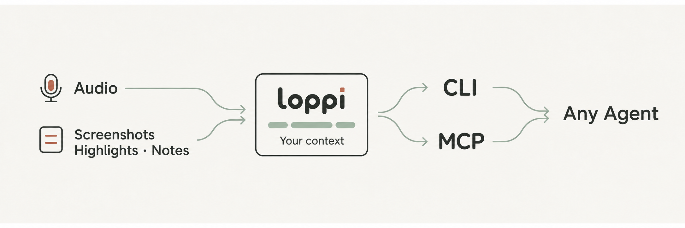
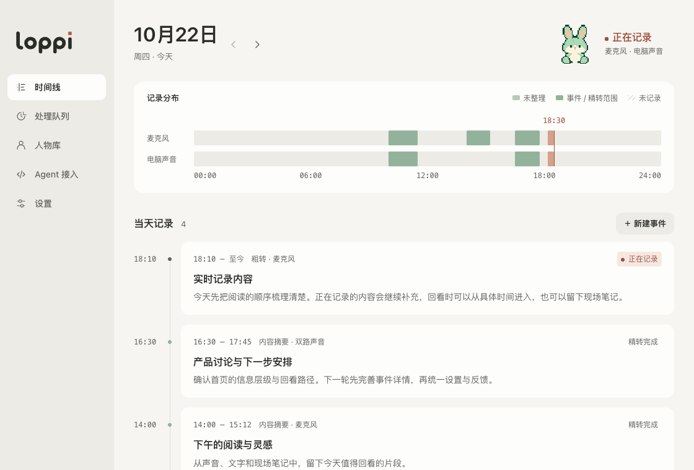
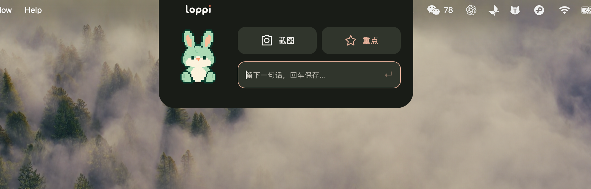
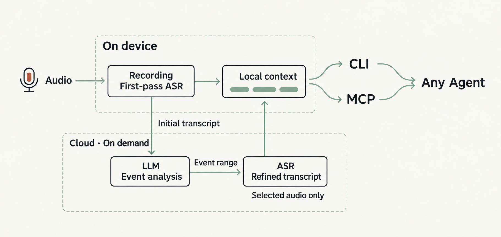

[简体中文](README.md) · English


**loppi is a little rabbit that lives on your computer, quietly recording shared context for you and your agents, 24/7. MCP and a CLI make that context easy for any agent to read and manage.**



We work closely with agents every day, but I’m tired of having to tell AI what we just discussed or what happened in a meeting that just ended. The MacBook in front of me was already there for those discussions, meetings, decisions, and ideas.

So I built loppi to turn your computer into a real-time context collector. It uses your computer’s storage and local compute to record audio and produce an initial transcript with an on-device model. Cloud LLMs and ASR then analyze important events and refine their transcripts. Once recording is enabled, you don’t have to remember to press Record for every meeting. loppi is already there.



Use the notch panel or floating widget to take a screenshot, mark a highlight, or leave a comment whenever you need to. Let technology give you your attention back.



## Download and setup

Visit [Releases](https://github.com/hAcKlyc/loppi/releases) to download the installer for your operating system and processor. See each release’s notes for supported platforms, installation requirements, and known limitations.

1. Install loppi and allow microphone and system audio recording.
2. Configure your DeepSeek and Volcengine credentials.
3. Start recording and keep loppi running.

Your computer needs to stay awake to record. Add screenshots, highlights, and notes whenever you need to. See the [usage guide](docs/usage.md).

## Connect an agent

In the sidebar’s **Agent access (Agent 接入)** section, copy the CLI command, MCP configuration, or Skill installation command for an agent on the same computer. Examples for the default macOS installation:

```sh
/Applications/loppi.app/Contents/MacOS/loppi context list --date today
/Applications/loppi.app/Contents/MacOS/loppi context search 'release plans'
/Applications/loppi.app/Contents/MacOS/loppi mcp serve
```

MCP provides read-only queries; the CLI also provides management commands. See the [Agent Context contract](specs/tech_docs/agent-context.md) and [CLI guide](resources/agent/loppi-context/references/cli.md).

## Architecture



## Privacy and costs

Records are stored locally. Transcript refinement, event organization, and screenshot understanding send the relevant audio, text, or images to the cloud services you configure, with charges based on usage. Whether an agent forwards retrieved records depends on its own configuration. See [privacy and data](PRIVACY.md).

## Docs and contributing

Detailed guides are currently in Chinese.

[Usage guide](docs/usage.md) · [Development guide](docs/development.md) · [Releases and known limitations](docs/releases.md) · [Documentation index](docs/README.md)

[Contributing](CONTRIBUTING.md) · [Report an issue](https://github.com/hAcKlyc/loppi/issues) · [Security reports](SECURITY.md)

## License

Original project code, documentation, and artwork are licensed under [Apache-2.0](LICENSE). [NOTICE](NOTICE) · [Third-party notices](THIRD_PARTY_NOTICES.md) · [Brand and trademarks](docs/brand.md)

Copyright 2026 **Ethan L** · [myagents.io@gmail.com](mailto:myagents.io@gmail.com)
