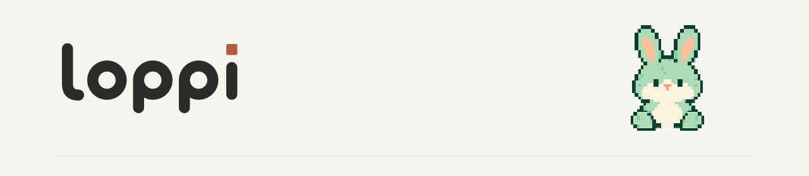
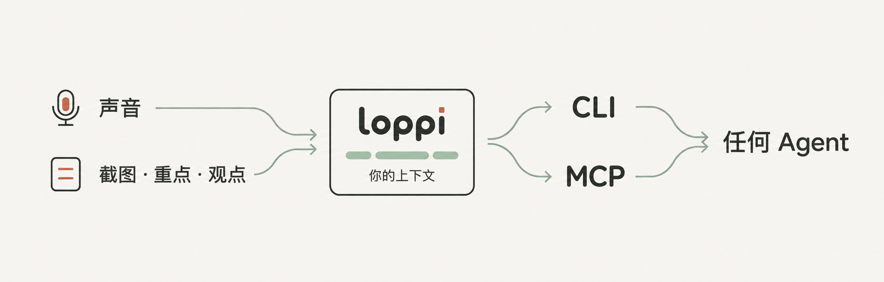
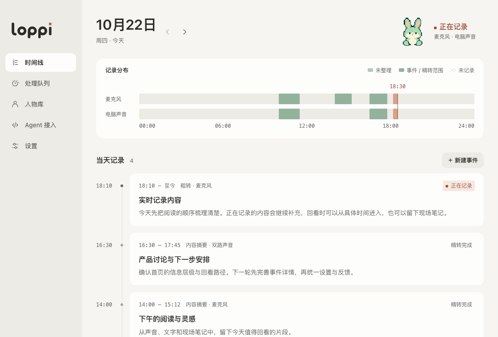
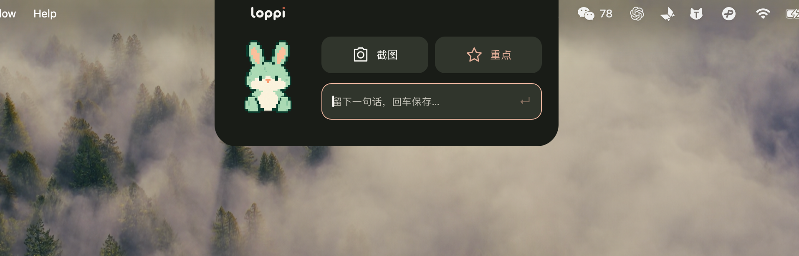
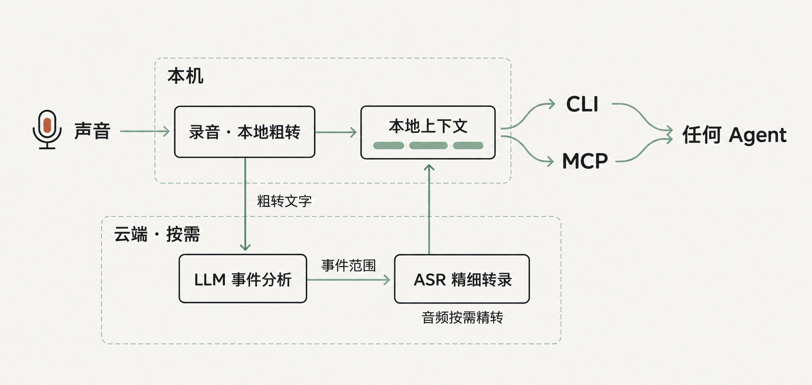

简体中文 · [English](README.en.md)



**loppi 是一只住在你电脑里的小兔子，它可以 7×24 小时为你和 Agent 默默记录共同的上下文。通过 MCP 和 CLI，让任何 Agent 都能便捷读取与管理。**



我们每天都在如此深入地和 Agent 一起工作，但我真的受够了：把刚刚发生的讨论、刚刚结束的会议，一遍遍复述给 AI。而面前这台 MacBook，原本就在场，就在那些讨论、会议、决定和想法发生的地方。

所以我开发了 loppi，让电脑成为实时的 Context 收集器。它使用电脑的存储与本地算力，在录音的同时用本地模型完成语音识别粗转录，再结合云端 LLM 和 ASR，对有价值的事件进行分析与精细转录。开启后，你不必每场会议都想着按下录音键，因为 loppi 一直在场。



你可以随时通过灵动岛或悬浮球，随手进行「截图」「标记重点」「评论记录」。让技术真正解放你的注意力。



## 下载与使用

前往 [Releases](https://github.com/hAcKlyc/loppi/releases) 下载适合你系统与芯片的安装包。平台支持、安装要求与已知限制见对应 Release 的说明。

1. 安装后，授权麦克风与电脑声音采集。
2. 配置 DeepSeek 和火山引擎凭据。
3. 主动开启记录，让 loppi 保持运行。

记录需要电脑保持唤醒。截图、重点和观点由你随手补充。详见[使用指南](docs/usage.md)。

## 连接 Agent

从侧栏「Agent 接入」复制 CLI、MCP 配置或 Skill，供同机 Agent 使用。macOS 默认安装位置示例：

```sh
/Applications/loppi.app/Contents/MacOS/loppi context list --date today
/Applications/loppi.app/Contents/MacOS/loppi context search '发布计划'
/Applications/loppi.app/Contents/MacOS/loppi mcp serve
```

MCP 提供只读查询；CLI 还提供管理命令。详见 [Agent Context 契约](specs/tech_docs/agent-context.md)与 [CLI 说明](resources/agent/loppi-context/references/cli.md)。

## 技术架构



## 隐私与费用

资料保存在本机；精转、整理和截图理解会将相应音频、文字或截图发送到你配置的云服务，按量计费。Agent 读取结果后的外发取决于其自身配置。详见[隐私与数据说明](PRIVACY.md)。

## 文档与参与

[使用指南](docs/usage.md) · [开发指南](docs/development.md) · [版本与已知限制](docs/releases.md) · [文档索引](docs/README.md)

[贡献指南](CONTRIBUTING.md) · [提交问题](https://github.com/hAcKlyc/loppi/issues) · [安全报告](SECURITY.md)

## 许可证

代码、文档及项目自有图像采用 [Apache-2.0](LICENSE)。[NOTICE](NOTICE) · [第三方声明](THIRD_PARTY_NOTICES.md) · [品牌与商标](docs/brand.md)

Copyright 2026 **Ethan L** · [myagents.io@gmail.com](mailto:myagents.io@gmail.com)
