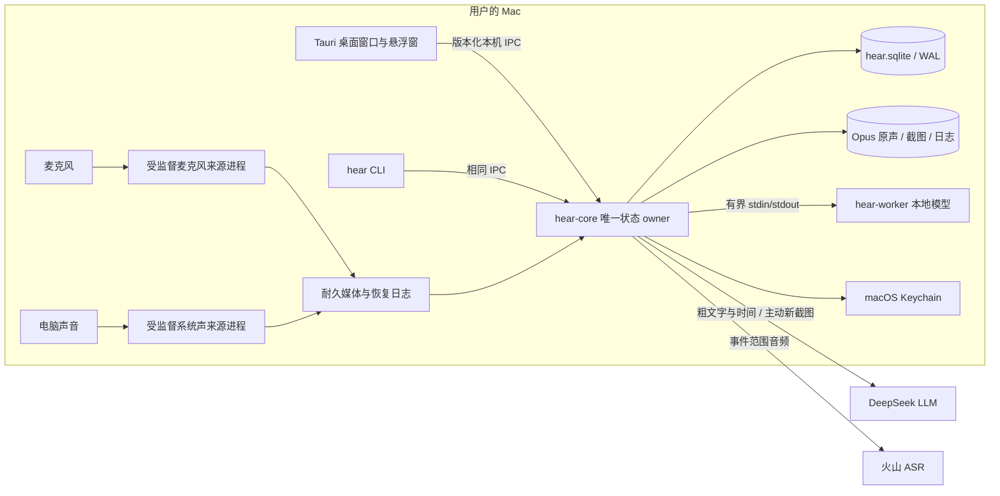
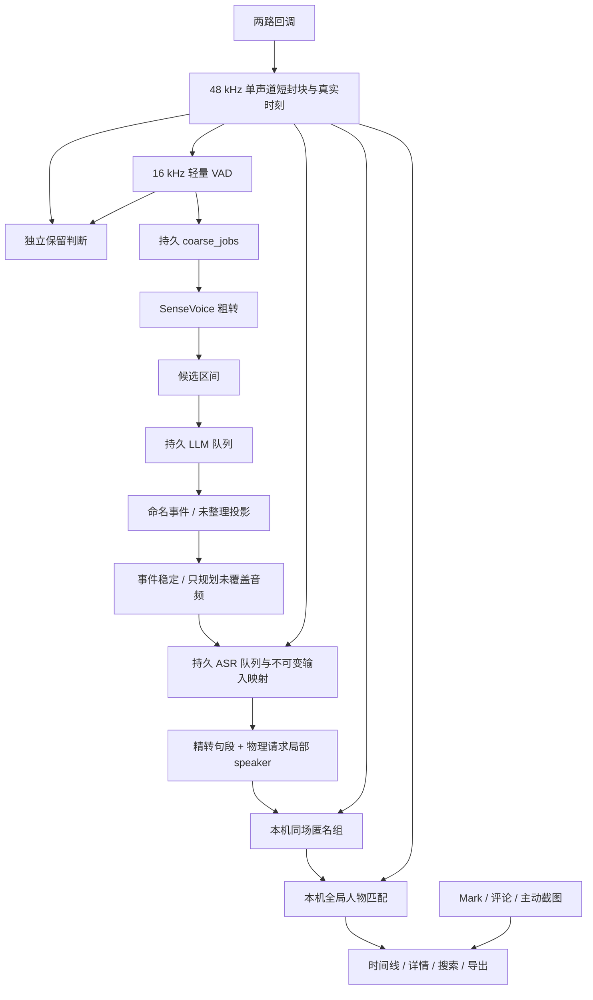

# hear 0.1 整体架构

> 口径：2026-10-22 工作树当前实现；稳定性与性能优化仍在开发和整体验收中。产品目标见 [PRD](prd/prd_0.1.md)，算法与具体阈值见 [核心处理算法](tech_docs/algorithms.md)和[说话人和全局人物](tech_docs/speaker-identity.md)。本机已安装 `.app` 的能力须以安装版实测区分，不能由本文件推定。

## 1. 系统边界与进程

| 组件 | 代码入口 | 职责与边界 |
| --- | --- | --- |
| GUI | [`src/App.tsx`](../src/App.tsx)、[`src-tauri/src/lib.rs`](../src-tauri/src/lib.rs) | 时间线、详情、队列、人物、设置、顶部/悬浮兔子入口；通过 Tauri command 调用核心，不直接改数据库。主窗口关闭可隐藏，悬浮窗同进程。 |
| CLI | [`crates/hear-cli/src/main.rs`](../crates/hear-cli/src/main.rs) | 查询、控制、修订、搜索、导出与清理的完整命令入口；与 GUI 共用请求协议。 |
| 核心 | [`crates/hear-core/src/main.rs`](../crates/hear-core/src/main.rs) | 唯一 SQLite 写入者；持有采集监督、时间映射、媒体、两条云队列、声纹任务和权限/容量状态。登录项与按需服务争同一个 owner 锁。 |
| 采集来源 | [`source_process.rs`](../crates/hear-core/src/source_process.rs)、[`record.rs`](../crates/hear-core/src/record.rs) | 每个来源以同一签名核心可执行文件的私有子命令运行；持有原生设备、有界缓冲及封块写入。只发布不可变媒体和 core 管理的 ingestion 日志，不访问业务库。 |
| 本地推理 | [`crates/hear-worker/src/main.rs`](../crates/hear-worker/src/main.rs) | 轻量 `vad` 与重型 `recognize` 独立进程；`embed` 按需复用 CampPlus。三者共用有界帧协议，父 core 消失退出；只计算，不拥有数据库。 |
| IPC 协议 | [`crates/hear-protocol/src/lib.rs`](../crates/hear-protocol/src/lib.rs) | 请求/响应、稳定 ID、预期修订、重复提交标识和协议版本。当前工作树版本为 20。 |
| macOS 桥接 | [`src-tauri/native/`](../src-tauri/native/privacy.m)、[`crates/hear-core/native/`](../crates/hear-core/native/system_audio.m) | 登录项、权限、截图/OCR、系统声 API 等原生操作；业务数据仍由核心裁决。 |

没有长期运行的 Node 服务，也没有局域网/HTTP 管理接口。模型权重按哈希安装在本机数据目录；`.env` 仅供开发，不打进客户端。正式凭据由设置页交给核心验证并存在 Keychain。[模型包实现](../crates/hear-core/src/model_pack.rs)；[云端凭据和请求](../crates/hear-core/src/cloud.rs)。

## 2. 所有权与数据层

### 2.1 唯一事实源

核心通过受限 Unix socket 接受 GUI/CLI 请求，检查本机对端和版本；数据库打开 WAL 模式，只有核心拥有写连接。[启动、锁与 socket](../crates/hear-core/src/main.rs)位于 `run`、`acquire_owner_lock`、`verify_peer`；请求身份与幂等回执见 `serve_one`、`mutation_receipts`。查询唤起的按需核心不据保存的记录意图偷偷开麦；登录项启动才按本次登录会话的退出标志和持久意图评估采集。

GUI 首次 IPC 经协议库 `lifecycle` 的会话屏障核对实际 Core 与随包构建身份；`lifecycle.lock` 串行化多个 GUI 的交接。稳定的 `Status` / `Lifecycle` 控制消息不受业务协议版本限制；业务命令仍严格检查。新版先验证随包 helper，再请求旧 owner 优雅交接，等待 `core.lock` 释放（采集线程已 join、socket 已删除），随后在原目录启动新版并传递原内存采集/正常运行许可。已发布协议 17–19 使用兼容版本的 Status / Quit，只有观察到录制或启动中的旧实例才恢复采集许可；其它旧实例保守查询启动。更新不降级较新构建，不直接写 SQLite，不强杀或删除活跃 socket。

显式退出 GUI 先排空本会话 IPC、封闭后续请求，再向现存 Core 发跨版本退出指令并等待 owner 锁释放；没有后台时不为退出而启动一个后台。程序请求退出失败时保留 GUI 并提示实际错误；macOS 原生 terminate（菜单、Cmd-Q、Dock）绕过 ExitRequested，必须在最终 Exit 事件同样执行幂等清理，此阶段系统已决定退出，失败显示实际错误及重新打开后重试的说明，不强杀 Core。关闭主窗口仍只是隐藏窗口。新 Core 的交接不写用户退出标记，正常退出则仍记录当前登录会话的退出状态；新后台保留来源、暂停与容量限制，运行许可不能绕过这些条件。交接初始化后的 AppOpened 仍按既有语义启用定时运行。

权威数据位于 `~/Library/Application Support/hear/`（测试可用 `HEAR_DATA_DIR` 隔离）：

| 层 | 实际对象 | 性质 |
| --- | --- | --- |
| 物理事实 | `recording_sessions`、`session_clock`、`audio_blocks`、`coarse_segments`、`media_gaps`、`media/*.opus` | 两路声音各自的采样/墙钟映射、已确认封块、粗转与真实缺口；不能被事件标题反写。 |
| 处理事实 | `candidate_windows`、`cloud_queues`、`cloud_tasks`、`asr_inputs`、`event_asr_refs/state`、`precise_segments` | 候选与供应商任务有各自版本；ASR 输入不可变，当前事件通过有效范围引用物理请求；云结果必须通过当前归属与清理范围校验才能发布。 |
| 用户事实 | `named_events`、`manual_ranges`、`moments`、`people`、`speaker_bindings`、`local_speaker_assignments`、`voice_samples`、`text_corrections` | 人工边界、名字、身份和纠错优先；清理会使所选范围失效。 |
| 派生投影 | 日程未整理块、`speaker_groups`、有效身份视图、FTS 搜索、导出内容 | 从当前有效事实重建；不能把投影编号当成人物 ID。 |
| 清理/恢复 | `clear_ranges`、`media_deletion_jobs`、导出/截图/媒体暂存作业 | 先提交逻辑失效，再回收或重写物理文件；迟到任务不得复活清理数据。 |
| 用量统计 | `usage_models`、`usage_prices`、`usage_requests`、`usage_meta` | Core 保存匿名调用身份、不可变价格版本和用量；与任务发布/内容清理解耦，UI 只读每日聚合。未知用量不视为零，费用是公开按量价估算。详见[云用量统计](tech_docs/cloud_usage.md)。 |

表的创建分散在 [`main.rs` 的 `Store::new`](../crates/hear-core/src/main.rs)、[`events.rs`](../crates/hear-core/src/events.rs)、[`knowledge.rs`](../crates/hear-core/src/knowledge.rs)、[`cleanup.rs`](../crates/hear-core/src/cleanup.rs)、[`moments.rs`](../crates/hear-core/src/moments.rs)。这是当前模块 owner，而非一份另行维护的模式定义。

容量展示读取 `storage_usage` 常量规模投影；媒体与孤儿的新增、更新、删除由 SQLite 触发器在原事务更新计数，首迁移回填一次。`core_migrations` 将搜索、说话人组、纠错锚点历史回填和完成标记一起提交，失败可重试，不在每次启动扫描全部历史。访问媒体路径、session 样本、待分析和恢复状态使用对应索引。[存储迁移](../crates/hear-core/src/storage.rs)。

物理删除由 core 的维护线程每批最多取 32 个待办。文件 IO 在 `Store` 锁之外执行，逐文件复用 `cleanup_gate` 保护播放/导出媒体寿命；成功或文件已不存在才确认完成，失败不阻挡后续路径并在下轮重试。逻辑失效与用户清理语义仍由清理事务裁决。当前容量投影仍为原有逻辑媒体口径，未扩张为全部物理临时空间。

精转文字的权威时间轴来自不可变 `asr_inputs`（更早无清单任务使用已记录的任务起点和范围）。`publish_asr` 核对当前任务/清理归属、可还原的输入映射、正时长和请求范围后保存完整供应商文字与时间。VAD、当前原声文件、静默长度、首尾误差、原声占比和重叠量都不裁决文字是否可用；包括补入静默中的结果也保留，接受偶发长时间跨度。原声回放与声纹各自核对真实媒体，文字可用性与这两者独立。没有新增发布状态、队列或重试器。[发布实现](../crates/hear-core/src/events.rs)；[算法契约](tech_docs/algorithms.md#6-两条云队列与精转)。

### 2.2 双时间坐标

每一路采集有独立来源内采样序号与单调时钟锚点；核心把它们映射为真实 UTC 毫秒。`audio_blocks`、粗/精转、事件、重点/笔记/截图都存真实时刻。文件内偏移和供应商句段的相对毫秒仅用于解码/对齐，入库前必须映射回真实时刻。播放器和详情显示当地钟点，点击真实时刻再由核心寻找对应封块；不能把“从事件开始累计播放的秒数”当作墙钟。[采集时钟](../crates/hear-core/src/record.rs)、[供应商时间映射](../crates/hear-core/src/events.rs)、[按真实时间播放](../crates/hear-core/src/playback.rs)。

睡眠、设备切换、回调断流、来源失败和升级中断都须留下 `media_gaps` 或相应录制状态。两路可能同一时刻并行；静音不写音频，也不把时间轴压短。一个长事件是对连续时间范围的**虚拟引用**，不是把封块物理合并成一个主文件。

## 3. 正常数据流

采集、保留、粗转、候选、两条云队列、声纹与 OCR 不是同一个阻塞链。采集热路径不能等待网络或模型；本地计算积压与云端失败由持久状态表达。`analysis_loop`、`coarse_loop`、`cloud_loop`、`voice_loop`、`capture_supervisor` 分别在[核心](../crates/hear-core/src/main.rs)；事件算法见[核心处理算法](tech_docs/algorithms.md)。

VAD 先事务提交 `coarse_jobs` 的来源/session/16 kHz 样本区间与 `speech_active`，保留判断同时提交，不等待 SenseVoice。粗转任务从原有不可变封块重建输入，使用与 VAD 相同的逐块重采样；不新增另一份音频库。每来源独立追踪 worker 游标，重建或不连续时回放该来源最近最多 6 个连续已完成的人声／尚待判定块，已持久化覆盖区间不重复入队；通过已有 coarse_jobs/旧 coarse_segments 的实际覆盖扣除，允许补齐历史失败空洞，不能以 session 的最大结束点代表全部前缀成功。worker 返回独立的 speech_pending 表示仍有未结束话语；它存在时保留尚未确认的开头，待完整区间发表后再裁决最多 6 个连续前块。该边界覆盖原有 20 秒话语上限及起点回看；已关闭区间的样本终点也能结束其之前的等待。已失去 VAD 上下文的历史完整块由现有 maintenance 有界收敛为 `retain_unresolved_v2`，保留媒体和原始语音标志，避免永久阻塞精转；不把尚未确认的声音直接标为人声。worker 丢弃底层 flush 产生的零样本空片段，核心保留严格时间校验。清理使相交待办失效，发布前复核任务当前状态；all_data 墓碑也约束迟到 VAD 区间。空文字/粗转失败不回写为无人声。

### 3.1 资源准入与模型寿命

[`resources.rs`](../crates/hear-core/src/resources.rs) 是 core 内部的计算预算 owner，不拥有用户录制意图。每秒读取 macOS 内存压力/热状态/低功耗及电源状态、core 与直接子进程 physical footprint、可靠封块进展、最多 1024 项待办的音频秒下界/最老年龄、磁盘和控制延迟。warning 持续 10 秒降载，critical 即刻进入严重状态；健康持续 60 秒进入恢复，再 60 秒恢复正常，避免反复加载模型。

8 GiB 档后台软/严重水位为 768/1024 MiB，≥16 GiB 为 1024/1536 MiB；粗转预留峰值 640 MiB、声纹 256 MiB，两者在低内存档不同时计算。粗转观测超过 768 MiB、声纹超过 384 MiB 或严重压力时，核心通过可取消 RPC 终止并回收该 worker，持久延期不消耗错误次数。输入时长仍独立限制。粗转/声纹空闲 30 秒释放，VAD 空闲 60 秒释放；不周期重启 core。后台水位是采样驱动的工程预算，并非 OS 强制内存上限。

正常情况下两条云 provider 各自一个准入槽，压力下共享一次重任务机会；导出有独立预留和有界等待。VAD 积压时优先人声判断。粗转双来源交替，三个最新机会后保留一个最老机会；历史任务不会一直压在队尾。GUI/WebView、完整回调队列指标和组合态长时测量仍由最终读取/观测批次补齐，不将当前后台预算扩大为全应用内存承诺。

## 4. 采集与生命周期

麦克风和电脑声音各有来源开关、录制 session、封块与缺口。麦克风桥接在 [`microphone.rs`](../crates/hear-core/src/microphone.rs)；电脑声音在 [`system_audio.rs`](../crates/hear-core/src/system_audio.rs) 及原生实现。当前工作树在满足系统版本和授权预检条件时有 Core Audio Tap 路径，其他情况沿用 ScreenCaptureKit，音频采集和探测都注册 Audio 与 Screen 输出；Screen 回调只消费交付，不保留像素；**Tap 的最终安装版关屏、真实空闲睡眠及较低系统版本验收仍开放**。`src-tauri/tauri.conf.json` 当前声明最低 macOS 13.0，不能据此认为所有路径已在 13–25 实测通过。

`capture_supervisor` 每路独立启动/停止并处理睡眠和异常退出。录制意图、手动暂停、容量暂停、来源开关、系统许可、模型准备及本次登录的完全退出各有独立含义。来源异常后使用有上限退避，恢复前保持真实缺口；另一来源可继续。容量边界暂停新增采集并提醒，释放空间后由用户手动恢复。[采集监督](../crates/hear-core/src/main.rs)、[封块写入](../crates/hear-core/src/record.rs)。

每日定时录制由 Core 的 [`schedule.rs`](../crates/hear-core/src/schedule.rs) 管理：单例 `recording_schedule` 存开关、两个当地分钟、处理游标、时区与暂停原因。原生日历 helper 只换算时间；`capture_supervisor` 在决定来源启停前，于同一个 Store 写事务中补最近一次遗漏动作并持久化游标。目标已满足也消费边界，不重启 session。手动控制先结算到期动作再应用用户意图；保存新配置只重建未来起点，关闭规则不改变录制。日历按系统时区处理 DST，时区变化仅重建未来边界，时间回拨不回放游标之前的动作。

查询型启动不执行定时动作。正常登录运行或宿主既有状态刷新携带的幂等 `AppOpened` 恢复信号才开启定时结算；Core 区分本实例的正常运行许可与实际采集许可：先打开 GUI 再启用规则只安排未来动作，Core 中断后下一次宿主刷新可重新激活；重复刷新不把设置保存变成即时录制。完整退出期间宿主刷新已停止，不拉起应用。GUI、CLI 保存共用修订与请求回执；不在前端执行计时。定时开始不清除容量暂停，也不能绕过配置、模型、权限及来源开关；`schedule_pause` 与手动暂停一样先登记停止意图，停止仍走现有尾块封存路径；缺口起点随最终确认原声校正，终点由恢复采集意图关闭。设置显示下一次计划，所有录制入口仍由真实采集快照投影。设置页的规则开关即时提交；时间与容量仅在独立弹窗编辑。`useSettingMutation` 复用原修订/幂等回执提交模式，只有 UI 生命周期内的草稿、busy 和待确认请求，不是配置事实源；未知结果由用户确认同一请求，不新增自动重试或前端计时。

启动只恢复有索引的未完成录制/任务状态，媒体历史遍历已移到 `inventory::Scan`：每轮最多 32 个文件、每个文件单独持有媒体生命周期屏障，文件检查和删除不持有 `Store`。它区分 live / pending-deletion / capture-staging / orphan，按扫描代次分批对账孤儿配额；物理分类是带观察时间的扫描结果，不能冒充瞬时精确磁盘快照。旧版本封块 `sealing` 的恢复仍保留；截图、ASR/导出暂存和旧导出文件恢复由 `recovery::run` 在服务接收请求后分批执行，每步最多 32 项。启动只将旧导出作业标记为 recovering，后台永不领取新 pending 作业；文件 IO 后按原 job/state 确认，失联磁盘在下一轮重试。ASR/导出暂存复用各自唯一资源准入槽排除活跃文件，截图复用 cleanup_gate；不按文件时间猜测所有权。容量暂停保持粘滞，扫描不能覆盖用户暂停或自动恢复录制。

`capture::channel` 是预分配的 SPSC 双环缓冲，回调只转换/复制到复用缓冲；输入总排队时长最多约 2 秒、字节上限 8 MiB。归一化与编码/fsync 分线程，待封块通道最多 2 项。来源进程每 250 ms 发非阻塞心跳；core 以 3 秒心跳、45 秒启动、15 秒耐久进度和 10 秒停止截止时间监督，超时只回收该来源。停止信号同时发给两路，监督线程只 join 已结束的来源。父进程死亡后 helper 自行退出；原生 HAL/SCK 的致命错误不能结束核心。真实采样时间优先使用硬件单调时间，墙钟跳变仍切断 session。

[`ingestion`](../crates/hear-core/src/ingestion.rs) 先同步 prepared 元数据，随后同步并发布 Opus，再同步含长度/hash 的 ready 元数据。每 session 最多 64 个待入库记录；核心按时间顺序、短事务导入，持久回执跨越数据库提交到 journal 删除同步的窗口，避免重复或清理后复活。缺失/损坏媒体保留隔离元数据并记录缺口，暂时性 IO / 重编码失败保留待重试。清理与导入共用媒体屏障；来源继续落盘，迟到块按 session 代次、来源、所选范围及清理提交时刻裁剪，保留未选尾部和操作之后的新录音，因此清理不再全局暂停设备。恢复日志不是第二个业务事实库。

手动暂停、定时停止、容量暂停与来源关闭产生的意图缺口，复用 `media_gaps.source_session_id` 归属当时的来源 session。创建时考虑已确认尾部；最终块或迟到 journal 入库时，与封块/回执同一事务按该 session 的 `last_confirmed_ms` 缩短缺口，关闭区间保持有效边界。历史无归属缺口仅在同源封块明确覆盖起点且 session 唯一时关联；升级迁移及之后的旧 journal 均能校正。清理分片保留归属且不会被重新创建；callback/source-failure 等物理缺口继续各自处理。修正由既有 ingestion owner 完成，不分散到时间线、文字、声纹读取方。

每个 journal 的单发布者在目录 inode 排他锁下修改名称；核心仅在枚举最多 128 个名称时尝试共享锁，忙则让出，读取媒体、数据库和推理均在释放目录锁后执行。来源写线程最多等 2 秒，回调不接触该锁。这样获得已发布记录的前缀，不能先分析后来块再补入此前块。journal 未排空时，分析领取必须有相邻块（含数字静音/已清理元数据）、归属同一来源 session 的真实缺口，或匹配代次的清理边界；会话关闭或墙钟已过去 8 秒不能单独证明流结束。media_gaps.source_session_id 表示原始采集归属，与生命周期补尾的 tail_session_id 含义分开，部分清理后两者仍保留。

云请求复用进程内 `ureq::Agent` 连接池，凭据仍逐请求附加。一次任务共享 60 秒预算，每次网络请求只获剩余时间（含响应体）；底层系统 DNS、Keychain 和不可取消文件 IO 是平台例外，预算耗尽后不再发起新请求。响应读取/截止失败作为瞬态错误保留原远端请求 ID，退避后先查询原请求。内部 Failure 只携带脱敏代码与 Retry-After 的秒数/HTTP-date 延迟，429（以及带该头的 503）把 provider 冷却下界写回原 cloud_queues，重启仍生效、不改 paused。二次退避附有任务 ID 派生的 0–20% 抖动；每四次领取中三次保留人工优先（其中一次最新优先）、一次按最旧待办，持续人工工作不会饿死历史自动任务。[云客户端](../crates/hear-core/src/cloud.rs)。

Keychain 访问依赖运行进程与磁盘 bundle 的签名身份一致。发行构建脚本在编译前拒绝覆盖当前正在运行的构建目录 App；日常运行使用独立的 `/Applications/hear.app` 安装副本。后台读取仍禁止授权弹窗，不复制密钥或放宽 ACL。Core 重启及成功重新保存某 provider 凭据时，复用现有 cloud_tasks 唤醒对应凭据错误的 pending/submitted 任务；保留任务/远端请求 ID、provider 冷却与用户暂停，不重跑已完成或其他失败任务。凭据阻塞及普通重试作为现有任务事实的投影展示，不与“正在记录”互相覆盖。

## 5. 外发、修订与清理边界

- DeepSeek 事件整理任务只见候选区间的粗文字、时间、来源及“检测到人声但无可用文字”等状态；其 JSON 仅是建议，核心检查边界、来源、冲突、人工优先级及任务版本。[`llm_input` / `publish_fit`](../crates/hear-core/src/events.rs)。
- 火山 ASR 只见被判定或人工指定需精转的音频；事件稳定后按来源及编码时长上限建持久任务，新物理请求保持连续时间坐标；不超过一分钟且有完整同源无人声证据的空档按真实时长编码静默，超过上限、未知、采集或清理缺口分开请求，不再插入压缩接缝；旧持久输入和远端请求 ID 不变。当前适配器是 `volc.seedasr.auc`，请求 speaker 信息、分句及 `ssd_version=300`。Keychain 的 LLM/ASR 凭据分别设置、分别暂停队列。[`cloud.rs`](../crates/hear-core/src/cloud.rs)。
- 人工确认人物后，Core 在既有声纹循环中筛选单句/相邻短句组合样例，按质量、近似去重和每场/每人物限额入库。每个组合成员保留人工绑定证据；自动命名不回流训练。内部取样任务及证据表由 `knowledge/enrollment.rs` 管理，复用本地 worker 和清理屏障，详见[声纹入库策略](tech_docs/speaker-identity.md#短句组合与音质)。
- 已配置 LLM 时，用户新保存的截图通过同一个持久 LLM 队列直接发送原图，输出中文摘要与完整 Markdown 转录。仅 `save_capture` 创建 `screenshot` 任务；配置或启动不回填历史。暂停、恢复、失败重试、用量统计沿用现有任务机制。原图和本地 OCR 始终保留；`moments.image_summary/image_transcript` 原子发布并更新搜索，任务状态从 `cloud_tasks` 派生。读图/上传持有既有 LLM outbound gate，网络不持有 Store；只清原声不取消截图任务，全部数据清理后不能发布迟到结果。详情按需刷新待处理记录，Markdown 禁止 HTML、远程图片及活动链接。
- 人物列表、声纹特征不因上述云任务外发。云 speaker 标签只在单个物理 ASR 请求内有意义；本机负责同场合组和跨事件人物匹配。[说话人文档](tech_docs/speaker-identity.md)。
- 人工改事件范围、标题、句段文字或人物时检查对象当前修订；迟到云结果必须核对目标版本。人工文字以独立修订保存，重转后无法唯一映射的放入待核对。[`events.rs`](../crates/hear-core/src/events.rs)、[`knowledge.rs`](../crates/hear-core/src/knowledge.rs)。
- 清理前先生成带范围/模式/内容签名的预览；`清除原始音频`保留文字和已提取的声纹特征，`清除全部数据`还删除范围内的文字、动作、关联声纹样例等并要求额外确认。逻辑墓碑先生效，再处理共享封块和物理删除。[`cleanup.rs`](../crates/hear-core/src/cleanup.rs)。

所有回放、搜索与导出只读取当前有效投影。导出在核心生成受限归档，不把媒体目录路径交给 UI/CLI；搜索索引仅是派生数据，不作为内容存在性的裁判。[`playback.rs`](../crates/hear-core/src/playback.rs)、[`knowledge.rs`](../crates/hear-core/src/knowledge.rs)、[`archive.rs`](../crates/hear-core/src/archive.rs)。

读取使用固定两个只读连接，每次请求持有一个短 WAL 快照，获取与 SQL 共用 3 秒预算；progress handler 在 SQLite 执行中取消超时查询，退出即回滚释放快照。每连接最多缓存一页、4 MiB，按该连接的 data_version 失效，压力下清空；缓存不是修订权威。详情修订按 256 行批量取得纠错/人物/声纹依据，组修订分页计算，沿用原摘要字节格式，旧页面 revision 仍有效。短词走时间索引，长词先探测最多 4096 个 FTS postings：常见词按时间流式校验 FTS，稀有词用 FTS 直接定位，最终可见性/去重/分页语义相同。音频范围读取通过带媒体路径／语音活动条件的 source + ended_ms 部分索引定位相交块，避免先扫描来源全部历史；来源掩码以 CASE/IN 集合表达，规避 SQLite 的 OR 分支选回旧 started_ms 索引。

GUI 上下文刷新合并在途请求，仅前台聚焦时周期刷新。连续播放由 [`src/playback.ts`](../src/playback.ts) 管理单一 AudioContext：一个网络/解码请求、至多当前和下一段两个 5 秒缓冲，按音频时钟接续，UI 计时只更新绝对时刻。切位置、来源、关闭或本页发起清理立即停止并淘汰旧代次，迟到结果不能发声；下一块预取失败时保留已排程的当前音频，到边界再报告读取错误；整段无媒体仍按原规则跳到下一可用时刻。跨客户端清理通过既有 ingestion 清理 generation 检测：chunk 附可选 generation，播放期间以最多一个在途 playback_valid 只读请求检查相交清理（约每 300ms 加 IPC 延迟），命中即停止并释放缓冲。校验失败安全停止；无 generation 的旧 core 响应保持单块播放，不预取。不会把清理与实时发声虚构为零延迟跨进程原子操作。交互入口不变。

## 6. 构建与分发形态

常驻入口复用同一个 `float` WebView / NSWindow。[`EntryRuntime`](../src-tauri/src/entry.rs)每 5 秒单飞查询 core 状态，主窗口和入口订阅同一快照；动作唤醒刷新，动画不查询核心。[结构化来源诊断](../crates/hear-core/src/diagnostics.rs)从实际采集、意图、启动/停止和阻断条件推导，UI 不解析原因文本。异常全部停止只在会话内轻提醒一次，完整正常恢复后重新启用提醒。

时间线日期右侧 [`CaptureStatus`](../src/CaptureStatus.tsx)复用该快照的 appearance/control 与 `EntryRequests`/`entry_action` 控制路径，不另建查询或录音 owner。App 保存完整快照，按 sequence 接受事件/初始读取/显式刷新；[`capture-status`](../src/capture-status.ts)仅映射文案与展示，不从错误文字推断原因。`useCaptureControl`仍在App会话中保存原请求/反馈，时间线切页卸载角色展示不丢待确认ID；真实启停由后续快照裁决。三处录音/暂停/等待/部分/中断都使用entryAppearance与同一个Rabbit，不再保留首页私有睡眠分支；本地桥接请求失败只显示错误，不伪造宿主快照。展示随页面卸载停动画，不测音量。控件不在其它页面显示。

[`entry.m`](../src-tauri/native/entry.m)附着现有窗口，负责主屏安全区、顶部/悬浮几何、原生命中、评论焦点和屏幕/工作区通知，不替换类或 delegate。顶部展开黑色表面从屏幕顶边延伸，原兔子的 hover 点也在展开命中区域中；圆角和悬浮空白由系统点击穿透。[React 入口](../src/FloatingWidget.tsx)只管理展开、会话草稿、反馈和交互；宿主用 presentation generation 拒绝迟到的布局/焦点请求。评论的用户焦点 intent 固定为首次打开 token，背景重布局不生成新激活意图；应用切走/评论关闭/模式变更取消旧 token。模式变更递增共享快照序号，旧布局还须匹配当前模式。入口创建时隐藏，接受 GUI 模式快照并准备布局后才首次显示。只有评论获取并释放前台输入焦点。焦点成功以应用active和入口key window同时成立为准，延迟确认绑定原评论intent；macOS14+沿用系统协作激活。顶部展开由原生200ms小幅超调+100ms归位组成，收起140ms；同一layoutSerial取消整条原生动画链，完成通知与布局共享generation，取消后的旧完成不得揭示新面板。操作区在最终完成后淡入；兔子保持同一DOM节点，以实时viewport宽度及原生安全区/横移几何派生位置和尺寸，刘海屏先下移避开硬件再横移，不另启逐帧计时。收起立即释放焦点、移除操作区，原生命中以目标收起frame为准，视觉尾部不拦截原按钮区域。无刘海屏的32pt高度仅供收起兔子使用，展开和评论不保留硬件空白。模式与显示器归一化悬浮锚点保存到 GUI 配置，测试随 `HEAR_DATA_DIR/gui` 隔离，业务库不保存这些偏好。

入口动作各保留一个稳定 UUID 与原负载；宿主还保留该槽的最后已确认响应，直到新 UUID 替换，避免 WebView 丢失回复后用新修订重建控制请求。保存与暂停槽独立，草稿仅在真实确认后清空。截图由 core 的 ScreenCaptureKit 单次获取过滤当前 GUI 窗口，以 socket 同 UID 和实际 peer PID 校验排除目标；macOS 13 使用短 SCStream，14+ 使用 SCScreenshotManager。`anchor_ms` 保留触发时刻，CLI 默认为当前时刻且无窗口排除；PNG/OCR/回执仍走原 moments 路径。

[`Rabbit`](../src/Rabbit.tsx)读取统一v2 atlas，以低频计时播放；96px清单格子由用户确认的双竖耳/趴睡生图素材及派生呼吸/眨眼/回应帧组成，主窗/notch/悬浮共用素材与clip。尺寸由清单定义，不硬编码旧48px裁切；隐藏/减少动态效果停计时，canvas 后备尺寸跟随显示大小与像素比，加载失败显示当前状态的静态素材。I4 方形源图与平台图标分别保存。生产代码已修改，真实系统验收尚未全部完成；证据见[安静兔子执行台账](prd/prd_0.1_quiet-rabbit-entry.md)。

前端是 React/TypeScript/Vite，Tauri 2 使用 macOS WebView；主窗口与透明悬浮窗共用样式 token，产品视觉规则见 [DESIGN.md](DESIGN.md) 与 [`src/tokens.css`](../src/tokens.css)。`src-tauri/tauri.conf.json` 将签名登录项与 CLI 放入 `.app`；本机核心和推理 worker 不应因 GUI 关闭而丢失采集状态。[`build_macos.sh`](../scripts/build_macos.sh) 构建并签名各组件；[`package_macos.sh`](../scripts/package_macos.sh) 生成 `.dmg`、送公证、装订并检查 Gatekeeper。

目前有已签名的本机测试应用，但公证凭据和组合态发行验收尚未齐备；**不能将本目录或本地签名成功当成可分发 DMG 的证明**。模型权重属于首次安装后的受控下载，不把开发机密钥或录音数据塞入安装包。[发行状态](../plan.md)。

## 7. 观察与验收

`unilogs` 将各模块的结构化、脱敏事件写到受限滚动 JSONL；日志不是状态事实，也不包含原音频、正文、截图、向量或密钥。[日志实现](../crates/hear-core/src/unilogs.rs)。核心每秒覆盖写入一个 `diagnostics.json`（不 fsync、不作为恢复事实），包含 run/PID、压力模式/转换次数、后台 footprint 峰值、积压秒数下界、带观察时间的容量与物理扫描、WAL 字节数；采集回调只更新固定原子计数，记录回调/丢失帧、ring 高水位、消费/可靠落盘年龄、回调耗时与封块直方图，成功和正常报错退出均发送最终计数（强杀无法补发）；控制事务和 ingestion 锁等待/提交也使用固定桶。诊断不保存音频、正文或凭据。

资源采样默认 1 秒，可显式短测 100–250 ms；进程清单最多每秒更新，生命周期更短的进程仍可能遗漏。按精确 bundle 路径识别本体与 helper，WebView 通过 launchd resource coalition 与已确认 desktop 关联，不能按 WebKit 进程名全算。PID 加出生时间防止重用后拼接曲线；支持旧系统 rusage 回退，缺失能耗为 0 表示不可用。原始 CSV 轮转上限约 320 MiB、诊断流约 96 MiB，分钟报告保留每进程峰值，meta 记录同时采样总量（不是不同时间峰值之和）。进程存活或内存平台并不能替代音频覆盖、可回放和缺口检查。[`measure_macos.sh`](../scripts/measure_macos.sh)、[`report_macos_resources.py`](../scripts/report_macos_resources.py)。隔离录制结束后可用 [`audit_recording_coverage.py`](../scripts/audit_recording_coverage.py) 对显式时间范围分别核对清单／仍保留媒体的缺口与重叠，逐块验证路径和可选解码帧数；一次只解码一块，不能据此推断语音召回或参考音频一致。

当前源码的短音频链路曾跑通，但 Batch 6 尚有说话人误并/漏认、设备/睡眠、长时资源、最终 GUI/CLI 和公证安装门槛。具体进度以 [plan.md](../plan.md) 和 [PRD 执行台账](prd/prd_0.1.md) 为准；文档存在不表示门槛通过。

资源准入在普通推理边界让位：等待超过 1 秒、策略允许且释放当前空闲驻留后满足峰值预算的另一个模型可促使空闲模型卸载；活动推理不因公平性被中断。无任务、模型未就绪或被压力策略延期的任务不能占住让位权，低内存机器也不会被反复抢占的粗转饿死声纹。

升级迁移增加索引、派生表和可空列，不改模型或阈值。追加式 schema 不等于任意二进制降级安全：旧 core 不认识新 journal、粗转待办和保留语义。需要回退时先停止所有组件，保留一致的数据库及媒体备份，再恢复匹配版本的整套备份；不得让旧 core 直接处理正在使用的新数据目录。

诊断遵循相同 owner 边界：协议 18 的 `Diagnose` 使用 Core 的只读快照与日志 worker，生成脱敏、有界的临时报表，不新增持久状态或调度入口。构建身份、日志字段、覆盖口径、统一验证和安装门禁见[诊断与开发验证](tech_docs/diagnostics-and-verification.md)。

## 单页首次设置（2026-10-20）

首次 GUI 路由由 Tauri 的 `onboarding.json` 管理（app_config_dir；隔离运行时为 `HEAR_DATA_DIR/gui`），仅含 schema_version 与 completed，原子受限写入。缺失时以 Core 的 enabled_intent 或双供应商已配置迁移既有用户；损坏显式恢复，不能根据历史空白重置。完成会重新读取 Core 模型、来源、双云和原生权限，保存元数据后进入首页，不写 Start/Resume、登录项或录制计划。CLI 不依赖 GUI 标记。

`SetupGroups` 在设置和首次页面共用模型/来源操作；`refreshContext` 仍是 GUI 观察入口。`CloudKeyInput` 保留未保存草稿在组件内，`setup.ts` 仅在当前 WebView 保存未确认请求 ID。云配置使用既有稳定 ID 与 mutation_receipts，`CloudConfigurationReceipt` 是只读查询；失败回执也记录，不因传输失败自动重复供应商验证。凭据只由 Core 验证、Keychain 保存。设置页并列显示两个云服务，独立弹窗显式验证并保存；首次引导 compact 输入仍维持既有提交方式。

必要语音模型在启动校验或显式安装后通过 Governor 的 Coarse 预算准入，以现有 AnalysisClient 运行 VAD 和 SenseVoice 合成静音加载检查；每次各有 30 秒请求上限，退出回收子进程，不建立业务录音或发云请求。ModelState 提供 checking/downloading/installing/verifying/loading/ready/failed 和分组件错误。CampPlus 独立失败不阻断完成。模型安装按锁定包体和解包文件预算加 2 GiB 录音余量检查磁盘；废弃暂存清理、完整包复用，未完成下载重新开始。

权限刷新不发起授权或试录；显式点击由宿主串行授权。Tap marker 仅表示曾完成前台准备，UI 不将其当作当前永久 TCC 授权。上线证据仍以单页首次设置 PRD 的签名新用户和平台验收为准。

候选分析窗口采用 15 分钟上限与 5 分钟安静等待；持久窗口起点和既有成员范围保留，参数变化不触发历史付费重跑。LLM 输出的观察覆盖由 Core 在发布事务中核验，明确未整理索引是单次请求契约，不是新持久状态。转录完成统计与空结果回听范围从当前 `transcript_tasks` 派生，前端不维护第二份任务状态。入库目录锁竞争通过 IO 错误类型交给原有轮询，不当作文件故障记录告警。
