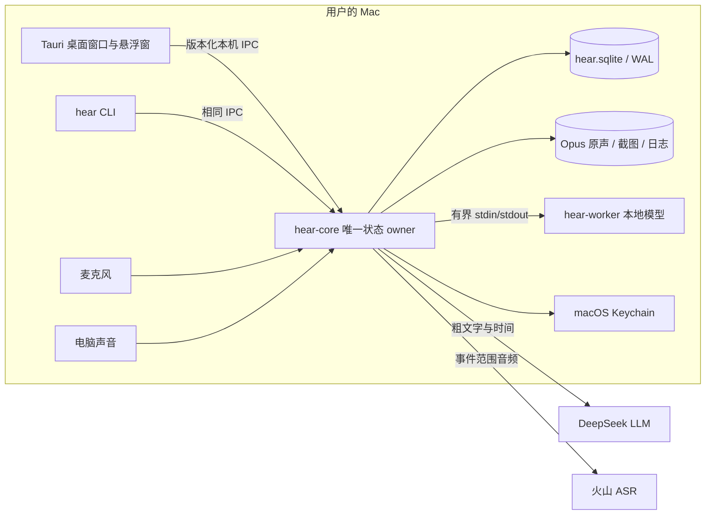
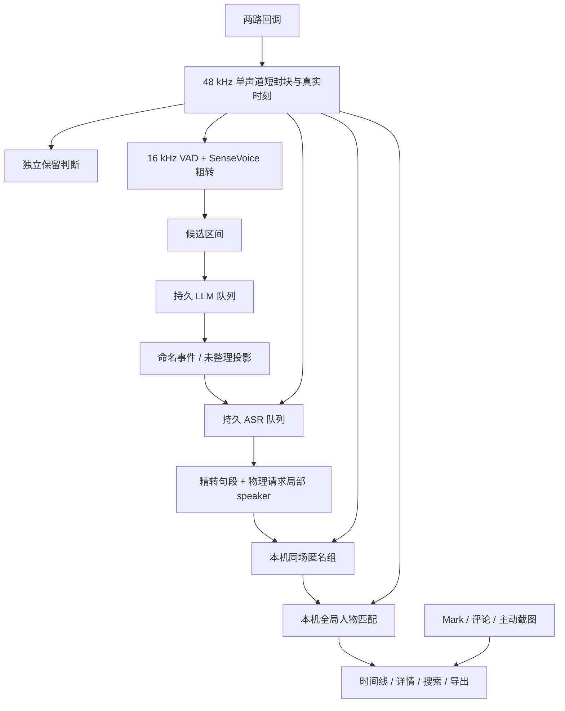

# hear 0.1 整体架构

> 口径：2026-10-01 工作树当前实现，Batch 6 尚未验收/提交。产品目标见 [PRD](prd/prd_0.1.md)，算法与具体阈值见 [核心处理算法](tech_docs/algorithms.md)和[说话人和全局人物](tech_docs/speaker-identity.md)。本机已安装 `.app` 的能力须以安装版实测区分，不能由本文件推定。

## 1. 系统边界与进程

| 组件 | 代码入口 | 职责与边界 |
| --- | --- | --- |
| GUI | [`src/App.tsx`](../src/App.tsx)、[`src-tauri/src/lib.rs`](../src-tauri/src/lib.rs) | 时间线、详情、队列、人物、设置、顶部/悬浮兔子入口；通过 Tauri command 调用核心，不直接改数据库。主窗口关闭可隐藏，悬浮窗同进程。 |
| CLI | [`crates/hear-cli/src/main.rs`](../crates/hear-cli/src/main.rs) | 查询、控制、修订、搜索、导出与清理的完整命令入口；与 GUI 共用请求协议。 |
| 核心 | [`crates/hear-core/src/main.rs`](../crates/hear-core/src/main.rs) | 唯一 SQLite 写入者；持有采集监督、时间映射、媒体、两条云队列、声纹任务和权限/容量状态。登录项与按需服务争同一个 owner 锁。 |
| 本地推理 | [`crates/hear-worker/src/main.rs`](../crates/hear-worker/src/main.rs) | 常驻 Silero VAD + SenseVoice 粗转；另以受控 `embed` 子进程提取 CampPlus 声纹。只返回计算结果，不拥有数据库。 |
| IPC 协议 | [`crates/hear-protocol/src/lib.rs`](../crates/hear-protocol/src/lib.rs) | 请求/响应、稳定 ID、预期修订、重复提交标识和协议版本。当前工作树版本为 15。 |
| macOS 桥接 | [`src-tauri/native/`](../src-tauri/native/privacy.m)、[`crates/hear-core/native/`](../crates/hear-core/native/system_audio.m) | 登录项、权限、截图/OCR、系统声 API 等原生操作；业务数据仍由核心裁决。 |

没有长期运行的 Node 服务，也没有局域网/HTTP 管理接口。模型权重按哈希安装在本机数据目录；`.env` 仅供开发，不打进客户端。正式凭据由设置页交给核心验证并存在 Keychain。[模型包实现](../crates/hear-core/src/model_pack.rs)；[云端凭据和请求](../crates/hear-core/src/cloud.rs)。

## 2. 所有权与数据层

### 2.1 唯一事实源

核心通过受限 Unix socket 接受 GUI/CLI 请求，检查本机对端和版本；数据库打开 WAL 模式，只有核心拥有写连接。[启动、锁与 socket](../crates/hear-core/src/main.rs)位于 `run`、`acquire_owner_lock`、`verify_peer`；请求身份与幂等回执见 `serve_one`、`mutation_receipts`。查询唤起的按需核心不据保存的记录意图偷偷开麦；登录项启动才按本次登录会话的退出标志和持久意图评估采集。

权威数据位于 `~/Library/Application Support/hear/`（测试可用 `HEAR_DATA_DIR` 隔离）：

| 层 | 实际对象 | 性质 |
| --- | --- | --- |
| 物理事实 | `recording_sessions`、`session_clock`、`audio_blocks`、`coarse_segments`、`media_gaps`、`media/*.opus` | 两路声音各自的采样/墙钟映射、已确认封块、粗转与真实缺口；不能被事件标题反写。 |
| 处理事实 | `candidate_windows`、`cloud_queues`、`cloud_tasks`、`precise_segments` | 候选与供应商任务有各自版本；云结果必须通过当前版本与清理范围校验才能发布。 |
| 用户事实 | `named_events`、`manual_ranges`、`moments`、`people`、`speaker_bindings`、`voice_samples`、`text_corrections` | 人工边界、名字、身份和纠错优先；清理会使所选范围失效。 |
| 派生投影 | 日程未整理块、`speaker_groups`、有效身份视图、FTS 搜索、导出内容 | 从当前有效事实重建；不能把投影编号当成人物 ID。 |
| 清理/恢复 | `clear_ranges`、`media_deletion_jobs`、导出/截图/媒体暂存作业 | 先提交逻辑失效，再回收或重写物理文件；迟到任务不得复活清理数据。 |

表的创建分散在 [`main.rs` 的 `Store::new`](../crates/hear-core/src/main.rs)、[`events.rs`](../crates/hear-core/src/events.rs)、[`knowledge.rs`](../crates/hear-core/src/knowledge.rs)、[`cleanup.rs`](../crates/hear-core/src/cleanup.rs)、[`moments.rs`](../crates/hear-core/src/moments.rs)。这是当前模块 owner，而非一份另行维护的模式定义。

容量展示读取 `storage_usage` 常量规模投影；媒体与孤儿的新增、更新、删除由 SQLite 触发器在原事务更新计数，首迁移回填一次。`core_migrations` 将搜索、说话人组、纠错锚点历史回填和完成标记一起提交，失败可重试，不在每次启动扫描全部历史。访问媒体路径、session 样本、待分析和恢复状态使用对应索引。[存储迁移](../crates/hear-core/src/storage.rs)。

物理删除由 core 的维护线程每批最多取 32 个待办。文件 IO 在 `Store` 锁之外执行，逐文件复用 `cleanup_gate` 保护播放/导出媒体寿命；成功或文件已不存在才确认完成，失败不阻挡后续路径并在下轮重试。逻辑失效与用户清理语义仍由清理事务裁决。当前容量投影仍为原有逻辑媒体口径，未扩张为全部物理临时空间。

### 2.2 双时间坐标

每一路采集有独立来源内采样序号与单调时钟锚点；核心把它们映射为真实 UTC 毫秒。`audio_blocks`、粗/精转、事件、重点/笔记/截图都存真实时刻。文件内偏移和供应商句段的相对毫秒仅用于解码/对齐，入库前必须映射回真实时刻。播放器和详情显示当地钟点，点击真实时刻再由核心寻找对应封块；不能把“从事件开始累计播放的秒数”当作墙钟。[采集时钟](../crates/hear-core/src/record.rs)、[供应商时间映射](../crates/hear-core/src/events.rs)、[按真实时间播放](../crates/hear-core/src/playback.rs)。

睡眠、设备切换、回调断流、来源失败和升级中断都须留下 `media_gaps` 或相应录制状态。两路可能同一时刻并行；静音不写音频，也不把时间轴压短。一个长事件是对连续时间范围的**虚拟引用**，不是把封块物理合并成一个主文件。

## 3. 正常数据流

采集、保留、粗转、候选、两条云队列、声纹与 OCR 不是同一个阻塞链。采集热路径不能等待网络或模型；本地计算积压与云端失败由持久状态表达。`analysis_loop`、`cloud_loop`、`voice_loop`、`capture_supervisor` 分别在[核心](../crates/hear-core/src/main.rs)；事件算法见[核心处理算法](tech_docs/algorithms.md)。

## 4. 采集与生命周期

麦克风和电脑声音各有来源开关、录制 session、封块与缺口。麦克风桥接在 [`microphone.rs`](../crates/hear-core/src/microphone.rs)；电脑声音在 [`system_audio.rs`](../crates/hear-core/src/system_audio.rs) 及原生实现。当前工作树在满足系统版本和授权预检条件时有 Core Audio Tap 路径，其他情况沿用 ScreenCaptureKit；**Tap 的最终安装版关屏、真实空闲睡眠及较低系统版本验收仍开放**。`src-tauri/tauri.conf.json` 当前声明最低 macOS 13.0，不能据此认为所有路径已在 13–25 实测通过。

`capture_supervisor` 每路独立启动/停止并处理睡眠和异常退出。录制意图、手动暂停、容量暂停、来源开关、系统许可、模型准备及本次登录的完全退出各有独立含义。来源异常后使用有上限退避，恢复前保持真实缺口；另一来源可继续。容量边界暂停新增采集并提醒，释放空间后由用户手动恢复。[采集监督](../crates/hear-core/src/main.rs)、[封块写入](../crates/hear-core/src/record.rs)。

启动按顺序恢复暂存媒体、清理事务状态、录制尾部、两条云队列和未完成声纹任务，再开放服务；已提交的物理删除在后台有界执行。孤儿扫描识别待删除墓碑，不将其重新计入逻辑额度；实际剩余磁盘检查继续生效。崩溃恢复不推断缺失原声，也不把用户手动暂停变成启动。显式完全退出停止当次录音；关闭普通窗口仅隐藏窗口。[启动恢复顺序](../crates/hear-core/src/main.rs)。

云请求复用进程内 `ureq::Agent` 连接池，凭据仍逐请求附加。请求总期限为 60 秒，包含响应体读取；底层系统 DNS 调用不可取消，是该期限的已知例外。响应读取失败作为瞬态错误保留原远端请求 ID，退避后先查询原请求。[云客户端](../crates/hear-core/src/cloud.rs)。

## 5. 外发、修订与清理边界

- DeepSeek LLM 只见候选区间的粗文字、时间、来源及“检测到人声但无可用文字”等状态；其 JSON 仅是建议，核心检查边界、来源、冲突、人工优先级及任务版本。[`llm_input` / `publish_fit`](../crates/hear-core/src/events.rs)。
- 火山 ASR 只见被判定或人工指定需精转的音频；按来源和最长窗口建持久任务。当前适配器是 `volc.seedasr.auc`，请求 speaker 信息、分句及 `ssd_version=300`。Keychain 的 LLM/ASR 凭据分别设置、分别暂停队列。[`cloud.rs`](../crates/hear-core/src/cloud.rs)。
- 人物列表、声纹特征和截图不因上述两种云任务外发。云 speaker 标签只在单个物理 ASR 请求内有意义；本机负责同场合组和跨事件人物匹配。[说话人文档](tech_docs/speaker-identity.md)。
- 人工改事件范围、标题、句段文字或人物时检查对象当前修订；迟到云结果必须核对目标版本。人工文字以独立修订保存，重转后无法唯一映射的放入待核对。[`events.rs`](../crates/hear-core/src/events.rs)、[`knowledge.rs`](../crates/hear-core/src/knowledge.rs)。
- 清理前先生成带范围/模式/内容签名的预览；`清除原始音频`保留文字和已提取的声纹特征，`清除全部数据`还删除范围内的文字、动作、关联声纹样例等并要求额外确认。逻辑墓碑先生效，再处理共享封块和物理删除。[`cleanup.rs`](../crates/hear-core/src/cleanup.rs)。

所有回放、搜索与导出只读取当前有效投影。导出在核心生成受限归档，不把媒体目录路径交给 UI/CLI；搜索索引仅是派生数据，不作为内容存在性的裁判。[`playback.rs`](../crates/hear-core/src/playback.rs)、[`knowledge.rs`](../crates/hear-core/src/knowledge.rs)、[`archive.rs`](../crates/hear-core/src/archive.rs)。

## 6. 构建与分发形态

常驻入口复用同一个 `float` WebView / NSWindow。[`EntryRuntime`](../src-tauri/src/entry.rs)每 5 秒单飞查询 core 状态，主窗口和入口订阅同一快照；动作唤醒刷新，动画不查询核心。[结构化来源诊断](../crates/hear-core/src/diagnostics.rs)从实际采集、意图、启动/停止和阻断条件推导，UI 不解析原因文本。异常全部停止只在会话内轻提醒一次，完整正常恢复后重新启用提醒。

时间线日期右侧 [`CaptureStatus`](../src/CaptureStatus.tsx)复用该快照的 appearance/control 与 `EntryRequests`/`entry_action` 控制路径，不另建查询或录音 owner。App 保存完整快照，按 sequence 接受事件/初始读取/显式刷新；[`capture-status`](../src/capture-status.ts)仅映射文案与展示，不从错误文字推断原因。`useCaptureControl`仍在App会话中保存原请求/反馈，时间线切页卸载角色展示不丢待确认ID；真实启停由后续快照裁决。三处录音/暂停/等待/部分/中断都使用entryAppearance与同一个Rabbit，不再保留首页私有睡眠分支；本地桥接请求失败只显示错误，不伪造宿主快照。展示随页面卸载停动画，不测音量。控件不在其它页面显示。

[`entry.m`](../src-tauri/native/entry.m)附着现有窗口，负责主屏安全区、顶部/悬浮几何、原生命中、评论焦点和屏幕/工作区通知，不替换类或 delegate。顶部展开黑色表面从屏幕顶边延伸，原兔子的 hover 点也在展开命中区域中；圆角和悬浮空白由系统点击穿透。[React 入口](../src/FloatingWidget.tsx)只管理展开、会话草稿、反馈和交互；宿主用 presentation generation 拒绝迟到的布局/焦点请求。评论的用户焦点 intent 固定为首次打开 token，背景重布局不生成新激活意图；应用切走/评论关闭/模式变更取消旧 token。模式变更递增共享快照序号，旧布局还须匹配当前模式。入口创建时隐藏，接受 GUI 模式快照并准备布局后才首次显示。只有评论获取并释放前台输入焦点。模式与显示器归一化悬浮锚点保存到 GUI 配置，测试随 `HEAR_DATA_DIR/gui` 隔离，业务库不保存这些偏好。

入口动作各保留一个稳定 UUID 与原负载；宿主还保留该槽的最后已确认响应，直到新 UUID 替换，避免 WebView 丢失回复后用新修订重建控制请求。保存与暂停槽独立，草稿仅在真实确认后清空。截图由 core 的 ScreenCaptureKit 单次获取过滤当前 GUI 窗口，以 socket 同 UID 和实际 peer PID 校验排除目标；macOS 13 使用短 SCStream，14+ 使用 SCScreenshotManager。`anchor_ms` 保留触发时刻，CLI 默认为当前时刻且无窗口排除；PNG/OCR/回执仍走原 moments 路径。

[`Rabbit`](../src/Rabbit.tsx)读取统一v2 atlas，以低频计时播放；96px清单格子由用户确认的双竖耳/趴睡生图素材及派生呼吸/眨眼/回应帧组成，主窗/notch/悬浮共用素材与clip。尺寸由清单定义，不硬编码旧48px裁切；隐藏/减少动态效果停计时，canvas 后备尺寸跟随显示大小与像素比，加载失败显示当前状态的静态素材。I4 方形源图与平台图标分别保存。生产代码已修改，真实系统验收尚未全部完成；证据见[安静兔子执行台账](prd/prd_0.1_quiet-rabbit-entry.md)。

前端是 React/TypeScript/Vite，Tauri 2 使用 macOS WebView；主窗口与透明悬浮窗共用样式 token，产品视觉规则见 [DESIGN.md](DESIGN.md) 与 [`src/tokens.css`](../src/tokens.css)。`src-tauri/tauri.conf.json` 将签名登录项与 CLI 放入 `.app`；本机核心和推理 worker 不应因 GUI 关闭而丢失采集状态。[`build_macos.sh`](../scripts/build_macos.sh) 构建并签名各组件；[`package_macos.sh`](../scripts/package_macos.sh) 生成 `.dmg`、送公证、装订并检查 Gatekeeper。

目前有已签名的本机测试应用，但公证凭据和组合态发行验收尚未齐备；**不能将本目录或本地签名成功当成可分发 DMG 的证明**。模型权重属于首次安装后的受控下载，不把开发机密钥或录音数据塞入安装包。[发行状态](../plan.md)。

## 7. 观察与验收

`unilogs` 将各模块的结构化、脱敏事件写到受限滚动 JSONL；日志不是状态事实，也不包含原音频、正文、截图、向量或密钥。[日志实现](../crates/hear-core/src/unilogs.rs)。资源采样脚本按进程/PID 记录 CPU、内存、磁盘及能耗计数；进程存活或内存平台并不能替代音频覆盖、可回放和缺口检查。[`measure_macos.sh`](../scripts/measure_macos.sh)、[`report_macos_resources.py`](../scripts/report_macos_resources.py)。

当前源码的短音频链路曾跑通，但 Batch 6 尚有说话人误并/漏认、设备/睡眠、长时资源、最终 GUI/CLI 和公证安装门槛。具体进度以 [plan.md](../plan.md) 和 [PRD 执行台账](prd/prd_0.1.md) 为准；文档存在不表示门槛通过。
