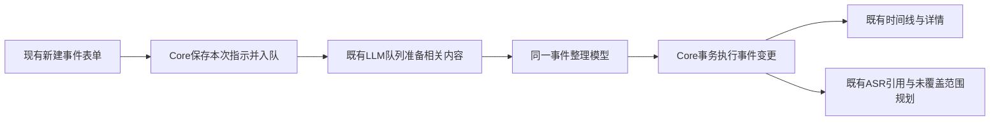

# 用户主动发起事件重新整理

## 执行须知

先读`specs/ARCHITECTURE.md`、`specs/DESIGN.md`、`specs/tech_docs/algorithms.md`、`specs/tech_docs/diagnostics-and-verification.md`及本PRD关联研究。相关事实以dev `01772c97c328efa5e303474b47b41f936d06b847`核实，符号入口见末节；引用符号而非易漂移的行号。

本PRD是一次原子交付，范围内实现、迁移、测试、真实模型与Computer Use验收全部完成后才能交付。开发批次仅是内部实现/审查/提交边界。用户已接受方案并授权在dev开发；本次不安装正式App或发布版本。

不扩大任务为智能体框架、长期记忆或历史批量重分析。核心原则：模型负责组织判断；Core提供上下文、正常数据操作和可靠事务。任何要求增加独立业务owner、额外队列、模型审查器或自动补偿协议的方案，先返回设计讨论。

## 1. 为什么做

用户只能指出“2点—4点是某个会议”，不应先研究系统已经分出了哪些事件，再逐张拆分合并。现有新建入口会与已有事件冲突，并直接建人工锁定事件、发起精转，缺少“把用户意图交给模型重新组织”的通路。

用户明确要求：“我们仍然走由模型组织的通路……由用户主动发起”；“交互不变，还是通过界面上的新建事件的表单来发起”；“保持架构正确、简单可依赖……LLM的决策就和人一样……别搞一大堆过度防御的逻辑”。

必赢场景：已有14:00—15:00事件A、15:00—16:15事件B。用户填“产品会议 / 14:00—16:00 / 双路声音”并保存。模型收到指示和已有完整材料，可能组织成14:00—16:15的产品会议；若最后15分钟实际是另一件事，也可以单独保留。程序不预先指定必须合并、必须裁在16:00或必须拆成两张。最终事件、摘要与详情一致，原有录音、文字、笔记仍可使用。

## 2. 已确认决策与范围

| 决策 | 结论与原因 |
|---|---|
| 发起方式 | 保留“新建事件”按钮、表单、名称/开始/结束/声音来源字段与保存操作；本次集中修改后链路 |
| 时间含义 | “作为大致范围，允许模型结合内容调整边界”；时间用于定位材料，不是程序硬裁边界 |
| 指示寿命 | “只影响本次，后续AI可以自行重新判断”；不把请求转成长期规则或新的边界锁 |
| 旧人工事件 | “可以，以这次最新指示为准重新组织”；本次相关事件可以调整，句段纠错、笔记、人物确认继续保留 |
| 决策与执行 | 模型决定保留、修改、拆分、合并及命名；Core执行明确变更，维持数据和事务正确性 |

本次一次性交付：现有表单发起、Core请求与持久任务、完整相关上下文、模型事件变更表达、共用发布执行、旧结果替换与ASR复用、处理队列反馈、迁移和验证。

明确不做：改造表单为聊天/拖选、新增输入字段或二次确认步骤、长期用户规则/指示管理、额外模型审查、自动全历史重跑、修改录音策略、删除原始内容、新任务队列/worker/服务、自动重复识别已覆盖音频。安装/签名发布不属于本设计任务；开发交付另按用户指令执行。

现有详情编辑、拆分、合并和明确重新精转保留各自语义。本功能取代GUI表单原来的直接CreateEvent调用，不把所有人工操作改成LLM任务。既有CLI明确人工建档命令保持兼容；新重整能力经同一IPC提供，CLI增加对应event reorganize命令用于同一路径操作和验收，不拥有单独业务逻辑。

## 3. 用户会看到什么

### 3.1 填写与提交

- 名称是用户希望的事件名称/活动描述，模型应优先采用并结合材料理解；程序不靠字符串规则判断模型是否“听话”。
- 起止时间是大致定位，声音来源限定本次要整理的音源；双路允许模型判断同场或独立活动。
- 保留现有表单默认值、字段和保存/取消操作。保存期间使用现有busy状态，受理后关闭表单并提示“已提交，正在重新整理事件，可在处理队列查看”。
- 提交只持久化指示和任务；不立即创建占位事件，不先拆合旧事件，不提前发起新精转。
- 名称、时间范围、来源按现有基础约束校验；仅处理已发生的时间，输入跨度沿用最多24小时。没有可用转录文字时在表单直接说明“这段时间暂无可整理的文字”，不凭名称虚构会议或为此额外触发识别。
- 有文字但没有保留原声时仍能组织事件；原声回放和新增精转是否可用沿用原有事实，不能把原声缺失当成所有文字失效。

### 3.2 等待、完成与失败

| 情况 | 行为 |
|---|---|
| 排队/处理中 | 时间线继续显示当前有效旧事件；处理队列显示“用户发起的事件整理”和时间/音源；不阻塞录音、浏览或其他页面 |
| 整理完成 | 同一事务更新相关事件和摘要；既有刷新机制让列表/概览读取最新投影；精转进度仍独立表达 |
| 模型判断无需变更 | 作为无改动完成，旧结果保留；不能凭空生成卡片来凑“新建成功” |
| 云服务暂停、配置缺失或余额受阻 | 复用现有LLM队列状态；用户操作不自动恢复暂停或改配置 |
| 网络/格式失败 | 沿既有有限重试和处理队列重试；失败期间旧事件不动 |
| 处理中人工修改使输入过期 | 本次结果不覆盖新事实；任务说明内容已变化，用户可从现有队列重试；不自动重基后循环付费重跑 |
| 处理中清除全部数据 | 相关任务按原清理语义失效，迟到结果不发布；不能重试恢复已清理内容 |
| 提交回执不确定 | 表单保留同一次请求ID，重试确认同一提交；不换ID自动创建第二个任务。关闭重开后从既有队列查看已受理任务 |

不增加新结果审批流程；用户本次保存就是发起重整，合法模型结果直接应用。模型语义判断可能有误，用户可沿现有入口继续调整，不建立另一套“模型审模型”的闭环。

## 4. 一条处理链路

日常自动发起和用户主动发起共享cloud_loop、供应商连接、FIT_SYSTEM、事件/摘要/理解规范化和事件写入原语。差别只在触发信息、材料范围与本次允许修改的旧事件。不能只复用网络请求、另写一整套“人工智能整理”业务引擎。

### 4.1 Core与最少持久化

- GUI提交`ReorganizeEvents {title, started_ms, ended_ms, sources}`；UI只持有本次草稿、busy和请求ID。Core仍是唯一业务写入owner。
- 一次事务保存不可变请求载荷并写入既有cloud_tasks，返回Accepted和逻辑任务ID。建议请求表`event_reorganization_requests`仅保存ID、名称、原输入起止、source_mask、创建时间；任务状态只在cloud_tasks，不重复一份业务状态机。
- 同一请求ID复用mutation_receipts，只能入队一次。相同表单内容的新请求ID是用户再次发起，不增加全局内容去重服务。
- provider仍为llm，新增target_kind=reorganization，manual=true；target_id指向本次请求，target_version反映不可变请求版本。沿用现有优先级、公平调度、暂停、恢复和用量记录；不穿透供应商暂停/余额限制，不中断已在执行的其他任务。
- 请求载荷用于本任务执行、重启恢复和失败重试；完成后只作为任务记录，不再进入任何后续自动整理输入。清除全部数据时相关载荷一并清除/失效，不能从任务历史恢复被清理内容。

### 4.2 送给模型的上下文

任务实际执行时读取当前事实，而不是拿用户点保存时的旧页面快照作为内容权威。输入包括：

1. 本次触发来源和明确用户指示：名称、粗略起止、所选音源。
2. 相关旧事件的ID、revision、时间、来源、标题、有效摘要与理解。
3. 同一范围的真实转录/证据及已有有限邻近前后文；带出相交旧事件完整范围的材料，避免只给14:00—16:00而漏掉B的16:00—16:15。

用户时间用于定位，不是最终边界上限；模型可在本次已提供材料范围内调整。上下文准备使用现有有限前后文预算，完整纳入直接相交事件，不递归扩展为全天重分析，不循环拉取材料。相关事件的完整内容超过单次请求预算时明确失败并提示缩小范围，不能静默截断后宣称已整理完整。初始预算沿用现有完整事件重建512KiB输入上限，实际限制与模型耗时必须在开发验收中证明。

音源是正常操作权限：未选来源继续保持；旧双路事件涉及部分音源时，模型需表达合法的来源拆分/保留，Core只检查来源与现有对象是否允许修改，不靠话题规则替模型决定分组。

复用当前粗转证据、摘要和理解链路，不为此引入新的长期证据库。已有文字修订继续有更高优先级；不能把未包含修订的粗转生成物伪装成已吸收用户修订，沿现有纠错失效和空摘要规则处理。笔记、截图和人物库保持原本地归属，不为此次整理额外上传图片或人物数据。

### 4.3 模型决定，Core执行

保留现有事件、摘要和理解输出能力，补足明确的事件变更表达：输出可指定更新哪个existing event_id、创建哪些新事件，以及显式退役哪些旧event_id。未提及旧事件保持不变；模型遗漏不等于删除。实现时采用最小字段扩展，不增加操作注册系统或新的计划持久库。

模型负责语义：是否同场会议、何时真正开始结束、哪些内容独立保留、标题和摘要怎么写。程序只校验结构、真实时间、来源、旧对象归属/修订和最终同源非重叠等现有数据不变量，并执行变更。不要求程序证明语义正确、转录覆盖率或用户指示匹配分数；不设最少事件数量、强制一条会议或额外审查调用。

本次用户请求可调整相关旧人工事件；触及的最终事件以正常可自动整理事件保存，不因用户这次发起新增origin=manual或标题/边界锁。未修改旧对象保留自身原语义。后续自动整理只看到已更新事件和正常材料，看不到本次指示，不因升级自动付费重算历史。

### 4.4 事件变更的落库与引用

- 在现有events owner中抽取/复用共用事件发布原语；自动和用户触发使用同一事件、summary、understanding规范化与事务执行能力。保留自动窗口原有续接/增量语义，不机械重写其工作方式。
- 一次事务执行明确的更新、新建、退役、旧新lineage和任务完成。失败整体回滚；不先删旧卡、等模型成功后再补回来。
- 模型重组的退役是事件元数据更新，不是删除录音/转录。不能直接串调会建立event_suppressions的人工删除/拆合高层命令，不能为一次性指示留下永久抑制；原slot关联和在途旧结果按既有任务/对象版本正常失效。
- 事件归属改变时复用event_asr_refs、transcript_tasks和asr规划能力；已有成功/在途物理识别请求和人工范围精转结果按来源/真实时间继承，不改remote ID、输入映射、已发生用量和句段ID。只为尚未覆盖且有保留原声的部分正常规划ASR，不调用“重新精转”入口。
- 用户文字纠错、人物确认和现场记录保持原有句段/绝对时间事实。不能为了退役旧事件把仍有效的句段绑定全量转待核对。确实跨越新边界的句段按现有边界待核对规则处理，不伪造词级时间，不自动重新识别。
- 搜索、导出、时间线、详情和旧选择失效读取当前有效投影；不新增另一份GUI事件缓存或事件状态源。

### 4.5 普通可靠性边界

复用当前任务状态、Store事务、实际输入/对象revision、outbound gate、ASR发布顺序和clear_ranges检查。网络调用不持有数据库写锁。材料或对象已变时不提交旧结果；重试由现有队列承担，不新增锁服务、上下文快照数据库、补偿事务或模型反复自审。

只清原声不让可用文字与已完成识别结果失效；全部数据清理阻止迟到结果重新出现。Core重启沿现有pending/processing恢复，用原请求载荷重新准备当前上下文。IPC入队幂等不等于供应商外发exactly-once，外发/费用仍遵守现有用量记录与确认不明语义。

## 5. 模型提示的设计

沿用同一FIT_SYSTEM，把用户发起作为结构化触发信息，而不是把表单文字拼成另一份system prompt。正常自动任务不携带user_instruction；本次指示来自用户主动提交，与录音里出现的指令区分。

拟加入的行为说明保持简短：

> 本次由用户主动要求重新整理。结合用户提供的活动名称、大致时间、已有事件和转录，给出更合理的事件组织并更新摘要。大致时间用于定位，真实活动边界由内容判断。明确写出对旧事件的修改或替换，保留独立活动；输出按给定变更格式交由系统执行。用户指示仅用于本次。

分组、边界、标题与摘要保持模型判断空间；JSON格式、event_id引用与变更字段严格约定。使用少量合成例子说明14:00—16:00可整理到16:15，以及尾段确属别的活动时应保留独立事件；不能拿固定时间规则替代模型判断。真实效果验收包括反例，不只测恰好合并成功的一例。

## 6. 技术边界与迁移

| 允许的新增 | 原因 |
|---|---|
| 一个一次性请求载荷表 | 重启后仍能完成用户已提交任务；不是长期指示库 |
| 一个IPC业务请求及对应队列target_kind | 把明确的用户重整与原来的直接人工建档、固定边界摘要重建区分；不混用owner |
| 事件输出的旧ID更新/显式退役表达 | 让模型可以真正重组既有事件，而非只生成冲突卡片 |

其余复用现有owner与机制：无新队列、进程、持久事件计划、长期锁、主动扩窗循环、语义判分器、自动补偿或历史回填。

新IPC正常提升当前源码协议23；新增target_kind通过现有init_cloud_tasks/storage迁移保留全部旧任务ID、ASR输入/引用与用量。追加请求表不触发历史调用。保留真实CLI CreateEvent人工建档兼容，不把已有命令静默改成异步模型组织。更新ARCHITECTURE、algorithms和DESIGN中本次受影响的行为说明。

## 7. 验收与完成定义

以下均属于本PRD一次性交付的必做项：

1. **表单闭环**：Computer Use在隔离应用中填写相同字段并保存，确认仅入一个任务、旧卡等待时仍可用、完成后读取模型组织结果；失败和队列重试路径可见。无新表单步骤，按钮/默认列表策略不变。
2. **真实模型组织**：用合成资料运行同一Core/LLM通路，覆盖相交两事件、真实延长到16:15、尾段独立、单事件改组和无需变更；接受多种合理语义结果，不写死必须合并。验证名称/时间/音源及完整相关旧事件确实进入输入，单次同时更新摘要。
3. **一次性与权限**：成功结果不新增人工锁；下一次普通整理输入不含旧指示。用户发起能处理旧人工边界；普通自动任务仍遵守原人工保护。双路与单路选择、旧双路事件部分音源调整均有回归。
4. **物理事实复用**：已有成功/在途ASR和手动范围结果均能复用，只有实际缺口新增规划；人物绑定、文字纠错、笔记和已发生用量保持。跨句边界的已知待核对行为诚实显示。
5. **正常失败与并发**：重复同ID提交、回执不明、LLM暂停/失败、处理中人工修改、全部清理与Core重启，沿既有机制表现；旧结果不半改、清理内容不复活，不新增语义兜底链。
6. **回归与迁移**：前端typecheck/lint/build及相关回归、Rust构建和Core/协议/CLI测试、旧库迁移与正常自动窗口续接/摘要/引用测试通过；真实模型合成验收与Computer Use证据均落盘。未跑真实服务或隔离UI不得记为通过。
7. **开发结束门槛**：实现过程中不得靠新增平行机制解决问题；如果现有引用或发布抽象无法满足上述结果，应回到本设计修正而不是静默扩架构。按start-dev完成独立审查、最终整体检查和提交，才能标记implemented。

用户已确认成稿并授权开发；所有运行证据与当前完成状态见执行台账。安装与发布仍按当时用户指令处理。

## 8. 代码与资料入口

- 研究：[技术核实](../research/2026-10-31-user-event-reorganization.md)。
- GUI：`src/App.tsx`的openForm/saveEvent/mutate，`src/api.ts`的core，`src/WorkspaceViews.tsx`的QueueView，`src/cloud-task-status.ts`。
- 协议/幂等：`crates/hear-protocol/src/lib.rs`的Request/PROTOCOL_VERSION，`crates/hear-core/src/main.rs`的Store::mutate_response/serve_one。
- 主链路：`events.rs`的init_cloud_tasks/llm_input/fit_context/publish_fit_with_input/task_current，`events/fit_prompt.txt`，main.rs的process_cloud_task。
- 内容和引用：`events/summary.rs`、`events/understanding.rs`、`events/asr.rs`的inherit/schedule，`knowledge.rs`、`moments.rs`、`cleanup.rs`。
- 原人工工具和固定摘要重建只供比较边界：create_event_in/suppress_old/split_event_in/merge_events_in、`events/rebuild.rs`，不能直接串成模型重整实现。

## 执行台账

### 开发契约
- 必赢场景与原子范围：完整实现上述表单→既有LLM队列→模型事件更新/退役→事务发布→ASR引用复用，真实模型与Computer Use一并验收。时间可微调、指示只用一次、允许处理旧人工事件；模型决定语义。
- Owner：Core唯一写入；请求表仅不可变载荷；cloud_tasks唯一任务状态；GUI只保留草稿/busy/请求ID。
- 复用：mutate_response/mutation_receipts、llm_input/FIT_SYSTEM/publish_fit_with_input、summary/understanding规范化、asr::inherit/schedule、lineage、QueueView、clear_ranges。
- 允许新增：一次请求载荷表、ReorganizeEvents IPC与target_kind、明确旧事件修改/退役输出。无新队列、worker、长期约束、额外模型审查/补偿/自动重基。
- 必须保证：同ID只入队一次，旧结果等待/失败时不半改，物理事实/纠错/人物/笔记保留，既有ASR复用，清理和人工修订不被迟到结果覆盖。
- 不做：正式App安装、发布、main合并、无关命名需求；同工作树新出现的prd_0.1.14_loppi-rename.md不属于本批。

### 行动清单（单批次）
- [x] 协议/持久请求/上下文/模型发布与引用复用。
- [x] 表单、队列、CLI及文档。
- [x] 静态/构建、前端与Core回归、真实模型合成验收。
- [x] mandatory Computer Use隔离应用闭环。
- [x] fresh requirements/adversarial并行、最终architecture PASS、提交推送dev、整体静态复核。

### Review基线与验证对应
- Batch base：01772c97c328efa5e303474b47b41f936d06b847；仅本需求实际diff。rename PRD及本地资料不纳入。
- Rust/协议/存储改动重跑相关cargo check/test/build及IPC烟测；前端改动重跑typecheck/lint/build与相关回归；模型输入/发布改动重跑合成模型/引用证据；仅文档收尾不使运行证据失效。
- 结束：全部必做项、三路审查、组合态共同静态通过；不以还能增加防御性场景继续扩展。

### 待决策
无。按已接受架构实施。

### 进展
- 2026-10-31：用户接受成稿，ready gate通过并进入in-progress；已读start-dev，开始在既有dev实现。讨论台账已吸收入PRD，按prd-writer移除。
- 已实现一次请求/既有LLM任务、同一FIT_SYSTEM、现有发布事务内显式更新/退役；复用摘要/理解、ASR物理引用与旧人工工具分离。表单和队列/CLI已接入，普通列表策略不动。
- 首轮前端66项、Core/协议/CLI 402项非忽略测试通过；新增13项重组测试及真实App提交回执回归通过（最终组合态另复核）。真实配置LLM五组合成材料验收通过，含同场合并、独立尾段、单事件、无需变更、部分音源；证据build/dev-event-reorganization/real-model/。
- 已构建桌面候选并完成内置模型准备烟测。Computer Use在独立QA.app/合成DB验证原表单提交、旧卡等待保留、暂停队列与任务恢复、模型结果09:00—10:15和摘要、详情原转录；输入过大失败提示/重试入口已验证，正在完成重试结果闭环。
- 验收隔离事件：CUA在退出后getAXState会自动重开测试App，初次重开丢失shell环境，测试Core短暂接管正式数据目录。已停止测试GUI并用Lifecycle handoff恢复/Applications中的原Core，保留capture许可，实测双来源均recording；未在正式界面提交测试表单。随后固定QA包LSEnvironment并重新签名/注册，每次重开核对lsof，仅访问ui-data，原正式Core继续运行。证据formal-restored-status.json与formal-owner-restoration.log；不把此过程描述为正式安装或无数据目录写入。
- 组合态前端typecheck/lint/build及67项回归通过；Rust全套非忽略通过，最新结果见rust-tests-final.log。重组13项覆盖旧schema含retry列迁移/引用、请求回执、完整上下文、来源拆分、旧事件替换、过期与清理、ASR/人工文字/人物/笔记保留。
- Computer Use与真实Core/LLM完成：原表单09:00—10:00→模型09:00—10:15事件及摘要/完整粗转；队列暂停/重开保留任务；输入超预算失败→重开恢复合成材料→点击原任务重试→完成。CLI event reorganize实际IPC受理。ui-tasks-final.json确认三条原任务全部complete，重试未新增逻辑任务；截图/AX在build/dev-event-reorganization/ui-*。
- Phase1固定tree 6ad393b4：requirements发现返回逻辑任务ID不符、队列缺音源，adversarial发现created_ms截断延迟请求新内容；主Agent核实均为范围内阻塞项。已改为返回真实cloud_tasks.id并由原回执重放、CloudTaskView可选sources从请求派生、材料范围从当前证据/事件事实确定而非提交时钟。无新owner/状态。补充回执ID一致/可重试、三类音源投影、延迟后混合来源事件扩展回归，15项重组与真实App队列标签回归通过；正在定向复核及最终构建。
- 修复后tree b26c1281：原requirements/adversarial定向复核均PASS；随后fresh architecture审查完整19文件diff及修复后PASS，未引入不必要机制。三项阻塞已闭环，无剩余证据缺口。
- 修复后全量407项Rust（391 Core、14协议、2 CLI，21项既有/显式付费测试忽略）、67项前端与静态/构建通过；五组真实配置LLM重跑通过，见real-model-repaired/及日志。完整桌面包构建及模型准备/重试烟测通过（desktop-build-repaired.log）。
- 最终桌面包Computer Use确认队列显示“09:00—10:00 · 双路声音”；实际CLI IPC回执object_id等于准确的cloud_tasks.id，音源投影正确。ui-final-sources.*与cli-repaired-receipt.json/cli-repaired-tasks.json为证据。无新增正式安装/发布，代码与版本仍为dev/0.1.14，协议24。
- 开发提交8ce77920f1ecbea8a934c524cf047a1faa51052f已推送origin/dev；该HEAD共同typecheck/lint/cargo check再次通过。单批次整体范围/mandatory验收/三路审查闭环，无临时并行机制或待用户决定项。本收尾只更新交付台账，不使运行证据失效。
- GitHub检查124505835515（run41190395376）未启动：注释明确账户付款失败/支出上限阻断，另有macOS arm64容量提示；不记为CI通过，不改账单或工作流。远端证据remote-checks.json、remote-check-annotations.json。QA进程已关闭，原正式Core双来源录制健康再次确认；verification-summary.json汇总本地证据。
