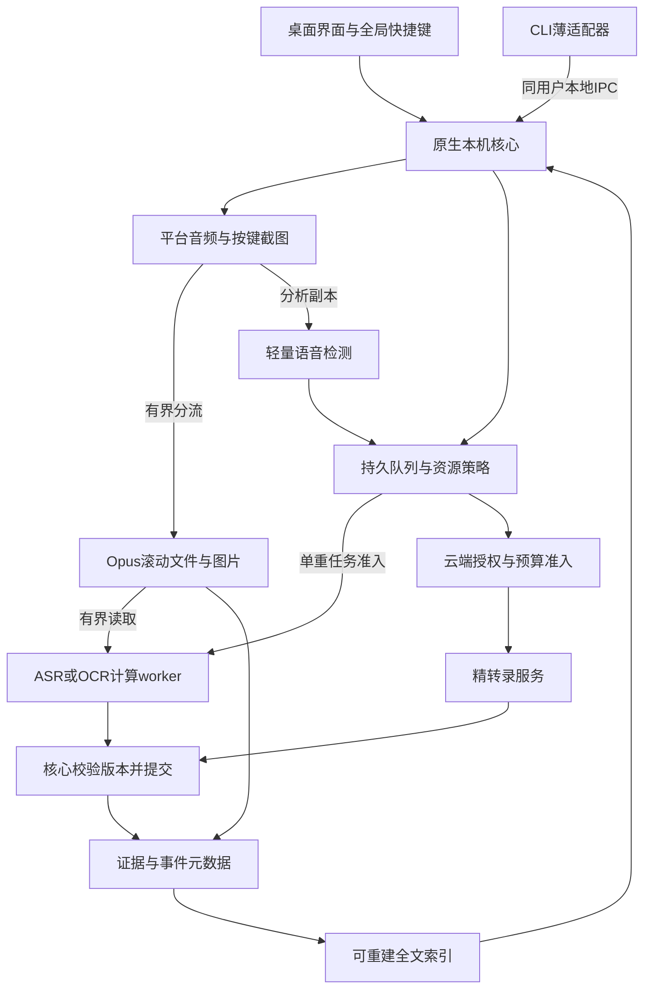

# hear 技术 RFC

## 1. 目标与依据

实现[PRD](prd_0.1.md)定义的持续采集、事件整理、主动截图/Mark/评论、可找回原声和按需精转。本文区分：已确认的产品原则、官方能力、工程推算、建议参数与待测指标。本文所有性能数字均非hear实测。

推荐原生Rust核心、按需桌面界面、受控计算worker、本地事务存储与媒体文件。可评估Tauri作桌面壳，但不继承其他产品的进程/工作区设计。依赖选型须校验确切版本、模型权重许可和分发方式；本仓库没有导入实现代码或模型。

## 2. 逻辑架构与进程

核心为用户会话内的单实例进程，持有托盘/权限/设备与存储；查看窗口不是采集生命周期owner。建议最多一个轻监测worker和一个重计算worker；两者可使用同一可执行程序的不同模式，不各建队列、数据库或HTTP服务。UI底层可能存在平台WebView辅助进程，实际内存按产品进程树统计。

本地CLI只作能力适配。推荐核心未运行时返回明确的不可用状态，不通过读命令暗中恢复录音；显式启动方式待PRD D4/D6确认。默认不建立系统级常驻服务，不借助Agent Session、通用LLM循环或定时任务平台维持采集。

## 3. Owner 与权限边界

| 事实/资源 | 唯一裁决者 | 其他层允许做什么 |
|---|---|---|
| 用户启用/暂停、来源与授权 | 核心配置入口 | UI/CLI提交命令，不直接覆盖配置文件 |
| 实际采集、设备generation、时间映射 | 核心采集控制 | 平台adapter报告状态和样本 |
| Evidence/Event/Moment、保留、删除 | 核心存储与事务入口 | worker返回结果，不直接写库或删媒体 |
| 任务、预算预留、尝试与发布资格 | 核心队列/调度入口 | worker只执行有界任务 |
| 索引 | 当前有效内容的派生投影 | 可重建，不反向决定内容保留 |
| 对外上下文 | 核心权限和范围检查 | CLI/其他客户端仅得到允许的投影 |

这些是模块职责，不要求每行一个进程或框架。配置与元数据变更通过核心串行化/事务处理。异步任务携带输入revision、任务attempt/执行代次和取消/删除版本；采集generation仅标识来源流。不能拿当前设备generation作所有任务的提交条件，否则设备切换会错误作废仍有效的历史录音处理。

本地IPC使用同用户的系统访问控制，并对读取、导出、控制、删除、上传分别定义产品权限。它不能隔离已经取得同一OS账号完全权限的恶意程序；CLI可执行性也不等于云端外发授权。默认不开放LAN服务；若引入HTTP，必须独立定义认证、来源和范围，而非仅凭localhost信任。

## 4. 数据模型

SQLite作为建议的元数据/任务/配置事务库，媒体放在应用私有目录。全文索引采用一个派生实现；可评估Tantivy中文分词或SQLite全文能力的检索质量，决定后不并行维护两套全文引擎。当前不引入向量数据库或通用知识图谱。

| 对象 | 最少语义 | 关系与生命周期 |
|---|---|---|
| CaptureSpan | 来源、generation、采样/时钟映射、覆盖与缺口 | 设备变化/睡眠建立边界；不把断流补成静音 |
| Evidence | 类型、来源、实际时间/区间、内容revision、可用性 | 音频/图片保留原素材；用户文字编辑产生revision；可独立于Event存在 |
| Moment | 锚点、用户动作、证据引用、保护范围 | Mark绑定时间；评论可晚提交；未来保护范围尚无声音时为pending |
| Event | 标题、时间范围、组织来源、revision、证据关系 | 可合并/拆分；普通修改保持ID，替代关系可追溯 |
| Derivation | 输入ID/revision/范围、模型/算法、结果、状态 | 转写/OCR/摘要/判断；旧输入结果不能直接覆盖当前版本 |
| Retention claim | 请求来源、证据/区间、有效期限或显式保留 | 各保护请求独立；解除一个请求不取消其他有效保护 |
| Job | 输入快照、类型、执行代次、状态、尝试与预算预留 | queued/running/succeeded/failed/cancelled/interrupted；云请求结果不明另记 |
| ContextBundle | 选中内容与revision、来源、权限范围、缺口说明 | 默认查询投影/发送快照；不再建立可编辑永久记忆库 |

Event与Evidence按区间/图片/评论建立关系，不把文件物理目录当语义归属。ContextBundle只包含当前目的相关的内容，正文、图片引用和音频读取权限分别表达。

用户修正标题、事件边界和文字时需保留来源与优先权；晚返回的模型结果不能覆盖用户修改。转写句段ID不作为永久时间定位，Mark和引用使用逻辑音轨/素材范围。

事件拆分/合并保留替代关系。旧ID拆成多条时返回明确的后继集合，不静默跳到其中一条；外部引用尽量同时携带证据范围，避免一次归组修订改变被引用的原话。

采集覆盖、处理进度、场景判断、用户关注、保留和外发授权是正交状态；不用单个record.status同时承载所有含义。Evidence本身不存模型置信度；派生结果没有可靠分数时允许unknown。

## 5. 原生采集、截图与时间

### 5.1 平台方案

| 能力 | macOS候选 | Windows候选 |
|---|---|---|
| 麦克风 | Core Audio；可评估CPAL桥接 | WASAPI共享模式 |
| 系统声音 | Core Audio taps；SCK作比较基线 | WASAPI endpoint loopback |
| 主动截图 | SCScreenshotManager按需单帧 | Windows.Graphics.Capture按需帧 |
| 电源/负载提示 | 原生通知与QoS | 原生电源通知与后台EcoQoS |

Apple taps官方样例要求macOS14.2+；Windows10 1703起支持事件驱动loopback。它们是API能力下界，不是hear已承诺的最低支持系统。应用进程树loopback的官方Windows样例要求build20348+，不能当作所有Windows10均支持。平台资料见第12节。

两路音频保留来源。标准输出混音不能可靠推断是哪一个App在说话；本App回放应使用平台支持的排除机制或明确抑制其自动事件/云精转，不能把整路麦克风静音来防回声。

系统音频与截图分开，不能为获取声音而默认保存全天视频。受保护内容、权限限制、安全桌面可能不可捕获；缺失可见。登录、锁屏、睡眠和应用退出分别建状态，不假定锁屏就是睡眠。

### 5.2 热路径和双轨对齐

设备回调仅将带时间戳的样本复制到预分配有界队列；无推理、网络、同步文件IO或无界分配。归档和分析分开消费，分析落后不阻塞原声；归档自身超限必须记录实际丢失，不能宣称可靠保存。

源采样率在连接期间保持稳定，分析副本重采样为模型所需格式。记录采样位置、单调时钟与墙钟锚点，处理跨来源漂移；睡眠/设备切换后建立新的CaptureSpan。墙钟变化不重写已有证据次序。

无语音时主要减少ASR/OCR等重计算，不频繁重开设备或降低原声采样质量。若实验引入动态码率/静音压缩，须验证弱语音与句首保真、时间连续性和回溯能力；不能用VAD裁掉原声窗口中的所有非命中内容。

原声尽量不被破坏性降噪覆盖。外放造成双路回声时，仅在参考和对齐可靠的分析副本上尝试AEC；质量/CPU成本须同语料测试。默认设备选择要考虑蓝牙输入对播放模式的影响。

截图记录触发时间与实际帧时间，评论挂接原Moment。即时截图先捕获再异步编码/OCR；在途帧达到上限时返回忙碌/失败，不能把稍后截到的画面假称为原时刻。

## 6. 处理链与运行策略

### 6.1 候选与会话组织

VAD只定位候选语音，不决定永久删除。模型不可用或落后时保留有界待扫描范围。ASR处理候选区间，不为每次调用反复识别整个历史窗口。

句段端点、物理文件封块、事件边界各自独立。短静默可以形成ASR句尾，但不是会议结束的充分条件。会话归组结合时间、来源、文字线索、用户Moment及已有组织；结果可先使用“讨论片段”，后续修订。不能只凭会议App运行判断价值，也不设“少于几分钟一定无效”的硬规则。

组织策略先用有界的时间/来源规则产生候选组，再以新增转写和Moment修订；人工边界优先，矛盾或不足信息保留未分类状态。不默认引入常驻LLM判断每段声音。事件使用有序来源区间表达，可跨文件且允许中间缺口；呈现上折叠静默与物理删除是两个操作。自动归档和精转各自记录触发依据，便于用户修正及离线评估。

自动事件生成应与素材固化/清理交接配合，不能产生持久列表条目但底层原声音即将无提示消失。自动归档准则和正式保留期限取决于PRD D1/D2，未确认前不能用任意阈值把它们实现为既定行为。

### 6.2 模型与调用

| 工作 | 建议基线 | 明确不推定 |
|---|---|---|
| 语音检测 | Silero VAD、ONNX、CPU单线程 | 声音概率不是工作价值 |
| 本地初步转写 | SenseVoice INT8 + sherpa-onnx先做对照基线 | 已有集成经验不代表最省电或中文最准 |
| 截图OCR | macOS Vision候选；Windows端本地OCR实现待选 | API/识别模型存在不等于已解决本机部署、分发与整图质量 |
| 云端精转 | 选一个通过语言/时间戳/费用验证的正式适配器 | 不把厂商名称、固定日期模型或“兼容接口”当质量保证 |
| 人物/摘要/视觉理解 | 按用户需要另行准入 | 不默认全天运行，也不作为记录可用的前置条件 |

选型比较同一套中文、中英混说、远场、短句、重叠语音和数字/专名样本；检查代码与权重分别适用的许可。CPU INT8无需独显；Core ML/ANE、GPU/NPU等只有经过完整质量/能量对照才启用。

### 6.3 频率与资源参数：单一候选表

本表是原型校准起点，不是用户逐项确认，也不是跨设备保证。能由事件触发就不额外轮询。

| 环节 | 建议参数 | 约束 |
|---|---|---|
| 设备回调 | 由设备/OS决定；观察量级10–40ms | 不为追求统一数值强制高频唤醒 |
| 内存前缀/分析队列 | 前缀5s；分析队列每路≤8s | 超限分析范围可从仍保留的原声补算 |
| 音频编码/文件 | Opus 20ms帧；64kbps/mono/source作为预算基线；60s封块 | 32kbps可作质量实验，不能先假定足够清晰 |
| 音频checkpoint | ≤5s候选 | 需匹配真实持久化、容器恢复与崩溃损失合同 |
| VAD | 16kHz/512samples=32ms；可128ms聚合送入 | 逐窗保持模型状态，不通过跳样本减负 |
| 语音端点/ASR单元 | 静默约0.8s；常见5–15s；候选上限20s | 最终以所选模型的有效长度与质量测试校准 |
| ASR合批 | 接电15–30s；电池30–120s | 正常无竞争目标，过载时允许明确积压 |
| 重任务 | 最多1个；ASR基线单线程 | ASR/OCR有配额与老化，避免相互饿死 |
| ASR占空比 | 电池25%，接电50%作为候选 | 指工作窗口内的墙钟配额，非OS硬CPU/功率限额；需给其他工作留余量 |
| 截图/OCR | 用户按键捕获；新图片一次OCR | 原始帧最多2个在途；保存与识别解耦 |
| Mark保护窗口 | 前30s/后60s作为候选 | 不保证未来音频已存在；需产品确认D5 |
| 索引/归组 | 结果后≤5s合并索引；归组15–30s合并 | 无新内容不计算；静默120s仅作候选结束 |
| 模型空闲卸载 | 3min候选，内存压力时更早 | 校准冷热切换成本，不每句话重载 |
| 资源复核 | 系统事件即时，活动时5s补查 | 空闲合并；不启动LLM判断省电 |
| 持久任务队列 | ≤500任务或≤6h源音频候选 | 超限转有界待扫描游标；游标自身不能无界增长 |
| 原声回溯 | 最多24h候选，受实际容量约束 | 显示真实覆盖；正式保留内容另算 |

### 6.4 电源与背压

正常电池下采集持续、重任务合批；接电可补积压，但热压力和前台竞争优先于接电加速。候选策略为电量≤30%停止自动重计算，≤20%停止自动采集；低电恢复使用超过阈值5个百分点且稳定60s，或接电稳定10s。所有数值须校准/确认，用户暂停始终优先。

空间按全部原声、保留副本、图片、索引、临时文件及任务预留记账；候选系统空闲底线为2GiB，总预算待D2确认。超过上限先清理允许清理的内容，仍不足停止准入和自动采集。

队列记录素材引用和处理进度，不持有全天PCM。积压游标按源区间合并，保留过期/删除缺口；到期未处理必须计入覆盖状态，不能假装已完成。

## 7. 云端精转与外发

先按用户查询、Moment及内容不确定性排序，再检查来源范围、授权、费用/时长预算、素材是否仍有效。先预留预算再发送，按实际双轨请求、padding及重试计量。推荐默认单请求在途；请求单元30–60s仅作候选，最终遵循所选API合同。

请求前再次检查撤销/删除。已发出的请求可能无法撤回；取消后至少禁止结果发布与后续请求，不承诺厂商从未接收。超时结果不明时保留attempt和预算预留，不自动当失败释放后无限重试；人工/厂商查询对账后再终结。

没有可验证价格或可靠费用上限时，不启用自动付费路径。云端错误、断网、余额不足不影响已有本地记录的回放与检索。结果在来源、时间定位和关键实体质量上验证后，才能被产品称为精转提升。

音频、截图、文字交给外部AI分别受授权范围约束。原声24h兜底不意味着用户同意将24h音频上传。ContextBundle仅发送明确选择的正文/媒体，不能把“引用一条记录”暗中扩展成全天历史。

## 8. 保留、删除与恢复

### 8.1 保留交接

Retention claim保护明确证据/范围，独立于模型价值分。Mark创建时先保护仍存在的前文并预留后文空间；未来区间按真实采集填充。

推荐先用固化片段实现长期保留：原声音窗口仍有效时有界裁剪/生成独立可解码素材，校验后原子提交保留映射，再允许滚动原声清理。物理文件可以更换，逻辑来源区间保持稳定。失败继续保护原范围或明确报告无法保留，不发布空壳成功。

Opus块不能直接字节拼接当作新音频。边界裁剪需选择经验证的重封装/解码重编码方案，评估时间误差、质量与额外空间。所有副本登记来源关系；不能只删除滚动缓存而漏掉保留副本。

### 8.2 删除与迟到结果

核心先提交逻辑失效范围/版本，立即阻止本地播放、检索、导出和新任务准入，再完成物理清理。任务返回时检查取消、删除、输入revision和权限；旧结果不能复活内容。

搜索结果、旧引用、缓存和媒体读取统一按当前权威元数据过滤，不等待异步索引清理才生效。部分删除涉及共享文件时，先隔离被删范围的访问，再持久化校验仍需保留的区间并切换映射，最后移除旧副本；对外不能暴露包含已删区间的整块文件读取入口。

跨删除边界的片段与部分受影响摘要需要裁剪、失效或重算。取消分组不同于删除原证据；共享引用的作用范围在操作中明确。仅删除一段内容不应误删其他未受影响且仍被保留的素材。

“立即失效”不是磁盘安全擦除保证，也不能抹去已经导出、备份或已被云商接收的副本。清理失败可追踪并重试，不能重新开放逻辑访问。

### 8.3 崩溃与中断

SQLite事务、媒体持久化顺序、原子文件提交、checkpoint与任务状态必须作为一条恢复协议验证。崩溃后识别未完成文件/任务，恢复或标记interrupted；无确认的内容不伪报保存成功。

分别记录用户动作提交和各路媒体持久化水位。Mark元数据成功可反馈“已标记”，音频保护区间须按水位显示已保存/待补齐；截图保存成功需图片持久化与元数据提交均完成。候选5s checkpoint只定义待验证的尾损预算，不能把未来后文或尚在内存的声音标成已保存；保留动作可要求提前持久化现有相关音频。

重启先读用户意图，不能把异常退出当手动暂停，也不能用重启抹掉真正暂停。睡眠/设备变化重建流，保留缺口。采集日志不保存转写正文、图片内容或密钥；诊断以计数、状态和不含内容的标识为主。

## 9. CLI与外部调用

先定义产品能力，后冻结命令。候选CLI返回稳定ID、结构化结果、来源定位、版本和明确错误；耗时任务返回job身份，可查询终态。命令返回成功不等于转写已完成。

优先范围为状态、列出/读取、搜索与选定内容导出。控制录音、删除、精转请求需要独立权限与确认语义；具体交付范围由PRD D6决定。CLI不能直写数据库、绕过删除检查或另起一套采集。

接口用版本化请求/响应表达能力协商， stdout 与诊断输出分离。不预定命令名、完整参数表或MCP映射，避免接口工作先于产品合同。外部内容视为数据而非自动执行指令。

## 10. 资源量级与计算口径

### 存储

十进制容量公式：GB = 总码率kbps × 1000 ÷ 8 × 秒数 ÷ 10^9。VBR、容器、索引和副本需另计实测。

| 数据 | 平均吞吐 | 24小时容量 |
|---|---:|---:|
| 一路32kbps | 4kB/s | 345.6MB |
| 两路各64kbps | 16kB/s | 1.3824GB |
| 麦克风64+系统立体声96kbps | 20kB/s | 1.728GB |
| 两路16kHz/16bit/mono分析PCM | 64kB/s | 5.5296GB |

两路各64kbps保留30天约41.47GB，不含其他内容。因此有限磁盘与无限保留不能同时承诺。一天采集的物理文件量有界；不得以一个会话或一个模型调用承载全天PCM。

3840×2160×4字节的截图原始RGBA约31.64MiB，HDR/拷贝/OCR会增大峰值。压缩图片大小因内容而异；不能预设每张固定1MB。5秒48kHz float32、麦克风mono+系统stereo缓冲约2.88MB，只是样本数据量，非进程RSS。

### CPU与积压

设λ为每秒到达的候选源音频秒数，两路可相加到2；r为指定单线程CPU配置下实测RTF（推理墙钟秒/音频秒）。CPU为主时ASR平均单核等效需求近似λr，不含VAD、编码、OCR、加载和调度开销。多线程/GPU不能直接用这条式子推算CPU占用。

两路各20%候选语音、r=0.1时，需求近似4%单核。λ=0.9、r=0.45时则约40.5%。若只给墙钟占空比d=0.25，处理能力d/r，例子每小时积压约20.67分钟源音频；这不是某一型号电脑的实测。

队列要稳定需处理余量，d=λr只是理想持平；实际要给加载、OCR和前台竞争留出空间。选择更快模型/后端、接电补算或允许延迟，不用静默漏记满足资源数字。

### GPU、内存与电池

默认CPU量化路径不需要独显。Apple Silicon可对照Core ML/ANE，Windows的GPU/NPU支持依实际模型、驱动和运行时验证；加速可用不等于总能量更低，独显唤醒可能抵消收益。

候选资源预算：关闭UI时采集+轻监测≤200MiB，单重worker峰值≤1GiB，含界面/截图总峰值≤1.5GiB。它们是测量目标，非模型文件大小推算结果。

额外电池容量百分点 = 增量平均瓦数 × 小时 ÷ 电池Wh ×100。60Wh电池运行8小时，额外0.5W约6.7个百分点，1W约13.3个百分点；不是续航时长减少相同比例。不能由CPU百分比直接推导瓦数。

## 11. 验证门槛草案

| 方面 | 方法与通过依据 |
|---|---|
| 平台 | 目标macOS/Windows版本与架构上，覆盖权限、耳机/外放、内置/USB/蓝牙、设备切换、睡眠唤醒；未测平台不宣称支持 |
| 资源 | 同机基线→音频→编码→VAD→ASR→截图/OCR分项测量；30min定位、8h多轮对照、72h稳定性 |
| 记录可靠性 | 统计回调缺口、实际持久覆盖和恢复尾损，不能用模型完成数替代 |
| 质量 | 独立测试集统计短句/远场漏检、关键数字/专名、归组准确与检索成功；调参与验收集分开 |
| 精转收益 | 同样本对照本地和云端，关键实体与整体转写均核验；没有收益不宣传为提升 |
| 生命周期 | 截屏→评论→精转→事件重组→保留交接→原声过期→删除的组合测试；迟到结果不复活 |
| 资源有界 | 队列、worker、图片帧、媒体/临时文件、索引/日志均有预算；72h无持续非预期增长 |
| CLI | 不启动录音的读取、权限/范围、任务真实终态、核心不可用状态、删除后旧引用失效 |

建议安静场景增量功率目标≤0.5W，达到1W需重新评估；混合8小时额外电量目标≤10个百分点，超过15个百分点不符合默认长期开启定位。必须随结果报告电池容量与基线负载，不能将这些数值包装成通用达标保证。

硬件基线建议Apple Silicon/现代Windows低压CPU、16GB/SSD；8GB与较旧Intel为资源约束组。精确质量阈值、正式支持矩阵、续航与持久化尾损合同需要在原型验证和产品收敛时锁定，未锁定不进入发布承诺。

## 12. 一手资料与证据边界

以下资料在本轮讨论中于2026-09-21核对；主分支/在线文档可能变化，实际选型需锁定版本与权重。没有运行真实录音、模型功耗基准或云端精转。

| 来源 | 支持的结论 | 不支持的外推 |
|---|---|---|
| [Apple Core Audio taps](https://developer.apple.com/documentation/coreaudio/capturing-system-audio-with-core-audio-taps) | 进程音频捕获与样例14.2+要求 | 不保证hear长跑功耗或所有路由可靠性 |
| [Apple SCScreenshotManager](https://developer.apple.com/documentation/screencapturekit/scscreenshotmanager) | 按需单帧捕获 | 不保证所有受限窗口可截取 |
| [WASAPI loopback](https://learn.microsoft.com/en-us/windows/win32/coreaudio/loopback-recording) | 共享模式输出捕获、事件驱动与受保护内容限制 | 不等于任意App身份归属或睡眠常录 |
| [Windows应用loopback样例](https://learn.microsoft.com/en-us/samples/microsoft/windows-classic-samples/applicationloopbackaudio-sample/) | 包含/排除进程树及build要求 | 不支持泛称所有Windows10可用 |
| [Windows屏幕捕获](https://learn.microsoft.com/en-us/windows/apps/develop/media-authoring-processing/screen-capture) | 帧、系统选择、时间戳与资源释放 | 不要求常驻录像 |
| [Silero VAD](https://github.com/snakers4/silero-vad) | 上游称30+ms块单线程耗时低于1ms | 不是完整双路链路功耗/RSS |
| [SenseVoice / sherpa基准](https://k2-fsa.github.io/sherpa/onnx/sense-voice/pretrained.html) | RK3588单线程INT8 RTF：A76=0.099、A55=0.436 | 不是Mac/Windows设备跑分 |
| [whisper.cpp](https://github.com/ggml-org/whisper.cpp) | CPU与Apple加速候选；Core ML可用于encoder | 不代表全模型均在ANE或必然节能 |
| [Apple计时器能效](https://developer.apple.com/library/archive/documentation/Performance/Conceptual/power_efficiency_guidelines_osx/Timers.html) | 减少无用唤醒与事件驱动 | 不提供本产品固定瓦数 |
| [Windows QoS](https://learn.microsoft.com/en-us/windows/win32/procthread/quality-of-service) | 可影响核心与功率调度 | 非硬CPU/功率限额 |
| [Modern Standby](https://learn.microsoft.com/en-us/windows-hardware/design/device-experiences/modern-standby-wake-sources) | 特定音频后台场景与唤醒条件 | 不适合作通用桌面程序低功耗睡眠录音承诺 |

前期比较过整套持续记录项目，但本方案不复制其业务、服务端或数据库；公开可读代码不等于可直接商用复制。引入具体依赖时单独完成许可与技术验证，不从历史许可或项目宣传推定当前权利和性能。
