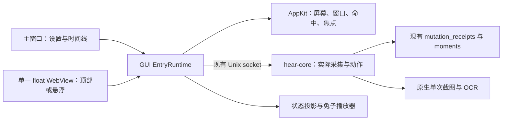
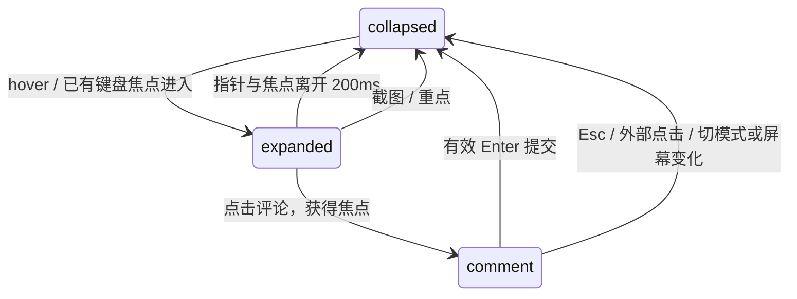

# hear：安静兔子入口技术 RFC

## 0. 文档地位与结论

[功能 PRD](prd_0.1_quiet-rabbit-entry.md)已由用户于 2026-10-01 确认需求与设计素材，本 RFC 给出一次原子交付的技术方案。产品行为以 PRD 为准；本文是已接受的技术契约，实现进度与原生证据以 PRD 执行台账为准。先读[当前架构](../ARCHITECTURE.md)、[设计规则](../DESIGN.md)、[既有 RFC](tech_rfc_0.1.md)及[素材说明](../../design/rabbit/b4-i4-v1/README.md)。本任务已开始生产开发；未恢复此前暂停的长时录音测试。

采用 **一个 GUI 进程、一个常驻入口 WebView、同一套会话状态与动作服务**。保留 Tauri 2 / React 和现有 `float` 窗口标签；窗口在顶部和悬浮之间改变形态，使用 AppKit 桥接处理屏幕、命中与焦点。`hear-core` 继续裁决采集与保存；动画是消费者。截图由核心使用 ScreenCaptureKit 过滤入口窗口，不依赖界面隐藏时间与 RPC 返回时间一致。

本次允许新增的结构只有 GUI 的模式/位置偏好、会话内控制器，以及现有协议中的采集诊断字段和截图排除窗口参数。没有新进程、网络监听、业务表、持久队列、采集机制或 Windows 移植。macOS 两种入口和应用图标一起验收、统一交付；工程验证顺序不产生受支持的中间版本。

## 1. 核实过的开发前基线（1782131）

| 事实 | 证据与本次影响 |
| --- | --- |
| 前端 React 19 + Tauri API 2，宿主锁定 Tauri 2.12.0 / tao 0.37.1 / wry 0.57.0 | `package.json`、`Cargo.lock`。不为本功能升级框架 |
| 已有独立 `float` 透明 WebView，与主窗口同进程 | `src-tauri/src/lib.rs::run`。当前 68×68，置顶、所有工作区；没有 notch / AppKit 入口控制器 |
| 主窗口和悬浮分别查询状态，悬浮每 5s 一次 | `src/App.tsx::refreshStatus`、`src/FloatingWidget.tsx`。合并状态查询，不把动画变成额外轮询 |
| 展开菜单向上，DOM 从上到下是暂停/继续/开始、评论、截屏 | `FloatingWidget`。主点击重点，7px 判断拖动；评论走 `show_main` / `hear-open-comment` |
| 当前展开通过前端串行 resize/position，球固定在右下角锚点 | `FloatingWidget::changeMenu`。此逻辑解决过透明大窗挡住下层点击；本次把几何收口到宿主，并补命中范围 |
| `ServiceState` 有意图、来源启用/实际采集、容量状态，但诊断仍是自由文本 | `hear-protocol::ServiceState`、`CoreState::service_state`。整体 recording 不保证所有已启用来源正常 |
| 运行变化不一定改变数据库 `revision` | `service_state` 读取 `CaptureRuntime`，`revision` 来自持久意图。不能用相同 revision 丢弃新的来源状态 |
| GUI 普通请求每次产生新 UUID；核心已有持久幂等回执 | `core_request` → `send_from` → `send_from_with_id`；`Store::mutate_response` / `prior_mutation_response`。入口操作需保存原 ID 和载荷 |
| 截图由核心调用 `/usr/sbin/screencapture -R`，Vision OCR 后写回时刻 | `moments::capture`、`native/moments.m`。鼠标所在屏整屏；当前没有入口窗口排除参数 |
| 核心并发处理有界客户端，截图/OCR 不持有采集写锁 | `main.rs::run` / `serve_one`。保留清理门闩与数据库事务；暂停不与入口保存共用一把 busy 锁 |
| 当前协议 14，最低 macOS 13，已启用 `macos-private-api` | `hear-protocol`、`tauri.conf.json`、`src-tauri/Cargo.toml`。新增字段需统一版本；本功能不更改发行渠道或最低版本 |

本机安装版可能落后于工作树。上述代码能力不证明混合缩放、全屏、输入法、截图过滤和功耗已验收。旧 `playground/hear-island.html` 的整入口隐藏、无刘海回退和 200 字限制已过时；[B4 / I4 工作台](../../design/rabbit/b4-i4-v1/index.html)验证的是视觉演示。

## 2. 职责与生命周期

| 层 | 唯一负责的内容 | 生命周期 |
| --- | --- | --- |
| core | 启停意图、实际来源状态、容量、保存、幂等回执、截图文件/OCR | 沿用已有核心生命周期，不因换模式或主窗隐藏变化 |
| Rust `EntryRuntime` | 单次状态查询、共享快照、窗口模式/几何、动作请求记录、反馈和异常去重 | GUI 进程级；模式切换不销毁 |
| React 入口控制器 | 展开状态、键盘/鼠标交互、notch 草稿、动作投影 | 位于两种视图外的同一控制器；模式只是条件渲染，不重建 store |
| AppKit 桥接 | 屏幕枚举、windowNumber、窗口层级、鼠标命中与外部点击、前台应用与 key window | 附着一个 Tauri NSWindow；注册时创建，GUI 退出时注销 |
| Rabbit renderer | 按状态/单次动作选择素材，计时和绘制 | 同时只挂一个可见角色播放器；移位/换尺寸不产生另一只兔子 |

主窗隐藏继续保留入口；完全退出沿用当前 `Quit` 规则，入口不能擅自恢复采集。GUI 退出释放鼠标监听、屏幕/工作区通知、动画与反馈计时器；不让退出清理触发提交草稿或重试动作。React StrictMode 的装卸不重复注册宿主服务。

主窗初始启动不激活入口。`Reopen` 不能仅因入口可见就吞掉打开主窗口的动作：本机主窗隐藏而入口显示时，点击 Dock 仍应打开主窗。

### 2.1 状态查询与快照

将主窗口和入口的 `Status` 查询收敛到宿主服务：GUI 启动立即查询，随后按现有 5s 节奏查询；同一时刻最多一个 Status 在途，周期与动作触发合并。主窗/入口在订阅前取得当前快照，订阅后按宿主递增的 `snapshot_sequence` 接收事件；不得只等事件而漏掉初始状态。主窗口的时间线/队列查询不归入这个状态服务。

快照含最近成功的 `ServiceState`、本地观测序号、观测时间及连接错误。一次查询失败立即投影为 unknown / 清醒等待，停止健康循环；旧快照仅供上下文说明，不继续宣称正常。首次没有快照同样等待，不等同睡眠或故障停止。动画不发查询。

控制命令回执只证明意图已提交。立即安排 Status 刷新；没有观察到真实停采/恢复前，保持切换姿态。宿主序列化查询，避免早发晚到的结果覆盖动作后的新状态；不能按 `ServiceState.revision` 判断运行状态是否变化。

## 3. 真实状态与结构化诊断

### 3.1 最小协议补充

在 `ServiceState` 增加下列字段，由 core 根据既有意图、`CaptureRuntime`、来源 busy 标记、`allow_capture` 和 `maintenance_pause` 生成，不另建采集状态机或写入数据库。

| 拟新增字段 | 取值与用途 |
| --- | --- |
| `microphone_phase` / `system_phase` | `disabled / idle / starting / recording / stopping / unavailable`；区分正在切换与确定缺失 |
| `capture_blocker` | `none / sources_disabled / model_not_ready / setup_incomplete / query_only / session_stopped / maintenance / storage_limit / source_unavailable`；区分正常不采集与异常停止 |

每路 phase 的优先级：实际已启动且正在退出 → stopping；实际采集 → recording；用户关闭且没有残留采集 → disabled；主动暂停/未启用且已停 → idle；实际启动或清理切换 → starting/stopping；应采集但没有采集、也没有启动过程 → unavailable。来源失败文字只用于说明，不能解析关键词决定 phase。busy 当前覆盖整个来源线程生命周期，不得把 busy=true 一律写成 starting。

构建诊断时保持既有锁顺序，不持锁等待系统 API；同时采集到不一致过渡信息时保守表达切换，不能给出虚假健康。`capture_blocker` 优先保留容量原因，其次维护/显式禁采/准备条件，最后来源不可用；原 `reason` 和 per-source reason 继续提供文字。文本变化不改变提醒去重身份。

这些字段用于投影，不反向控制 supervisor。代码中存在查询启动不采集、当前登录显式停止、清理短暂停采等正常路径；它们不能被当作设备故障。旧字段保留供现有主窗口/CLI 使用；所有调用方同时适配。

### 3.2 投影规则

设 `E` 为已启用来源，`A` 为实际采集来源。按下表从上到下评估，并单独输出可用操作及说明，不让图案替代权限/容量错误信息。

| 条件 | 展示 | 操作与注意点 |
| --- | --- | --- |
| 快照缺失/读取失败 | waiting | 不推断已停止；允许查看主窗口，无旧状态盲目 toggle |
| 存在仍在停止的来源，或全局维护/启动切换 | waiting | 不提前入睡，不弹故障提醒；稳定的部分缺失可继续显示 partial |
| storage_paused 且实际已停 | interrupted + 静态提示 | 容量原因优先，不能显示主动睡眠；用户手动恢复 |
| paused_intent 且实际已停 | sleeping | Continue；hover/保存回应仍闭眼 |
| 从未启用，且实际已停 | sleeping/rest | Start，沿用首次设置检查 |
| E 为空，或 query_only / session_stopped / model/setup 阻挡 | waiting/rest | 展开说明并进入已有设置/启用路径；不冒充正常倾听或来源故障 |
| E 非空、E 全在 A 中，且无来源切换 | listening | Pause；静音与有声相同 |
| E 中部分来源 unavailable、另有实际采集 | partial | 缺失来源说明，仍可 Pause；主动关掉的来源不计缺失 |
| E 非空，应采集、实际全部停止、明确 source_unavailable | interrupted + 静态提示 | 原因与处理入口，依第 3.3 节去重提醒 |
| 其余不可确定的过渡 | waiting | 不推断健康或原因 |

`Start / Resume / Pause` 根据意图和最新快照选择，携带原 `expected_revision`。回复中的状态不能直接触发成功动效：主动暂停后直到实际来源全部停止才播放 pause；恢复后直到满足实际采集条件才播放 stretch / listening。source phase 变化、容量预警和云端队列错误不会驱动呼吸速度。

### 3.3 异常提醒去重

宿主保留一个会话内故障 episode 标记，主窗隐藏、切换形态、重绘、原因文本变化和自动重试均不重置。首次快照已有全部停止异常时标记 episode 已存在但不提醒；之后首次观察到明确的异常全停/容量停才提醒一次。unknown 不产生异常提醒，也不结束 episode；重试中的 starting 不视为恢复。

只有确认启用来源恢复正常采集后，结束该 episode，允许下一次异常再提示。手动暂停不产生提醒，也不能通过暂停/继续反复刷新同一未恢复问题的提醒。部分来源失败只显示姿态和展开说明。恢复不弹“正在记录”。

提醒最多一条、无声音、无焦点变化，关闭/过期即回到角色。5s 查询只保证提醒 GUI 实际观测到的停止，不能保证捕获每次短于轮询间隔的自恢复故障；核心继续记录真实 `media_gaps`，本功能不引入新事件推送协议。

## 4. 原生窗口、屏幕和命中

### 4.1 选择同一个 Tauri NSWindow

复用 `float`，创建时隐藏，入口准备完成后以持久模式显示；切换时收起并重定位，不新建第二个 WebView。背景透明、无装饰/阴影，不允许用户任意 resize；内容仍由 React 渲染。获取窗口的 `ns_window()`，通过 `run_on_main_thread` 调用新增 Objective-C 桥接；不保存跨销毁的裸指针，不修改 Tauri 窗口 delegate 或动态替换 NSWindow 的 Objective-C class。

锁定版本的 Tauri 源码已有 `ns_window`、`set_focusable`、`set_ignore_cursor_events`；底层 tao 明确：已聚焦窗口调用 `set_focusable(false)` **不能自动释放焦点**，评论结束必须显式处理 key window 与前台应用。[Tauri WebviewWindow API](https://docs.rs/tauri/2.12.0/tauri/struct.WebviewWindow.html)、[tao 0.37.1 Window API](https://docs.rs/tao/0.37.1/tao/window/struct.Window.html)。

不直接给普通 NSWindow 加 `.nonactivatingPanel`：Apple 将此能力定义为 NSPanel 或其子类的行为。真正的 NSPanel 承载 WebView 涉及窗口所有权和 WebView 重挂载，不在本方案中混用。若本节原生门槛不能满足，停止并回到这项架构选择，不静默改成两个常驻窗口或无刘海强制悬浮。[Apple nonactivatingPanel](https://developer.apple.com/documentation/appkit/nswindow/stylemask-swift.struct/nonactivatingpanel)。

### 4.2 主屏、刘海与坐标

主屏取 `NSScreen.screens[0]` / 对应 `CGMainDisplayID`，**不取 `NSScreen.main`**；后者跟随键盘焦点，会违背入口固定系统主屏的规则。[Apple screens](https://developer.apple.com/documentation/appkit/nsscreen/screens)、[Apple main](https://developer.apple.com/documentation/appkit/nsscreen/main)。

使用 `safeAreaInsets.top` 和 `auxiliaryTopLeftArea / auxiliaryTopRightArea` 得到真实顶部遮挡及安全区域；有有效遮挡时取两个安全矩形之间的缺口，不硬编码 Mac 型号、屏幕像素宽度或刘海宽度。收起兔子在右侧安全矩形左边缘附近；展开面板以缺口中心对齐，下方放兔子与三按钮，物理遮挡区不放控件。`visibleFrame` 排除了菜单栏，不能用它代替顶部安全区域。[Apple auxiliaryTopRightArea](https://developer.apple.com/documentation/AppKit/NSScreen/auxiliaryTopRightArea-gr2n)、[Apple visibleFrame](https://developer.apple.com/documentation/appkit/nsscreen/visibleframe)。

无刘海使用屏幕 frame 顶部中央，仍是同一模式。收起保留32pt兔子点击高度，展开/评论时band为0，去掉硬件遮挡带及相应空白。有效安全矩形缺失时不猜刘海宽度，保守采用无刘海布局并记录诊断；设置中的模式不变。

宿主统一使用 AppKit 全局 point 坐标，以兔子中心/脚底为稳定锚点。前端只传逻辑视图状态与内容高度；不再累加 `(expanded - collapsed) × scale` 的窗口偏移。转换到 Tauri physical 坐标时以主屏 `maxY` 做 y 轴翻转，并按**目标显示器**的 backing scale 换算、取整；不能用整个虚拟桌面宽高除同一缩放值。最终定位可直接在 AppKit 主线程 `setFrame`，避免跨不同缩放显示器的全局 physical 坐标混算。

逻辑尺寸：顶部兔子约 28px、展开角色约 72px、面板宽约 412pt；实际高度由硬件顶部带及内容决定。悬浮保留 68pt 收起单元和 52px 点击目标，48×48 素材居中留 2px，避免 52/48 非整数倍率让像素格粗细不一致；所有角色绘制锁定纵横比。展开预算为 132×230pt，菜单始终向上，文字15px。按屏幕可用区域夹紧悬浮锚点，必要时把兔子整体移入能容纳上方菜单的位置，不翻转菜单顺序。低分辨率屏允许缩减内边距，不把功能挤入硬件遮挡。

监听屏幕配置、backing scale、工作区和屏幕唤醒变化；每次重新枚举，不长期缓存 NSScreen。屏幕移除/主屏变化先收起，保留草稿，按 PRD 回主屏或重新夹紧。拖动结束保存的是兔子锚点，不是展开窗口左上角。

### 4.3 层级、工作区与输入命中

顶部窗口使用 status 等级，悬浮使用 floating 等级；不升到屏保/锁屏层级，不盖住系统授权弹窗。保留 canJoinAllSpaces，结合 fullScreenAuxiliary；macOS 13+ 按 SDK 设置 canJoinAllApplications，不能与 primary/auxiliary 等互斥 flag 乱叠。Spaces/全屏变化只收起，不提交草稿或主动切换工作区。[Apple collectionBehavior](https://developer.apple.com/documentation/appkit/nswindow/collectionbehavior-swift.struct)、[Apple canJoinAllSpaces](https://developer.apple.com/documentation/appkit/nswindow/collectionbehavior-swift.struct/canjoinallspaces)。

窗口外框随内容收缩。仅 CSS `pointer-events:none` 或透明像素不能保证下层应用收到点击；宿主维护当前可交互区域：兔子目标、面板、悬浮菜单或输入区，排除 hardware 缺口、圆角外围、阴影、兔子与菜单之间的大片空白以及反馈。用本地/全局**鼠标**事件监听更新指针位置，区域外开启整窗 `ignoresMouseEvents`，区域内关闭；监控器不截断或重发其他应用事件。初次显示、改 frame、展开/收起后立刻重算，拖动过程中保持拖动目标，避免第一下点击丢失。

只监测 mouse move / drag / down，位置用于原生侧判定，只有命中真假或展开状态变化才通知 WebView；不把每次 mouse move 转发到 React，不注册全局键盘监听，不开持续高频位置轮询，不引入辅助功能或输入监控授权。全局监听看不到本应用事件，因此需要本地与全局监听配合；外部点击由全局 mouse-down 或应用失活处理，本地监听原样返回事件。[Apple Monitoring Events](https://developer.apple.com/library/archive/documentation/Cocoa/Conceptual/EventOverview/MonitoringEvents/MonitoringEvents.html)。

这是拟定的原生命中实现，必须实测鼠标跨越边界后首个点击、系统菜单、圆角空白及下层文本选择/滚动。若监听与切换存在不可消除的首击竞态，不能用“透明即可穿透”作为交付结论。

## 5. 交互与评论焦点

### 5.1 独立于录音的界面状态机

业务请求的 requesting/confirmed/unconfirmed/failed 与此状态机正交；面板收起不取消已经发出的业务请求，不丢草稿，也不决定采集状态。

顶部展开由AppKit先在约160ms内调整窗口，完成通知携带当前布局generation；React仅接受当前代次后揭示操作区并淡入60ms。取消、切模式、重新布局与销毁会使旧完成失效；减少动态效果时两段均无过渡。键盘焦点在操作区可见后移动，不进入尚被窗口裁切的隐藏控件。顶部展开只保留面板左侧一只兔子，收起角色隐藏且不能仍持有键盘焦点。纯 hover 不调用 app.activate / set_focus；鼠标点截图、重点和暂停也不借机打开主窗。其他应用前台时入口默认 focusable=false，只有用户点击评论才获取输入焦点；hear 本身已前台时，允许用户通过系统窗口循环/辅助功能明确聚焦入口，随后使用 Tab、Enter/Space 操作。应用激活/失活通知与显式评论会话共同决定 focusable，不能为了支持键盘让 hover 激活应用；不新增全局快捷键。此路径同样列入原生焦点验收。

截图、重点点击及评论有效 Enter 均在本次 UI 更新立即收起，不等网络、本机 IPC 或动画。收起后使用现有 `inhibit`/`inhibited` 防止静止指针自动重开；原生层按收起后的实际命中区域解除抑制，不保留旧面板矩形，窗口缩小产生的 DOM leave 不能单独解锁。仅展开→收起时设置抑制，反馈重布局不得重新设置；原生点击解除抑制，React 显式点击/键盘聚焦可展开，展开布局同步清除原生抑制。保存成功才发轻提示和 nod；sleeping 下改用 sleeping-response；异常/等待不播放健康动作。

悬浮沿用单击重点、7px 拖动、向上菜单顺序和主窗口评论。拖动后抑制该次 click，pointer cancel 释放判断；位移中不触发 hover 彩蛋，不能把顶部兔子的暂停点击复用到悬浮主点击。现有 `show_main` / `hear-open-comment` 保留，监听在主窗口已初始化后使用；事件送达失败要反馈，不当作评论已打开。

### 5.2 notch 草稿

一份会话草稿 `{ text, anchor_ms, version }`，在入口控制器中独立于形态组件保存。首次点击评论且没有草稿时 `anchor_ms=Date.now()`；恢复草稿不改锚点。逐次输入只改变草稿版本，不创建业务 Moment；清空后关闭清除锚点，退出 GUI 丢弃未提交稿。

中文组合期间 Enter 不提交：同时维护 composition 状态并检查 `isComposing`；测试 WebKit 组合结束时 Enter 的顺序，必要时阻止同次组合确认按键落入提交。Shift+Enter 换行，空白无操作，`Array.from(text).length` 对齐核心 Unicode 字符数量；最多 5000，输入区三行后内部滚动，不显示常驻计数。

提交时冻结文本、原锚点和草稿版本，保留稿到确认成功；再次打开时 requesting/unconfirmed 的原稿可查看，但不能修改载荷后沿用同一 ID 重试。明确失败后可编辑并产生新操作。若允许在确认之后继续输入，成功回调只能清除版本相同的已提交稿，不能抹掉新文字；本方案默认提交确认前锁定该稿，减少并发分支。

模式切换、屏幕/Spaces 变化和 Esc/外部点击只关闭输入区，保留文本和锚点。悬浮的主窗口评论继续使用自己的既有会话输入，不把 notch 草稿复制过去。

### 5.3 焦点获取与释放

点击评论时，宿主保存当前前台应用与当前焦点恢复目标，设置 entry focusable=true，按用户点击激活 hear、令入口成为 key window；React 收到本次 presentation 确认后聚焦 textarea。使用递增 presentation generation，迟到的焦点完成不能聚焦已收起或已切模式的输入框。

有效提交或 Esc：先收起、显式 resign key，关闭入口的 focusable；只有当前前台仍是本次 hear 评论会话，且用户没有选择其他应用/主窗口时才恢复原目标。原目标是 hear 主窗则恢复主窗；目标已退出则只释放焦点。外部点击或用户切到另一应用时不反向激活原应用；Spaces 变化尊重当前空间，不追着旧窗口跳回。后台保存回调绝不调用 focus。

减少动态效果、source 状态变化和保存反馈不获取焦点。输入区处于组合输入时，几何变化不能重新挂载 textarea 或丢掉 selection；全屏评论必须实际验证 key window、中文候选窗口及提交后前台应用。

## 6. 动作、回执与失败语义

### 6.1 复用现有请求路径

新增受限 `entry_action` 宿主命令，接受有类型的入口动作，不开放任意 core Request 或文件路径。仍调用 `send_from_with_id(ClientKind::Gui, request, id)`；现有通用 `core_request` 继续服务其他主窗能力，不扩大其权限。入口动作记录位于 GUI 会话，不持久化。

| 动作 | 核心请求 | 冻结信息 |
| --- | --- | --- |
| 重点 | AddMoment kind=mark | UUID、点击真实锚点、固定载荷 |
| 评论 | AddMoment kind=comment | UUID、草稿锚点/文本/版本 |
| 截图 | CaptureScreenshot | UUID、触发时刻、入口原生窗口 ID 排除列表 |
| 开始/暂停/继续 | Start/Pause/Resume | UUID、用户目标、原 expected_revision |

点击时前端产生 UUID 和锚点并立即收起；Rust 校验 UUID、动作类型和范围，再保存不可变 Request，异步发送。重试只接受已登记 operation ID，由宿主取回原载荷；不能由前端替换文本、修订或排除列表。返回结构化 outcome，区分 core 的 Error 回应与传输错误，不靠 userError 的文字匹配是否提交。

保存操作按 mark/comment/screenshot 分别最多一个未决请求；采集控制有独立请求槽，不共用当前 `FloatingWidget.busy`。结果不明时，同一功能的再次操作明确呈现为“确认上次操作”，复用原 ID；不无声新增 Moment。终态保留最近结果供去重事件使用，槽位总量固定，不累积客户端任务队列。

### 6.2 结果分类

| 结果 | 行为 |
| --- | --- |
| 确认 MomentSaved | 清理对应草稿，轻提示一次，发 `hear-moment-changed` 刷新现有时间线；反馈/动画失败不把已保存动作改成失败 |
| core 返回明确 Error | 显示可读失败原因；保留评论，可编辑后作为新动作重试 |
| 超时、断连、响应 ID/格式异常 | unconfirmed；保留 ID、载荷和草稿，显示结果待确认，允许同 ID 核对/重试；不得显示成功或确定失败 |
| 同 ID 重试返回已有回执 | 视为原动作确认，按 operation ID 防止重复反馈和重复刷新 |
| 修订冲突 | 刷新状态，不用新 revision 自动重发原控制；让下一次用户目标基于新状态重新生成动作 |

协议已有 Request 指纹和事务回执；同 ID 重试必须携带原 expected_revision，并保持关联字段一致。不得用查询出来的最新 revision 覆盖待确认请求。控制结果不明但新鲜状态已证明用户目标且 revision 已变化时，可恢复控制能力；迟到旧请求仍受原修订检查，不能覆盖后续新意图。保存慢/失败不锁住暂停。

退出 GUI 不承诺补交，未提交稿也不跨会话恢复；核心已有成功回执保留。截图没有恢复用户点击瞬间像素的承诺：若原请求没有成功回执，同 ID 的人工重试可能重新拍摄当时屏幕；禁止自动重拍或以新 ID 自动再提交。

## 7. 截图排除与原生采集生命周期

### 7.1 排除参数与信任边界

将现有单位变体扩为 `CaptureScreenshot { excluded_window_ids: Vec<u32>, anchor_ms: Option<i64> }`，默认空列表保持 CLI 使用方式。宿主从唯一入口 NSWindow 的 `windowNumber` 取得 ID；角色、面板和反馈在同一窗中，所以一个 ID 即可。模式切换复用窗口，待确认请求中的 ID 不变；主窗保持原有截图语义，不因为本功能而整应用排除。

核心根据 Unix 对端真实 PID（在现有同用户检查上读取 peer PID）核对传入 SCWindow 的 owningApplication，不信任载荷自报 PID / ClientKind。列表数量和数值有上限，只接受对端自身的窗口，拒绝过滤其他应用。CLI 空列表不新增选区功能或参数。窗口已销毁或确认不可见时可以忽略；入口仍可见却无法解析到对应 SCWindow 时失败，不能无过滤继续截图，也不误排同号其他应用窗口。

本次协议版本在当前 14 基础上递增，GUI/core/CLI 的 Rust 构造、TS 类型与 fixtures 同步修改；部署打包为同一版本，沿用现有 protocol_version 拒绝不匹配组件，不新增并行 v14/v15 服务或业务数据迁移。开工前若版本已变化，以当时基线递增。

### 7.2 选定截图后端

继续由核心选择鼠标所在显示器、记录触发/捕获时刻、写 PNG 与做本机 OCR；把图像获取从 shell screencapture 换为 `SCContentFilter(display, excludingWindows)`：macOS 14+ 用 `SCScreenshotManager.captureImage`，macOS 13 用短生命周期 SCStream 接收一张完整有效 screen sample 后 stop。两条仅为真实最低系统版本责任，使用相同过滤、像素尺寸和保存路径；不开常驻屏幕流，不采集声音。

SDK 头文件确认 `SCContentFilter`/SCStream 可用于 macOS 12.3+，`SCScreenshotManager` 类的 availability 为 macOS 14.0；不要误用 macOS 26 的新 ScreenshotConfiguration API，也不能把最新示例工程的最低系统要求当成接口最低版本。[Apple SCContentFilter](https://developer.apple.com/documentation/screencapturekit/sccontentfilter)、[Apple SCScreenshotManager](https://developer.apple.com/documentation/screencapturekit/scscreenshotmanager)、[Apple ScreenCaptureKit sample](https://developer.apple.com/documentation/screencapturekit/capturing-screen-content-in-macos)。

过滤是在系统合成层完成的，因此界面请求超时、模式变化或后台出现其他反馈时，入口仍不进入截图。无需把正常入口隐藏到 OCR 和数据库提交结束；也不依赖 NSWindow.sharingType 或 Tauri content protection 作为排除保证。SDK/文档能力仍需签名安装版证明。

权限沿用屏幕录制授权，但不能假设系统音频 Tap 授权等于截图授权。core 只检查并快速报告缺失许可，不在后台 helper 等交互授权。用户主动截图触发需要时，由 GUI 的前台权限桥接调用现有 `hear_request_screen_authorization`；Tap 路径现有 `request_system_audio_permission` 不可当作截图授权替代。授权未完成不显示已截图，复用主窗权限处理。

### 7.3 结束、迟到回调与落盘

图像获取设有界期限（建议 5s），只接受当前 operation 的有效完整帧。macOS 13 的 start/stop、sample 回调、错误和 timeout 均进入同一个结束路径：stop 至多请求一次，晚到 start 成功仍需 stop；晚到帧不能写入新操作。原生 completion 必须持有有效上下文直到返回，不能在 timeout 后访问已释放的 Rust/Objective-C 内存。不同请求不复用 stream 或可变截图配置。

保留 `moments::capture/save_capture` 的磁盘安全线、私有文件权限、pending 文件校验、原子改名、清理门闩及幂等事务顺序；只替换图像获取步骤。没有拿到有效图像则失败并清 pending。OCR 失败仍保留已成功保存的图片和失败状态；不能把短流停止失败或 OCR 延迟当作用户已保存。

IPC 默认 5s 等待与截图/OCR 总耗时可能不同；请求超时按第 6 节 unconfirmed 处理，核心迟到完成依旧只提交一次。截图过滤不需要延长 UI 隐藏或改造成另一条通知通道。采集/OCR等待不占用数据库写锁，不与声音采集共享停流控制。

如果过滤或 macOS 13 短流不能通过目标系统实测，不降级到“隐藏若干毫秒大概不会拍到”。需要重新明确可靠的图像获取/排除方案，仍属于本 PRD 的阻断门槛。

## 8. B4 / I4 资源接入与动画

冻结当前已接受的 `design/rabbit/b4-i4-v1` 为视觉来源；生成提示词和原始图保留在设计目录，生产只复制会用到的规范化资源到 `src/assets/rabbit`（拟定路径），不在运行时读取本地设计服务器或完整原始素材包。

| 资源 | 生产使用 |
| --- | --- |
| sprite-atlas.png + manifest.json | 48×48 单元、4×3 图，12 个透明姿态；按坐标绘制 |
| listening / sleeping | 12.8s / 9.6s 常驻循环，头与脚稳定；微呼吸、低频眨眼 |
| curious / nod / stretch / pause | 单次交互/真实状态过渡，不延迟收起 |
| sleeping-response | 睡眠中的 hover/确认，一次闭眼回应 |
| waiting / partial / interrupted | 静态；interrupted 叠加独立 UI 提示，不能只播放原 GIF 然后遗漏提示 |
| wave、GIF / WebP、@4x | 设计/导出用途；wave 不增加产品入口，GIF/WebP 不作为常驻主播放引擎 |
| icons/app-1024.png | 满幅正方形母图；Tauri bundle PNG/ICNS 按用途导出 |

当前基准 SHA-256：manifest `9cb112b2af8c02547e5de5f782493eebb57f49b933ecb0c7ec8b86033bae8715`；1024 方形母图 `87ddbd6ea93de992e37ad266fd5496e1d4154f7138c938c206fdaab3fda52a8f`。此处仅记录设计版本，不引入运行时模型式下载/校验服务。

参考 `rabbit-player.js` 的节奏和低频 timeout，接入 React 生命周期及实际宿主可见性。一次加载 atlas 并复用；按 `image-rendering:pixelated` / 关闭 canvas smoothing 绘制。Canvas backing size 对齐 DPR/屏幕缩放，切换显示器后重建像素映射；28px 缩小需实际看眼睛与耳朵是否还能识别。资源加载错误使用包内的对应静态后备图，不默认回到 listening。

优先级是**实际状态变化 > 单次回应 > 常驻循环**。更新状态取消旧动作；睡眠回应不走 wake，waiting/partial/interrupted 不播放正常确认动作；hover 每次进入一次，禁止 pointer-move 反复重启。UI 先收起，再由仍常驻的小兔子回应。

计时器按 manifest 帧停留时长安排，不使用永续 requestAnimationFrame。初次挂载若当前状态 sleeping，直接从 sleeping 绘制，不能先闪 listening；reduced-motion 为静态状态，优先于过渡；监听系统偏好变化。AppKit 告知入口不可见/睡眠、页面隐藏或 renderer 卸载时停计时器，重新可见从当前状态重新开始，不补播后台动作。仅 `document.hidden` 不足以判断透明置顶窗的原生可见性。

图标只从方形母图生成。PNG 方图用于需要正方形的场景；macOS 圆角 ICNS 是有透明角的派生版；不要再给已裁切图套第二次圆角或底座。更新 `src-tauri/icons` 与 `tauri.conf.json` 所引用工件，安装应用后在 Dock、Finder、应用切换器实看；系统图标缓存不能用网页缩略图替代验证。Windows ICO 保留为设计导出，不引入 Windows 构建验收。

## 9. 配置与迁移

GUI app config 目录新增一份小型 `entry-preferences.json`，与 core 的业务目录/数据库职责分开。只存 `schema_version`、`mode: top|floating` 与 floating 位置。位置用显示器稳定 UUID 加显示器内归一化兔子锚点；不持久化 SCWindow ID、临时 CGDisplayID、展开大小、草稿、请求、提醒 episode 或录音意图。

默认 top；用户旧版没有模式配置也采用 top，旧 float label/权限沿用。读取缺失/损坏/未知版本采用可用默认；经同目录临时文件原子替换保存，失败反馈但不改录音。设置变更由 Rust 串行提交，最后接受的用户选择生效；前端依据宿主回执显示实际模式，不形成设置页与入口两份权威值。拖动结束写位置，不每个 mousemove 写盘。

切换前取消普通 hover，收起输入并保留草稿，释放评论焦点；宿主一次更新 mode、frame、hit regions 和 presentation generation，再通知前端。只影响入口，不能发送 Pause/Resume/Start。未决业务请求与反馈留在会话，失败几何操作回到最近有效形态并说明，不显示两个入口或丢掉设置选择。

没有业务数据库迁移。若后续源码基线已有 GUI 配置设施，复用其路径/原子写入，不再建第二份配置 owner；这不改变本节允许保存的字段。

## 10. 验证与完成定义

先做同一交付中的原生最小验证，再接真实状态与保存流程，最后完成资源/设置和组合验收；这是开发顺序，不允许先发布部分入口。纯文档/HTML验证只能证明设计与逻辑演示。

| 门槛 | 必须记录的成功证据 | 失败处理 |
| --- | --- | --- |
| 状态投影 | 首次未知、暂停未停、单路启用、部分缺失、自动重试、显式禁采、清理维护、容量和断连不误报健康/睡眠 | 修正 core 结构字段/映射，不解析原因字符串绕过 |
| 窗口与命中 | 签名 app 在真实刘海屏与无刘海屏：hover 不抢输入、首击可用、圆角/空白可点击下层、菜单始终向上 | 修正桥接；无法达标则重新做窗口架构决策 |
| 焦点与评论 | 中文 IME、Enter/Shift+Enter、空白/5000字符、草稿原锚点、Esc/外部点击、提交后原应用、焦点回调迟到 | 修复输入/原生焦点，不用主窗评论代替 notch 就地输入 |
| 屏幕与全屏 | 1x/2x 混合缩放、负坐标屏、更换主屏/拔插/睡醒、全屏/Spaces/Stage Manager，入口不丢失也不跳焦点 | 修正坐标/通知/collectionBehavior，不能退化为第二入口 |
| 幂等与竞争 | 双击、回复丢失、迟到成功、原 ID/载荷重试、修订冲突、保存与暂停并行、模式切换不丢草稿或未决记录 | 数据不重复；失败按三类结果表达，不新 ID 自动重发 |
| 截图过滤 | macOS 13 短流和 14+ manager，入口展开/收起/反馈/切模式、慢 OCR/超时、屏幕移除和授权失败均排除 hear 控件 | 修复过滤与生命周期；无不可靠隐藏 fallback |
| 图像与时间 | 多屏/Retina PNG 尺寸、整个目标显示器范围、trigger/captured 时间、OCR 失败保图及清理回执一致 | 保留原时刻与文件契约，不能把图片获取换路径导致数据漂移 |
| 动画与资源 | 同时只有一只角色；睡眠操作不唤醒；reduced-motion/隐藏停计时；动画不发 IPC；Dock/Finder 图标无多重裁切 | 修正 renderer/导出/打包，加载失败用正确静态态 |
| 资源占用 | 同一设备对比旧入口、静态兔子和双循环，采样 GUI/WebContent/WindowServer 的 CPU、内存、唤醒；静止无高频鼠标轮询，模式反复切换不泄漏 | 超出静态开销的持续热点定位到计时、监听或重绘，优化后重新采样；不能只看 GUI PID |

前端类型/lint/build，Rust fmt/check、协议序列化与动作回执用例，以及核心状态纯函数边界须通过。macOS 签名安装版的原生证据分别记录系统、显示器、缩放、状态与结果；有任一阻断门槛未通过不能宣称本 PRD 完成。原项目尚未通过的录音、资源和发行门槛继续按现有计划执行，本 RFC 不豁免它们，也不自行恢复先前暂停的长时录音测试。

已取得的实现与原生实验记录在 PRD 台账；未取得的证据不得填为“通过”。不需要用户重新决定已接受的产品规则；实际原生失败如果迫使改变窗口所有权、通信或默认体验，则带证据回到架构取舍。

### 10.1 产品契约覆盖

PRD 2 的模式/屏幕规则对应第 4、9 节；PRD 3 的顶部、悬浮和草稿对应第 5、6 节；PRD 4/6 的真实状态与一次异常提醒对应第 3、8 节；PRD 5 的回执、截图、焦点与架构边界对应第 2、5–7 节；PRD 7 的验收对应本节。B4 / I4 与完整方形母图对应第 8 节。Windows 只有产品规则和已备 ICO，没有被本 RFC 纳入移植或完成门槛。

## 11. 实现落点与资料

| 路径/符号 | 工作内容 |
| --- | --- |
| `src/main.tsx`、`FloatingWidget.tsx` | 保留 float 路由，抽出共同入口控制器，区分 TopEntry / FloatingRabbit 视图 |
| `src/App.tsx`、`WorkspaceViews.tsx`、`api.ts` | 订阅共享 Status，设置模式、统一动作 outcome，保留主窗评论和 moments 刷新 |
| `src-tauri/src/lib.rs`、`entry.rs` 模块与 `native/entry.m` | EntryRuntime、受限 commands、AppKit 主线程、屏幕/命中/焦点、GUI 配置 |
| `src-tauri/build.rs`、capabilities | 显式链接 AppKit 和桥接编译；entry 权限仍限已知窗口，不开放全局窗口控制给 WebView |
| `hear-protocol::ServiceState/Request`、`core::service_state/serve_one` | 结构诊断、截图参数/对端校验、协议版本与调用方同步；保留回执事务 |
| `core::moments::capture`、`native/moments.m` | ScreenCaptureKit 过滤/一帧获取，保留 PNG/OCR/落盘和时刻路径 |
| `src/assets/rabbit`、tokens / 样式、`src-tauri/icons` | 规范化 atlas/静态后备、低频 renderer、顶部深色表面与角色 palette、I4 平台导出 |

模块名为方案建议，最终拆分可调整；owner、单窗口、真实状态、会话草稿、协议/回执及发布门槛不能随文件拆分改变。页面不展示这些内部术语。

其他参考：[Tauri Windows](https://v2.tauri.app/reference/javascript/api/namespacewindow/)、[Apple NSScreen](https://developer.apple.com/documentation/appkit/nsscreen)、[Apple Spaces 通知](https://developer.apple.com/documentation/appkit/nsworkspace/activespacedidchangenotification)。NSScreen 及 ScreenCaptureKit availability 另外核对了本机 Xcode SDK 头文件；SDK 声明只证明接口可用范围，不证明目标机器行为。

2026-10-01：用户确认需求方案并授权完整实现；本 RFC 为已接受方案，原生能力仍以执行台账中的真机证据为准。

### 11.1 实施补充

工作树协议已同步升至 15。`CaptureScreenshot` 新增可选 `anchor_ms`，GUI 保留点击时刻，CLI 缺省；core 校验未来时刻和排除 ID 后用实际 socket peer PID 过滤窗口。状态与布局投影详见当前 ARCHITECTURE 第 6 节。

宿主动作槽在确认后保留最后响应，收到下一次不同 ID 的动作才替换；同 ID 重试返回原确认，不重新构造控制修订。槽仍只有当前会话的四类操作，不增加持久队列。

2026-10-01 真机发现展开后鼠标原点被排除导致重复收起/展开，已修正原生命中包含顶部黑色区域；黑色表面从屏幕顶边开始，内容下移到安全区以下。回归脚本 `scripts/test_native_entry.m` 直接执行同一命中函数，不以 CSS 命中冒充系统命中。

后续实施修正：菜单167pt高、15px字号，悬浮窗展开230pt，原生 mask 按同一可见圆角与异常按钮布局命中。侧栏复用 I4 方形图，在界面单次裁圆角。评论使用首次用户打开 token；背景布局可以更新几何，但不新建激活意图，取消 token 后迟到布局不能重新激活。macOS13短流只在启动成功后请求停止，迟到启动也归同一停止 owner，成功编码前等待停止回执；失败/超时不报告截图保存。`scripts/test_native_shot.m` 是回调生命周期验证，不能替代该系统真机截图。

顶部收起→功能面板使用现有NSWindow animator，NSAnimationContext.duration为220ms；其余布局使用零时长，按AppKit的[animator契约](https://developer.apple.com/documentation/appkit/nsanimatablepropertycontainer/animator())立即中断在途插值。仅可见的同模式顶部展开播放，减少动态效果时为零。命中使用实时NSWindow.frame，resize通知更新鼠标穿透，不轮询、不换窗口类或delegate。固定按钮布局并淡入，避免缩放像素兔子；评论不延迟焦点，取消与Esc复用草稿保留/收起路径。

### 2026-10-20 定向修正

焦点请求不代表成功：原生仅在应用active且入口key window时确认，首次请求与DidBecomeKey/DidBecomeActive通知共用判断。延迟确认携带原评论intent，关闭/切走后的回调不能聚焦新编辑器。macOS14+使用activate与yieldActivationToApplication/activateWithOptions:0归还前台；13保留旧API。修正实施与证据见[本次devplan](devplan_261020_entry-polish.md)，不替代历史整体入口真机门槛。
