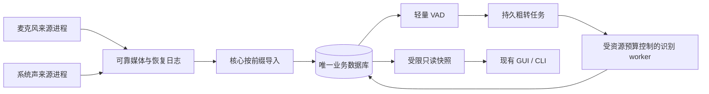

# hear 稳定性与性能优化执行报告

更新：2026-10-16。状态：**in-progress，未完成整体验收，不可发布**。

本轮已经实现研究方案 F01–F14 对应的 P0/P1 代码改造，并完成下述自动回归、规模验证、签名包短链和故障实验。现有页面、兔子入口、操作方式、来源选择、暂停意图、人工修订、模型及阈值保持原有契约。

尚缺最终版本的已知参考双路长时录音、最低 macOS 13 / 8 GiB 实机、真实标注语音留出集和完整设备故障矩阵。不能据本轮结果承诺“连续 24 小时一定没问题”或“所有设备内存都已验证可控”。这些是整体验收门槛，不是交付后的可选观察。

需求依据：[可靠性与性能研究](2026-10-16-hear-reliability-performance-optimization.md)。执行状态：[开发台账](../prd/devplan_261016_reliability-performance.md)。实现边界：[架构文档](../ARCHITECTURE.md)。证据索引：[optimization evidence](evidence/2026-10-16-optimization/README.md)。

## 1. 这次实际改变了什么

目标是让“持续记录，事后能找到且能听到”不再依赖所有后台工作都及时完成。采集先可靠落盘；人声判断、文字识别、整理、查询在各自受限的资源和生命周期内继续工作。任务迟到应形成可追踪的积压，不能悄悄变成丢录音。

| 研究项 | 实现结果 | 已有证据与边界 |
| --- | --- | --- |
| F01 / P0 采集隔离 | 回调预分配 SPSC；排队最多约 2 秒 / 8 MiB；封块通道最多 2 项；设备消费与编码落盘分离；可靠 journal 导入不依赖采集等待业务库 | 最终签名包锁库 11 秒，双路继续产生可靠块、短录制零丢包；尚非任意慢磁盘下零丢失保证 |
| F02 / P0 历史增长 | 容量改为事务内增量投影，待办和关键访问路径建立索引 | 百万行容量统计和真实领取路径；30/90/365 天查询规模 |
| F03 / P0 启动恢复 | 关键状态先恢复；历史媒体巡检、清理和非关键暂存恢复分批后台执行 | 迁移、容量分类、恢复回归；首次迁移仍单列，不能说启动完全没有 IO |
| F04 / P0 来源故障隔离 | 麦克风与系统声分别由受监督子进程拥有；启动、心跳、耐久进度和停止各有截止时间 | Batch B 单源强杀及恢复；最终 SCK / Tap 短链。完整蓝牙、权限、睡眠矩阵未完成 |
| F05 / P0 判断与识别解耦 | VAD 先发布人声区间和保留判断；粗转使用持久任务，读取原有媒体；未确认的跨块句首延后回收 | 固定输入对比、延迟导入与崩溃恢复、跨块句首真实模型回归；有声无字仍保留 |
| F06 / P0 资源控制 | 原 governor 统一后台峰值预留，结合系统内存压力、温度、供电、积压做准入与迟滞；重型 worker 空闲卸载；压力延期不消耗错误重试 | 状态/压力/截止回归，模型峰值短测；全天资源平台和最低配置未证明 |
| F07 / P1 恢复完整性 | 按来源和 session 重建连续上下文；保留未确认起点；已发表前缀不重复；迟到 journal 不被误认作流结束 | 双路强杀、连续讲话与旧版水位、正常/关闭/崩溃延迟导入完全一致 |
| F08 / P1 声纹效率 | 复用受限 worker，暂时失败重试，按页计算与有界样例缓存 | 10 次相同输入向量一致；暖请求约 66 ms 的组件短测；人物阈值不变 |
| F09 / P1 清理与录制 | 物理删除移出主库长锁；核心清理墓碑和代次裁决迟到导入；不为范围清理全局暂停设备 | 迟到块、部分范围、未来范围、回执、清理与恢复回归 |
| F10 / P1 连续播放 | 单一音频时钟接续，最多当前/下一块两个缓冲，单次音频读取；切换与关闭撤销旧代次；外部清理撤回预取 | 8 项播放器测试及真实 WKWebView；没有承诺零延迟跨进程撤销 |
| F11 / P1 读取效率 | 两个只读连接、3 秒短快照、每连接单页 4 MiB 缓存；批量修订；常见词有界探测；前台刷新单飞 | 365 天 / 12,614,400 块实际 SQLite 查询通过；不是全 GUI 冷启动 P95 |
| F12 / P1 云任务 | HTTP Agent 复用；一次任务共享 60 秒预算；持久 Retry-After、退避和公平领取；沿用原请求身份先查后交 | 本地慢响应/429/身份/公平测试；没有发送真实付费请求，供应商响应时间不作保证 |
| F13 / P1 编码 | 固定帧缓冲，移除反复头部搬移及逐帧临时分配 | 编解码帧数、原生采集与播放回归；保留原文件格式和同步要求 |
| F14 / P0 可观测性 | 固定采集指标、替换式诊断；进程出生时间和 WebView 归属；有界采样及媒体覆盖审计 | 3 项采样/审计测试，最终来源指标检查；资源数值本身不等于声音完整 |

全部测试写入隔离目录。没有恢复用户个人核心的录制，没有操作个人录音、转写或凭据，也没有重新安装之前卸载的旧应用。

## 2. 关键结构与内存边界

恢复日志是核心拥有的输入，不是另一个业务数据库。来源、时间、人工修订、清理与当前内容均由核心裁决。目录枚举只短暂尝试共享锁；不把数据库或模型计算放在目录锁里。会话已关闭或数据已经“很旧”，都不能单独证明尚未导入的尾部不存在。

后台预算在 8 GiB 档为软水位 768 MiB、严重水位 1024 MiB；≥16 GiB 档为 1024 / 1536 MiB。粗转预留 640 MiB、声纹 256 MiB，低内存档不同时跑两个大模型。观测粗转超过 768 MiB、声纹超过 384 MiB 或进入严重压力时，回收相应 worker 并保留可重试任务。粗转/声纹空闲 30 秒释放，VAD 空闲 60 秒释放。

这些是采样驱动的后台工程预算，**不是操作系统强制的任意瞬时内存上限**。GUI / WebView 纳入资源采样归属，不能将后台预算直接称为整个应用的内存硬上限。最终长时平台、峰值、积压追平仍须实测。

## 3. 已通过的验证

最终集成数据见 [final-integration.json](evidence/2026-10-16-optimization/final-integration.json)，包含源码与二进制哈希。所有构建使用 `MACOSX_DEPLOYMENT_TARGET=13.0`；这不替代 macOS 13 真机验证。

| 类别 | 实际结果 |
| --- | --- |
| 自动回归 | 199 项 Rust：185 core、9 desktop、5 protocol；24 项前端；4 项原生资源/采样/覆盖审计；4 组隔离 CLI 烟测 |
| 静态与构建 | Rust fmt/check、TypeScript、lint、前端构建、release 构建通过；最终 `.app` deep/strict 签名验证通过 |
| 最终原生短链 | SCK、Tap 各同时录制双路 12 秒，四个来源结果均零丢包；采样环缓冲最高 60 ms，回调 deadline miss 为 0 |
| 原生内存计量 | 三个真实驻留子进程的适配器总量与独立求和完全一致；最终签名包 SCK/Tap 顺序采样的总量比值中位数为 0.994 / 0.996，退出瞬态不当作同步测量 |
| 数据库拥塞 | 最终签名包锁库约 11 秒，两路各有 2 个可靠块等待导入；22 秒短录制结束均零丢包 |
| 核心崩溃 | 数据库锁住、4 个双路可靠块尚未导入时强杀核心；重启后全部恢复，帧数与崩溃前记录一致，未开启新的录制意图 |
| 固定输入非劣 | 中/英/日/韩/粤、弱声、跨边界、静音共 8 组，原 VAD 标志、区间和文字与基线完全一致；新增未结束话语标志由保留测试及实际链路验证 |
| 双源 worker 恢复 | 合计 335.52 秒公开语音、每路 34 块、60 个粗转任务；强杀 VAD 后两路结果与正常运行一致，无失败任务 |
| 连续语音恢复 | 每路 60 秒持续有声，任务恢复及旧版升级水位路径的已发表区间无缺口、无重叠 |
| 迟到入库与句首 | 发声从 4.8 秒开始，跨越 5 秒边界；双路正常、关闭后延迟导入、崩溃后延迟导入三种路径，文字/时间/保留完全一致，首块未丢失 |
| 真实桌面交互 | WKWebView 验证接续、定位、暂停恢复、切源、关闭；预取失败在当前块播放完后报错；外部 CLI 清理预取块后停止播放，保留文字和事件范围 |

桌面外部清理实测使用最终保留修复前的 `hear-integration.app`，相关播放源码完全相同；最终签名原生测试使用 `hear-final.app`。两个构建的证据已分开，不混称最终二进制完整验收。

实际模型跨块夹具可用 [verify_ingestion_quality.py](../../scripts/verify_ingestion_quality.py) 复跑，显式传入 core、CLI、模型目录、公开 WAV 与输出路径；它不会启用原生录制或云处理。公开短样本不能代替真实语音留出集的召回、CER 和误删评估。

## 4. 已测到的性能结果

主机为 M5 / 24 GiB。SQL 使用产品自带 SQLite 3.53.2 和真实 schema/生产查询；历史数据为合成数据。

| 场景 | 结果 | 测量含义 |
| --- | --- | --- |
| 百万行容量读取 | 原全表统计 median 31.884 ms → 增量投影 0.00125 ms | 同库暖缓存 21 次；只代表这一查询 |
| 百万行无待办 / 尾部待办领取 | 0.105 / 0.187 ms | 最终生产领取路径，各单次观察 |
| 365 天典型日时间线 | median 1.873 ms，max 6.580 ms | 12,614,400 块，暖缓存 5 次 |
| 365 天 100 句详情 | median 29.640 ms | 同上，包含原有修订计算 |
| 365 天全历史常见词 FTS | median 141.525 ms，max 141.723 ms | 同上；不是所有关键词或冷盘延迟承诺 |
| 相同声纹重复输入 | 暖请求约 66 ms，10 次向量完全一致 | 组件短测，不能当端到端身份识别 P95 |
| 最大粗转输入重复负载 | 30 轮、每轮 30 秒，worker 物理 footprint 峰值约 611 MiB | 100 ms 采样的短测，不能证明 24h 平台 |

365 天最初确实触发过 3 秒查询预算。执行计划表明来源 `OR` 谓词走了历史索引，改为同义的有限来源集合后通过，保留了原失败记录。没有靠放宽超时掩盖增长成本。[规模证据](evidence/2026-10-16-optimization/batch-d-scale.json)、[最终百万行复验](evidence/2026-10-16-optimization/final-history-1m.txt)。

## 5. 审查发现与修复

四个内部批次各自完成 requirements、adversarial、architecture 审查；最终又从原始基线检查组合态。审查不是按测试数量推定正确，已经实际修复以下边界：

- 待删除媒体被启动巡检误算为孤儿，导致容量暂停无法正确消退。
- 来源生命周期缺口及部分清理归属、固定待办窗口饥饿。
- worker 重建丢失未确认连续语音；旧版已发表水位重复或产生 1 ms 裂缝。
- 预取失败提前截断当前音频，外部清理未撤回已经预取的音频。
- 来源最后错误消息遗漏计数；新 session / PID 继承旧来源指标。
- 关闭会话后仍有 journal 尾部待导入，却过早 flush VAD；枚举中的发布前缀不完整。
- 真实资源对照发现把子进程数量误当字节数，低估后台内存；旧代码三子进程测试失败，按数量修复后与独立总量一致。
- 强化真实模型夹具进一步发现跨块句首过早回收，导致之后粗转缺失输入；修复后同一失败夹具通过三路径一致性验证。

最终修复的 requirements / adversarial 首轮定向复核已 PASS；完整 architecture 又确认了原生子进程内存漏计，已按系统接口的计数语义修复，并增加真实驻留子进程回归。最终 requirements、adversarial 定向复核与完整候选 architecture 门禁均已 PASS，详见 [final-review.md](evidence/2026-10-16-optimization/final-review.md)。局部代码审查通过不会关闭下方实机发布门槛。

## 6. 尚未完成的硬门槛

2026-10-16 用户确认暂时没有 macOS 13 / 8 GiB 测试机及人工标注录音留出集，要求保留为待验收项。以下最低配置和真实语音质量两项待条件具备后补验；当前状态仍为未验证。

| 剩余项 | 最小完成条件 |
| --- | --- |
| 最终版本长时稳定性 | 已知参考双路音源，先 2h、再 8h 工作负载、多个代表场景 24h、72h 趋势；核对真实媒体、缺口、丢帧、保留、资源和积压 |
| 最低配置 | macOS 13 / 8 GiB 真机，最终签名包跑采集、压力、恢复、播放与读取；当前机器不能代证 |
| 真实语音质量 | 分层标注留出集，测弱声/远场/短句/混合语言/噪声，报告语音时长召回、整段误删、CER 与时间误差 |
| 完整设备故障矩阵 | 真实蓝牙/路由、权限、锁屏/显示器关闭、睡眠唤醒、慢磁盘/磁盘不足、断电恢复；以恢复后的真实媒体计时 |
| 发行包 | 最终候选通过上述门槛后，再走公证、安装和登录项验收；本地签名包不等于可发布 DMG |

早期候选存在一段独立环境声持续录制观察，其 core SHA 为 `fc27be0e…`，不同于最终修复包；无已知参考声音。计划 2 小时，在发现旧包内存漏计后于 3614 秒主动结束，未通过 2h 门槛。独立采样和媒体审计仍保存：每路 722 块，样本坐标连续，15 个保留文件解码无帧数错误；麦克风墙钟边界有 ±1ms 差异，不能写成零时间缺口。它不能关闭上面的任何最终质量或长时门槛。[旧候选观察记录](evidence/2026-10-16-optimization/preliminary-ambient.json)。

## 7. 工程交接

内部提交：A `d9fbd57`，B `27f9c27`，C `1ba00e6`，D `ba7e90e`，最终集成 `d6d57f4`；基线 `2c81ebd49601c85d89aa3529555aeddaa98d63f5`。最终集成修复和证据已提交，完整工作状态以台账为准。

本机候选包：`target/release/bundle/macos/hear-final.app`。默认 `target/release/bundle/macos/hear.app` 已同步为同一签名候选，避免打开中间版本；两个包的核心 SHA 均为 `c341c02d…`。没有安装到 `/Applications`。模型、录音和凭据不包含在应用包内。

升级使用追加式迁移，但不能据此直接降级二进制：旧 core 不认识新 journal、粗转待办和保留语义。回退必须先停组件、保存一致的数据库和媒体备份，再恢复匹配版本的整套备份。

隔离试录进程均已结束，试录环境声文件已清理，只留无音频/文字正文的统计证据。

与本任务无关的既有兔子素材压缩包、playground 文件、前轮产品研究及旧研究证据保持原样，未混入代码提交。
