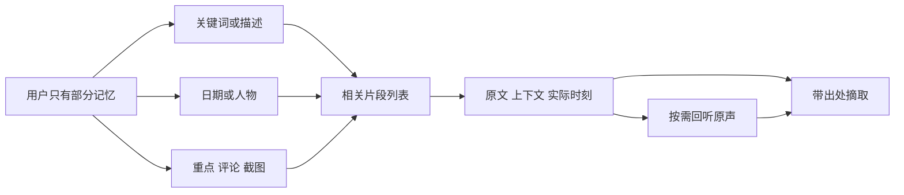

# hear 产品与设计深度审视：从持续记录走向可验证的找回

日期：2026-10-16，Asia/Shanghai
研究重点：用户明确选择的「日常工作中的持续记录与事后找回」
代码基线：`2c81ebd49601c85d89aa3529555aeddaa98d63f5`
文档性质：产品策略与体验研究，供下一轮需求决策；不是已批准 PRD，不改变现有产品契约。

## 1. 核心判断

**hear 最值得继续建设的产品价值，是让用户无需在当时判断什么值得记录，事后仍能凭不完整的记忆，找到并核实工作里说过、听过的内容。**

当前项目已经建立了相当完整的记录底座：双路声音、本地粗转、事件归组、云端精转、人物身份、真实时间定位、截图与笔记、人工修正和数据清理。它也已经形成清楚的视觉性格：薄荷兔、低频动效、安静的常驻入口，以及明确区分记录与暂停的状态表达。这些都值得保留。

但从普通用户完成任务的角度，产品重心仍偏向「把内容录下来、处理好、管理好」。**“找回”尚未成为与“记录”同样成熟的主流程。**最直接的证据是：图形界面没有搜索入口，已有关键词、日期、人物搜索只开放给 CLI；长记录主要靠逐段阅读；人物页主要管理名字和声纹样例；失败恢复按处理任务呈现。功能存在，并不等于用户能够轻松兑现它的价值。

我的建议分为两个层次：

- **必须先守住的底线：**持续采集、原声保留、时间定位、暂停控制、缺口说明和安装升级的可信度。仓库仍有明确未关闭的发布验收项，不能靠新增功能绕过去。
- **下一轮最值得投入的大需求：**「可验证的找回」。打通全历史查找、片段结果、原文与原声定位、结果摘取；再用带出处的摘要降低阅读成本。在这条链路稳定后，逐步增加语义找回和跨事件问答。

**如果只能选择一个升级方向，我选择“找回并核实”，而不是单独的自动摘要、通用聊天、更多采集来源，或继续扩展兔子表现。**原因在于：它直接兑现持续记录的原始承诺，而且可以利用已经投入很多工程成本的时间、转录、人物和本地索引。

### 研究边界与证据等级

本报告结合了产品文档、当前源码、历史验收记录、兔子开发版的真实界面抽查，以及少量外部一手资料。

| 证据类型 | 本次做了什么 | 能支持什么，不能支持什么 |
| --- | --- | --- |
| 当前源码 | 阅读主导航、时间线、详情、队列、人物、设置、状态映射，以及检索、导出、采集门槛等核心实现 | 确认能力入口、数据关系与当前限制；不能据此宣称真实声音质量或长时稳定性达标 |
| 产品与验收文档 | 对照 0.1 PRD、兔子 PRD、设计系统、架构、开发计划和 10 月修复台账 | 识别明确取舍、历史实测、未关闭门槛；旧日志中的问题不自动等于今天仍未修复 |
| 真实界面 | 访问仓库 `target/debug/bundle/macos/hear.app`，检查暂停首页、历史日期、长事件详情、音频信息、队列、人物和设置 | 支持布局、入口和交互路径判断；未开展完整声音质量、首次安装、跨屏或长期任务测试 |
| 外部资料 | 查阅个人信息再找回研究、Granola 官方说明、Microsoft Recall 官方说明 | 提供设计参照；不能证明 hear 的目标用户具有相同使用频率、付费意愿或满意度 |

最初按应用名打开了 `/Applications` 中的早期安装版，用户指出版本不对后，已排除其视觉和报错表现，改用兔子开发版。随后按用户要求将旧安装版移入废纸篓，保留开发版与用户数据。**旧圆形入口不是本报告评价的现行设计。**

开发包可执行文件时间为 2026-10-07，早于当日 HEAD 提交时间；本次未重建并证明二进制与 HEAD 完全一致。因此功能判断以当前源码为主，界面观察作为交叉证据。没有将“打开开发包”写成“最新提交通过正式安装验收”。

本文中的用户场景、改进效果和优先级属于产品判断；明确的指标数值均是建议验证目标。尚无用户访谈、真实找回成功率、留存或付费数据，不能把它们包装成已验证需求。

## 2. 从第一性原理看，用户究竟在购买什么结果

### 2.1 最小的用户问题

一个工作者每天接收大量口头信息：临时讨论、线上通话、评审、别人解释的一段背景、电脑播放的材料。其中只有少部分会在未来派上用场，但用户在发生时很难准确预测是哪部分。

如果必须先打开录音、取标题、决定分类，产品已经消耗了用户想省下的注意力。如果事后只留下大量逐字稿，用户又要支付一次整理和阅读成本。hear 的机会在于同时降低这两种成本。

目标用户的核心任务可以写成：

> 当我在工作中无法一边参与、一边完整记录时，帮我留下允许记录的内容；当我之后只记得一点线索时，帮我找到相关片段，核对原意，并把它用于当前工作。

这里有四个连续条件：**有记录、找得到、核得清、用得上。**另有一个贯穿全程的条件：用户愿意让它持续运行。

可以用一个定性模型帮助决策：

> 实际价值 ≈ 未来需要回忆的机会 × 记录覆盖 × 找回成功 × 核验可信度 × 可复用程度 − 设置、维护、注意力、隐私与资源成本。

这不是测量公式，也不假设各项相互独立。它表达的是：链路中任一环节很弱，都可能让上游投入无法兑现。转录小时数增加，不能直接证明产品价值增加。

### 2.2 优先服务的用户与边界

建议优先验证的用户，是**主要使用 Mac 工作、经常通过口头沟通推进事项、存在事后追溯需要，并且所在场景允许记录的个人工作者**。产品、设计、研发、项目协调等角色是候选样本，而非已经被数据证明的市场定位。

他们之间真正共同的特征不是职业名称，而是：

- 重要信息不总出现在正式会议中，很多发生在临时讨论里。
- 几天后需要重新确认某个细节、约束、原因或承诺。
- 不愿为每段内容维护知识库，也不想日常管理模型和任务队列。
- 对记录边界与可控性敏感，愿意用一定的本机资源换取安心。

当前不应同时承诺覆盖全天生活、离开电脑的所有场景、团队知识管理和自动执行工作。0.1 的真实边界是电脑可用时的声音与有限主动截图；睡眠和离开电脑的经历不能由产品补出来。[产品范围](../prd/prd_0.1.md#1-产品定位与成功结果)

### 2.3 应当赢下的真实场景

下表是用于推导需求的场景假设，不是已经完成的用户访谈记录。

| 场景 | 用户仅记得的线索 | 真正想完成的任务 | 成功结果 | 当前主要阻力 |
| --- | --- | --- | --- | --- |
| 临时讨论结束后 | “刚才有人说了一个限制，我没来得及记” | 找回最近几分钟的一句话 | 快速看到对应文字，听前后语境，复制需要的部分 | 有持续记录和时刻定位，但缺少以最近内容和片段为中心的找回入口 |
| 一周后继续做项目 | “上周聊过上线条件，具体哪天忘了” | 找到之前的约束 | 跨日期检索，缩小到少量候选，直接定位句段 | GUI 要先猜日期，再猜事件 |
| 和同一个人再次交流前 | “他上次担心的是什么？” | 回顾此人的相关发言 | 按人查到有来源的历史片段，不强行补全未识别身份 | 人物库存在，但 GUI 主要是样例管理 |
| 自己曾经做过重点标记 | “那天我标过一个地方” | 找回主动留下的线索 | 跨天查看重点、评论、截图，回到上下文 | 动作锚点存在，却缺少集中回看入口 |
| 长事件中确认一个事实 | “那场讨论最后到底怎么定的？” | 区分提议、争论和明确决定 | 简短概览与章节导航，每条结论能回到原话 | 默认是完整转录；原声核对路径有基础，信息压缩层缺失 |
| 不确定是否真的录到 | “那天耳机切换后还在录吗？” | 判断内容是否存在、是否值得继续找 | 告知来源、缺口、文字处理状态与可回听范围 | 状态数据较丰富，但容易分散在时间线、详情和队列 |
| 临时进入不适合记录的场景 | “先停一下，结束后我自己决定是否继续” | 迅速确认已停止，必要时清掉指定范围 | 控制明确、停止结果可信、删除影响说得清 | 已有暂停和范围清理；敏感场景的快捷路径与理解成本仍值得验证 |

用户往往会先找到一个“可能在那里”的场景，再在场景中定位具体内容。关于再找回的研究也观察到“先找信息源，再浏览具体信息”的两阶段过程，并指出用户自己的注释有帮助。这支持保留时间线和 Mark，同时补齐检索；它不能直接证明 hear 的使用效果。[Capra 与 Perez-Quinones，2003](https://arxiv.org/abs/cs/0310011)

### 2.4 三种看似合理、实际上会偏离目标的优化

**只优化“录得更多”。**如果没有降低找回成本，更多记录会扩大候选范围，还会增加磁盘、云处理与隐私负担。扩大采集范围之前，应先证明现有声音历史能被有效利用。

**只优化“总结得更漂亮”。**摘要适合快速辨认一场活动，但用户临时要找的往往是摘要没有选中的细节。摘要不能替代全文、原声或跨日期检索。

**只优化“AI 更主动”。**持续记录的价值之一是省注意力。每场活动都弹出总结、每天推送长报告、自动创建一批待办，会把记录工具变成另一个需要处理的收件箱。主动性要由真实触发场景证明。

## 3. 当前核心功能需求，以及它们在价值链中的位置

以下区分产品要求与实现成熟度，避免把“写进 PRD”“已有代码”“质量通过”混为一谈。

| 核心需求 | 对用户的意义 | 当前产品行为与能力 | 证据与成熟度 |
| --- | --- | --- | --- |
| 持续双路声音记录 | 不必提前决定哪场对话值得录 | 麦克风、电脑声音可分别启用；后台采集；保存启用/暂停意图；处理睡眠、设备与容量状态 | 已有实现和历史短链证据；完整长期可靠性仍有开放门槛。E01、E09 |
| 人声保留与真实缺口 | 需要时原声确实存在；不存在时说清楚 | 保留检测到的人声，不以是否成事件或粗转是否有字决定删除；确定无人声按保留策略清理；容量边界暂停新增采集 | 数据语义明确；VAD 弱声误删、误留及最终安装版验证不能视为完成。E01、E09 |
| 本地粗转与云端精转 | 内容可以先定位，再进一步核对 | 本地实时粗转；事件或指定范围进入精转；可重转；精转提供会话内说话人信息 | 已有实现；10 月时间映射修复有专项证据，不能外推所有识别质量达标。E06、E11 |
| 按真实活动组织事件 | 不需要面对成千上万个音频碎片 | LLM 拟合事件、标题与精转判断；未整理内容留在原时间；可手动建、改、拆、合并或取消标注 | 已有实现；自动边界与标题的用户可辨认程度缺少系统测量。E01、E04 |
| 时刻线索 | 在重要时刻留下最小提示 | 重点、评论、主动截图、本地 OCR；锚定发生时刻，不依赖事件已经生成 | GUI 和核心已有实现；跨历史找回这些线索的界面不足。E04、E06 |
| 历史找回 | 从不完整记忆回到具体内容 | GUI 按日浏览；CLI 可按关键词、时间、人物搜索转录、评论、OCR | 后端能力存在，普通用户入口缺口明确；没有现成语义检索。E03、E05 |
| 阅读、回放、修正 | 确认文字是否准确、是否理解错 | 真实时刻播放定位；粗精转区分；精转逐句纠错；人工归属与原识别结果分开保存 | 已有实现；长内容内快速定位、阅读导航和片段复用仍可改善。E06 |
| 跨事件人物身份 | 知道某人以前说过什么 | 全局人物和本机声纹样例；自动匹配与人工确认分开；身份可修正和撤回 | 已有实现；多人、跨来源质量仍需测量；GUI 人物页尚未成为历史入口。E07、E09 |
| 数据掌控 | 放心长期积累，并能带走或清理 | 本机保存为主；两条云能力分别控制；选定范围导出；清原声/清全部数据预览；存储上限 | 已有实现；导出主要是 TAR/JSONL 档案，日常摘取复用不够轻。E08 |
| 安静、明确的日常入口 | 不被录音状态持续打扰，同时能随时控制 | 顶部/悬浮兔子；首页明确状态；重点、截图、评论、暂停/继续 | 兔子设计及统一状态已有实现与专项验收；跨屏、全屏等整体门槛另计。E02、E10 |
| 设置与处理恢复 | 让系统长期可用，出现问题时能够自救 | 权限、本地模型、两项云凭据、队列暂停、失败重试、待核对修正、CLI | 能力较完整，用户仍需承担较多技术理解成本。E07、E09 |

从第一性原理排序，**持续记录、找回核验、用户掌控是直接价值；事件、转录、人物、OCR 是实现价值的手段；队列、模型、CLI 是支撑能力。**这不代表后者不重要，而是它们不应自动占据与核心任务同等的信息架构位置。

当前范围中的几个主动取舍需要尊重：GUI 不做搜索、首用必配两项云能力、默认整场精转、摘要不在 0.1、默认人声持续保存，都是已经写入 PRD 的决定。本文建议下一轮重新讨论其中部分取舍，**不将遵守旧 PRD 的实现说成漏做功能**。

## 4. 从专业产品经理角度：最重要的资产与结构性问题

### 4.1 最值得保留的资产

**第一，记录与整理分开。**一段声音有没有被命名，不决定它是否值得保留。这使产品能覆盖事前不知道重要性的临时内容，也避免 AI 判断不准直接造成不可追回的损失。

**第二，真实时间是共同坐标。**原声、粗转、精转、截图、重点、评论都能回到发生时刻；事件只是组织方式。这是未来搜索、章节、引用和跨事件关联的基础。

**第三，保留人工修正与证据来源。**人工文字、自动识别、人物猜测和确认并不混成一份内容。相比重新从“一个大文本框”开始建设，这个基础更适合做可核验的记忆产品。

**第四，本机数据与用户控制已经进入产品模型。**范围清理、迟到结果不能复活已删内容、云队列可分别暂停等，都是长期个人记忆的必要条件。后续 AI 能力应继承这些规则。

**第五，兔子解决的是日常存在感问题。**它让工具可以保持可见，又不持续制造“你已经录了多久”的压力。这符合用户已经表达的偏好，应当作为品牌与交互资产保留。

### 4.2 问题一：采集覆盖在增长，找回方式没有随历史规模增长

按日时间线在“我记得就是今天下午”时有效。但使用数周之后，用户未必记得日期，也未必认得系统起的标题。一天的浏览成本可以接受，不代表在几十天里逐日尝试仍合理。

更关键的是，源码已经提供检索底座，却只服务 CLI。对普通用户而言，“这个功能已经实现”几乎不可感知。这是当前最清晰、证据最充分的升级机会。[导航](../../src/App.tsx#L570)、[检索实现](../../crates/loppi-core/src/knowledge.rs#L810)

不过，升级不能简化成“把 CLI 包一层输入框”。现有搜索是短语/子串匹配与时间倒序，索引种类是粗转、精转、评论、OCR；它没有现成的语义排序，事件标题不在这四类索引中，Mark 本身也没有正文。结果对象没有直接的事件引用字段。标题、重点、结果分组、命中上下文和准确落点需要一起设计。

### 4.3 问题二：用户看到的是处理阶段，未必知道自己现在能做什么

“待整理、拟合失败、精转失败、待核对”都是真实状态，但用户真正关心的是：

> 原声还在吗？现在能读哪部分？需要我做什么？这个按钮会重复处理、产生费用，还是只是检查已有结果？

本次兔子开发版的历史队列显示 4 个事件整理失败和 15 个精转失败。10 月 7 日台账明确说明：保留历史失败状态、没有自动重试或重新上传。这是已有数据的延续，**不能据此断言修复无效，更不能把 19 条失败当成失败率**。

但它暴露出恢复体验的问题：详情跳到全局队列后，用户面对许多物理时间窗和“重试”按钮，需要自己判断哪些属于刚才的事件；某些旧响应需要在事件中重新精转，单纯查回旧结果不会解决。技术上谨慎的恢复策略，需要相应清楚的用户表达。[专项修复台账](../prd/devplan_261007_asr-timing-fix.md)、[队列实现](../../src/WorkspaceViews.tsx#L230)

建议先以“受影响的事件或范围”为用户对象，再把物理任务展开给需要排查的人。展示“原声已保留，可回听；文字仍是本地初步识别；重新处理将提交这段原声”等可行动信息，不能用更友好的词把缺口掩盖掉。

### 4.4 问题三：事件级组织完成后，事件内部仍缺少导航

一场活动应保留为一个整体，这个原则是对的。但“一场活动一个事件”不等于“事件内部只能是一条长逐字稿”。

本次抽查约两小时的历史事件，默认打开的是从开始时间起的转录流，右侧一直保留现场笔记。源码按 100 条继续加载文本，没有事件内检索或章节入口。用户要定位后半段的一个细节，仍需大量阅读或猜测播放位置。[详情实现](../../src/DetailDrawer.tsx#L770)

应增加的是**事件内的第二层导航**：概览、章节、与查询匹配的片段、重点时刻。它们引用同一真实时间线，不需要把同一场活动拆成许多独立事件。

### 4.5 问题四：复杂能力投入尚未充分转化成日常回报

全局人物库具有明显潜力：时间与人物都是个人信息找回的重要线索，早期 SIS 研究也有相关观察。但 hear 的人物页当前主要提供姓名、样例数、编辑和删除。对于用户，“有 20 个声纹样例”的意义弱于“这是我和他最近三次谈到该问题的片段”。[SIS 研究](https://www.microsoft.com/en-us/research/publication/stuff-ive-seen-a-system-for-personal-information-retrieval-and-re-use/)、[人物页](../../src/WorkspaceViews.tsx#L324)

因此下一步应优先把人物能力接入检索。可靠性不足时，保留未知人物和人工纠正；不能为让人物页面好看而放宽身份判断。准确身份是高价值的辅助线索，但所有人都识别完不应成为查找文字的前提。

### 4.6 问题五：首次价值出现之前，用户先承担了配置成本

0.1 要求本地模型及两项云能力准备就绪后首次开始；应用内出现 LLM、ASR、固定供应商、模型名、API Key。这是适合能力验证和技术用户的产品形态。[PRD 首次设置](../prd/prd_0.1.md#3-首次设置与启用)、[开始门槛](../../crates/loppi-core/src/main.rs#L3730)

如果目标逐渐扩大到普通工作者，用户在尚未相信产品价值之前，需要理解两个云服务和付费关系，可能成为激活阻力。这里没有现成转化率，不能直接断言它是流失首因。

值得验证的方向是：**把第一次可感知价值前移**。先说明会记录什么、如何停止，再让用户体验一小段可回放、可找回的真实内容。是否允许先本地使用、以后启用云端，是下一轮产品契约变更，需要单独收敛；不能把当前开发版悄悄改成另一种默认行为。

### 4.7 问题六：长期成本需要变成用户可以理解的选择

当前自动成立的事件默认整场精转，人物声纹、本地识别、长期媒体保留都有资源成本。0.1 明确不做应用侧月度预算管理。随着用户持续使用，花费、磁盘、维护与隐私不确定性都可能影响是否继续常开。

下一轮不必马上建立账号计费后台。更直接的是说明“哪些材料会发给哪项服务”“哪些正在等待处理”“本月已处理多少音频”“空间还够怎样的使用”，将估算和实际供应商账单分开。没有可靠计价依据时显示处理量，不编造精确金额。

存储方面，应保留“不静默删除旧人声”的已确认原则。若要增加可选保留策略，必须是明确的新选择，附影响预览；不能把扩大使用时间后的容量问题，用未经用户选择的自动删除解决。

## 5. 从专业设计师角度：视觉方向正确，任务层级需要重排

### 5.1 先肯定设计中已经成立的部分

兔子开发版有统一的暖白与灰绿表面、深绿文字和操作色，页面留白充足；清醒与趴睡形态明显不同，首页还有文字状态。这使角色承担低注意力的状态表达，同时保留可读的事实说明。

真实时间出现在播放器、句段和笔记中，用户无需理解音频文件分块。来源与粗精转有区分，人工修正也有独立提示。统一 token、减少动态效果与隐藏时停动画，都是已有的设计基础，不需要为了新版本重新换一套视觉语言。

**最值得调整的是用户目光和操作被什么吸引，而不是把整个产品重新装修。**

### 5.2 体验审视清单

| 位置 | 现状与证据 | 对任务的影响 | 建议变化 |
| --- | --- | --- | --- |
| 主导航 | 时间线、处理队列、人物库、设置四项并列，缺少查找。E03 | 管理系统的入口多于找回内容的入口 | 保留时间线；增加明确的查找入口与键盘入口；处理状态降为次级工具，有需要处理的异常再显著提醒 |
| 日期与空状态 | 默认当天；无内容时显示“这一天还没有记录”。E04、UI01 | 停用几天再回来，会先看到空白，而不是已有价值 | 保留真实日期，补“最近有记录的日期”“查找历史”；不擅自把当天切到旧日造成误解 |
| 日分布条 | 24 小时分布作为概览，重点与截图是细小标记。E04 | 有助于认出大块活动，但不适合精确找一句话 | 保留概览；从搜索或重点入口直接进入细节，别要求用户靠细条完成精确操作 |
| 事件卡片 | 标题、范围、处理状态、首条文字摘录。E04 | 第一条话可能是寒暄，未必能辨认活动；“未整理”本身信息量低 | 使用有依据的内容线索和相关人物；查找状态下显示命中附近上下文，普通浏览可用短概览 |
| 长事件详情 | 默认完整转录，现场笔记常驻右栏。E06、UI02 | 阅读与定位成本高；无笔记时侧栏仍占空间 | 为长事件提供概览/章节；笔记可收起或在有内容时展开，保留便捷写笔记入口 |
| 详情顶部动作 | 导出、清理、编辑等较突出。E06 | 管理动作占据常用位置，用户要摘一句内容仍不直接 | 片段选中时出现“复制原话”“带出处复制”“回听”；清理等放入清楚的次级菜单，不降低可发现性 |
| 播放与阅读 | 可以点句段时间回放；源码未见倍速、正文命中导航与自动跟随。E06 | 已有核验能力，但长内容中的核验效率仍可提升 | 首先做好搜索落点、命中高亮和前后语境；再按测试决定跟随、跳转与倍速的必要性 |
| 人物页 | 姓名、声纹样例数、编辑/样例/删除。E07、UI04 | 技术管理价值明显，历史回顾价值不直接 | 人物作为查找筛选条件，优先展示相关内容；样例管理进入详情 |
| 处理队列 | 展示服务开关、任务计数与物理范围重试。E07、UI03 | 用户要理解任务与活动之间的关系 | 按受影响内容组织；说明可用结果、原因和下一步，保留底层任务作为展开信息 |
| 云端设置 | LLM / ASR 与供应商模型标识。E07、UI05 | 功能用途、外发内容、费用关系需要用户自行翻译 | 主名称用“自动整理”“更准确的文字”；供应商与凭据保留在高级或展开区域 |
| 入口一致性 | 顶部兔子控制暂停；悬浮兔子主点击标重点，是明确的既有取舍。E02 | 切换模式可能造成动作预期变化，但本次没有用户测试证明误触 | 做任务测试确认学习成本；维持清楚提示，不仅凭审美偏好强行统一行为 |

以上将源码判断和真实观察分开。日期输入在自动化操作中的困难没有被列为产品缺陷；当前没有足够证据确认它对真实用户存在同样问题。

### 5.3 下一版的信息架构方向

建议用三种用户意图区分主任务：

- **回看经历：**沿时间线浏览，时间线继续作为默认首页。
- **找一段内容：**通过查找入口表达关键词、人物、时间或其他线索。
- **找自己留下的提示：**重点、评论、截图作为同一历史的筛选视图，而非再建一套独立仓库。

人物可同时出现在检索筛选和内容详情中。处理队列、模型和存储进入次级管理区域；录音异常仍应在常驻入口与相关内容处明确展示，不能因为导航降级而被隐藏。

保留已确认的“日期在左、兔子状态在右”的首页结构。新增查找入口不需要改成录音仪表盘，也不需要把常驻兔子做成聊天窗口。

这条路径的关键是：检索结果不只告诉用户“在哪一场”，还要把用户带到“哪一句、哪一段、当时有什么上下文”。

### 5.4 两个建议交互示例

**例一：用户搜索“上线条件”，不记得具体日期。**结果先显示相关句段与前后一句，再附日期、事件标题、声音来源和人物信息。用户点击后，详情直接定位并高亮该句；音频等待用户主动播放。返回时保留查询、筛选与列表位置。若结果来自粗转，应标明初步识别，而不是以“精确引文”包装。

**例二：用户打开一场很长的讨论。**顶部提供可折叠的简短概览和章节，用户可以直接选择相关议题。每个结论旁有来源入口，点击后回到原句。若未出现明确决定，就显示“讨论了某问题，未找到明确决定”，不把建议升级成承诺。概览生成失败时，原有全文与回听照常可用。

这两个流程比增加更多独立页面更重要。它们减少“找到活动后，还得重新从头找内容”的重复劳动。

## 6. 下一轮需求按什么优先级做

### 6.1 排序原则

没有覆盖人数、真实任务频次和工程拆分时，不应编造精确 RICE 分数。本报告按五项判断排序：对核心结果的直接影响、当前证据强弱、与既有能力的复用程度、下游依赖、持续维护成本。

下表中的成本为相对判断，不是工期承诺。P0 是已有承诺与可信使用的底线；新功能排序从 1 开始。

| 顺序 | 优先级 | 方向 | 为何排在这里 | 当前证据 | 相对成本与依赖 |
| --- | --- | --- | --- | --- | --- |
| 0 | P0，交付底线 | 可靠持续记录、保留与时间定位、真实状态、可控暂停、可解释恢复 | 丢失的原声无法靠后续摘要补回；不可信会让用户不敢依赖 | 强：仓库仍列有未关闭门槛，且历史有实际故障证据；具体当前失败率未知 | 中到大，含真机与长时验证；是正式交付门槛，不应无限扩大重构 |
| 1 | P1，下一轮主需求 | 全历史查找与证据定位 | 对“事后找回”最直接；后端已有可复用基础；能兑现时间、人物、OCR 的投入 | 强：GUI 缺口、源码能力和用户本轮场景选择一致 | 中；需要结果对象、全文定位、索引覆盖与体验闭环，不能只加输入框 |
| 2 | P1 | 带出处的事件概览、章节与关键结论 | 降低长内容的辨认与阅读成本，辅助查询前后两个阶段 | 中高：已有明确 backlog；实际详情缺少压缩层；收益大小待测试 | 中；依赖有效转录与稳定引用，需处理重转、修改、删除后的更新 |
| 3 | P1 | 长期使用的低负担与掌控感 | 让用户愿意持续开启：首用可理解，异常能自救，成本可预期 | 中：首用门槛和控制复杂度确定；用户流失原因尚未验证 | 中；先优化现有流程，先本地后云端等默认变化需另立需求 |
| 4 | P2，可由证据提前 | 语义找回与受限问答 | 解决只记得意思、不记得原词；建立在可检索、可引用、可拒答之上 | 中：场景逻辑强，尚无 hear 查询集证明缺口大小 | 中到大；转录召回、索引、模型成本、回答证据与失败边界均需评测 |
| 5 | P2 | 跨日的人物/主题回顾与轻量复用 | 帮用户在再次开展工作前恢复上下文，形成累积价值 | 中低：人物与素材基础存在；主题需求和使用频率未知 | 中到大；依赖前几项；身份与主题关系必须允许不确定 |
| 6 | P3，暂缓 | 自动行动、通用工作流平台、多人协作、多设备与新平台 | 扩大问题范围及维护成本，尚未证明能加强当前最核心的闭环 | 弱：当前定位不足以支撑优先投入 | 大；引入权限、同步、协作或新采集生命周期 |

第 3 项的“掌控感”指下一轮新增的便利性。**暂停可信、清理准确、外发范围明确属于 P0，不能为了这个排序而推迟。**

### 6.2 P0 应当做到什么，做到哪里停止

优先关闭与用户信任直接相关的既有门槛：醒着关屏仍可记录、设备切换与睡眠恢复可解释、弱声保留和误删受测、长时资源可接受、原声与文字时间对齐、人工修正不丢、安装升级可用。正式分发还要完成签名公证与下载安装验证。

测试必须核对实际媒体及已知样本，不能把进程在运行、绿色状态或内存曲线稳定当作记录完整的证据。人物质量也不能只用“可见人数正好等于实际人数”验收，还要检查具体发言归属。

这不是要求无限追求零错误。应区分：不可逆丢失与误导状态是阻断；明确标为未知的身份可以是可接受降级；不影响找回的标题不够漂亮可以后置。把标准与测试集固定，避免所有工程细节都变成长期阻塞。

P0 验证与下一轮查找原型可以并行推进，但不能把查找上线当成现有发布门槛自然关闭的依据。

### 6.3 第一优先级：全历史查找与证据定位

**首个完整范围：**

1. GUI 可跨日期查关键词；日期、人物、内容类型等筛选按实际能力逐步提供。
2. 覆盖当前有效的粗精转、评论、OCR，并明确补齐事件标题查找与重点浏览；不要求先精转或先命名才可发现。
3. 结果显示匹配上下文、实际时间、所属活动、来源与识别状态，按活动适当分组，避免双路或粗精转重复淹没列表。
4. 点结果进入准确句段或时刻；支持查找整份事件文字，不能只搜索前端已经加载的前 100 条。
5. 可回听相关原声，并轻量复制片段与出处；不必先导出整包文件。
6. 无结果时提供可理解的下一步，区分范围、未采集、处理未完成、已清理与无匹配。一个范围内存在失败任务，不代表该查询一定因失败而未命中，应展示为覆盖限制，避免武断归因。

在第一阶段优先保证准确词、时间和人工线索可用；中文短词、数字、人名、术语、中英混说与粗转错字是必须纳入测试的样本。语义检索可作为下一阶段，不必等它成熟才让普通用户使用现有索引。

**不纳入首批：**通用对话历史、多步代理执行、整个知识图谱、自动组织所有项目、全历史默认上传。任务是找回已有材料，不是建设另一个通用助手。

### 6.4 第二优先级：带出处的概览和章节

已有 backlog 明确记载下一版本需要事件自动摘要与关键结论，应该兑现；本报告只是把它放到找回流程中定义。[现有 backlog](../prd/BACKLOG.md)

建议输出少量稳定结构：活动的简短说明、章节、明确结论或仍待确认的问题、用户主动标记的位置。是否提取行动项要保守：只有明确的责任和承诺才归为行动；人物未知或日期含糊时保留未知，不能补齐成正式任务。

关键产品契约包括：

- 重要结论能回到支持它的具体句段，不能只链到整场事件顶部。
- 摘要是对已记录内容的解释，原文、人工笔记、AI 内容视觉上可区分。
- 不把娱乐播放、课程、独白和临时闲聊都硬套“会议决策/待办”模板。
- 内容短、识别差或覆盖不完整时，允许没有摘要，或清楚说明概览只覆盖部分内容。
- 边界变更、重转、人工纠错和清理后，旧概览标记失效或更新；不能让旧结论继续冒充当前内容。
- 不默认重新处理全部历史；先对新稳定事件及用户主动打开的历史按需生成，控制等待与成本。

采用这类结构，是为了降低“我需要读多少才能认出它”的成本。每场活动生成一份篇幅很长的报告，未必产生同样价值。

### 6.5 第三优先级：把“可以一直开”变成“愿意一直开”

这包括四类工作，应按真实阻力逐步选择，而不是一次塞进很多设置。

**上手。**用用途解释本地与云端能力；把第一次可见结果提前；下载、权限与试录结果可核对。保留技术用户自带凭据的能力，但不要求普通用户先理解 LLM/ASR 才知道该如何操作。

**恢复。**以活动为单位提示“哪些仍可用、需要做什么”；区分重新查询已有云结果和重新提交原声。对永远无法成功的旧响应，应说明限制并给正确路径，避免让用户重复点击同样的重试。

**日常控制。**先测试现有暂停/继续和范围清理是否容易找到、是否被正确理解；如确有需求，再提供最近一段内容的清理快捷入口。快捷清理仍须有范围与影响预览，不能一键不可见地抹去记录。定时恢复不是默认建议，避免违背用户的暂停意图。

**成本与容量。**显示处理量和当前外发状态，给出基于事实的空间提示；可探索用户明确选择的自动精转策略与额度提醒。任何从整场精转改为按需处理、从长期保留改为期限保留的方案，都属于下一轮新契约。

这里还存在“永久记忆”的现实边界：本机存储避免了必须依赖云端历史，但不等于有备份。若开始承诺长期知识资产，应验证导出是否可读、未来可恢复，以及是否需要用户选择的本地备份。当前 TAR 导出不能直接宣称是一套已验证的备份恢复产品。

### 6.6 第四、第五优先级：语义记忆与跨事件回顾

语义能力适合回答“我记得聊的是这个意思，原词忘了”。初期可以先返回相似片段，让用户选择；当检索已足够可靠，再对选中范围生成简短回答。**不要把生成式回答作为唯一入口或唯一结果。**

回答必须明确时间范围、引用和覆盖限制；面对“没记录到”“未识别出文字”“没有可靠证据”，允许不给结论。不同日期的意见可能变化，应该并列呈现变化依据，不能把旧提议和新决定压成一个确定答案。

跨事件回顾先服务一个窄场景，例如“再次讨论某主题前，找回最近几次的相关结论与未解决问题”。用户可以选择人物、关键词或少量事件，不必先创建项目、维护标签体系。只有重复需求出现后，再考虑自动主题组织。

人物历史的基本查询已包含在第一优先级；这里后置的是跨多场的综合回顾，而不是把已有按人检索也延迟。

## 7. 下一轮大需求建议如何收敛为可交付范围

建议工作名：**“找回我说过和听过的内容”**。

对外价值表达可以是：

> 不记得哪天、哪场，也能找回相关片段，并回到原声确认。

其中“不记得哪天、哪场”不意味着第一版必须理解所有自然语言。跨日期关键词、人物和人工线索已经能解决相当一部分问题，具体覆盖比例应通过查询集测量。

### 最小完整交付

一次完整交付应包含“查找 → 候选片段 → 准确落点 → 上下文 → 按需回听 → 带出处摘取 → 返回继续查找”。仅有一个搜索框和一串事件标题不算这个闭环完成。

建议先形成一份只覆盖这条闭环的原子 PRD。概览/章节形成第二份独立 PRD，复用相同的引用与失效规则。两者可以属于同一轮产品升级主题，但不强迫把所有 AI 能力绑成一个巨大交付。

| 阶段 | 要消除的不确定性 | 应产出的可审视结果 | 进入下一阶段的依据 |
| --- | --- | --- | --- |
| 场景基线 | 用户究竟记得什么、找什么、为何找不到 | 真实找回任务与现有流程记录；不只问“想不想要搜索” | 找到频繁且有后果的问题，并区分采集缺失与检索缺失 |
| 查找闭环 | 现有索引能否帮助普通用户完成任务 | 可用的全历史查找、片段落点与摘取；含无结果和缺口表达 | 用有标准答案的任务证明成功率和耗时改善 |
| 浏览压缩 | 用户卡在找活动还是读活动 | 带出处的简短概览和章节；人工与生成内容区分 | 更快辨认和定位，且没有增加关键事实错误 |
| 语义试验 | 关键词是否主要受原词遗忘、错字或概念表达限制 | 语义召回对照结果和错误分析 | 确认新增收益足以承担成本，之后再开放受限回答 |

工程上应沿用现有单一核心、有效内容投影和真实时间坐标。新引用至少需表达材料身份、来源、实际时间与当前修订语义；事件拆合后仍能解释原片段位置。若加入向量索引，它应当是可重建的派生索引，继承清理和失效规则，不能成为另一份独立事实库。

这些不是建议立即实现的详细架构，而是避免新需求破坏现有正确关系的边界。进入开发前仍应按仓库流程核实具体接口和复杂度。

## 8. 哪些方向现在应该克制

| 方向 | 现在不优先的原因 | 什么时候值得重新考虑 |
| --- | --- | --- |
| 自动周期截图、浏览器历史、键盘或全屏监控 | 扩大数据与隐私范围；尚未证明当前声音找回已经有效 | 找回失败明确来自缺少视觉上下文，主动截图无法解决，且用户愿意选择新的边界 |
| 继续大量增加兔子动作、皮肤、养成 | 当前角色已能表达核心状态；难以直接改善事后找回 | 已确认影响入口理解或常开意愿，且关键流程已稳定 |
| 通用 AI 聊天与代理执行 | 很容易从记忆工具扩张为维护多个外部系统；错误理解会放大后果 | 检索引用可信，用户反复请求一个明确、可确认的后续动作 |
| 自动创建全部待办、自动发总结 | 对话中的提议不总是承诺；产生新维护负担和误执行风险 | 行动提取准确性、确认流程和真实使用频率有证据 |
| 复杂项目树、标签系统、知识图谱 | 将“无需当时整理”的承诺转化成持续维护分类 | 用户多次重复同类回顾，轻量筛选无法满足 |
| 手机/硬件/多设备同步 | 新增采集场景、冲突和恢复问题，资源投入大 | 现有 Mac 闭环有稳定收益，且未满足的高价值需求主要发生在电脑之外 |
| Windows 优先于核心找回 | 扩大用户入口，但同时复制未解决的体验和采集验证成本 | Mac 上有明确有效场景和需求拉力，且平台限制成为主要增长阻力 |
| 围绕模型参数不断优化人物识别 | 正确身份很有价值，但无法替代 GUI 找回；错误姓名反而损害信任 | 代表性数据证明身份错误是主要失败原因，并且有可测改进路径 |

这并非永久否定这些方向。它们需要由核心任务的真实瓶颈触发，而不是由竞品功能列表触发。

## 9. 外部参照：能借鉴什么，不能直接照搬什么

外部核查日期为 2026-10-16。以下均采用论文原文页或厂商官方资料；产品功能说明属于厂商陈述，本次未对竞品做实机比较或准确率评测。

| 参照 | 可核实的事实 | 对 hear 的启发 | 证据边界 |
| --- | --- | --- | --- |
| Stuff I’ve Seen，Microsoft Research | 研究以统一个人信息索引帮助再利用，初步结果指出时间和人物是重要的找回线索 | 时间线、人物和检索应相互配合；不能只保留日期导航 | 2003 年的其他材料与用户环境，不能充当 hear 的用户数据。[原始研究](https://www.microsoft.com/en-us/research/publication/stuff-ive-seen-a-system-for-personal-information-retrieval-and-re-use/) |
| Re-Finding Found Things | 实验观察到先定位信息源、再找具体信息的迭代过程；用户注释参与再找回 | 既要跨历史查找，也要做好事件内定位；Mark/评论值得接入找回流程 | 网页再找回研究，不是全天音频记录实验。[论文页](https://arxiv.org/abs/cs/0310011) |
| Granola 官方使用说明 | 提供单场、多个选定会议、文件夹等范围内的问答和回顾 | 范围明确有助于结果相关性；应从用户任务设计问答，而非一上来查询所有历史 | 不能据此证明其问答准确或适合 hear 的持续记录方式。[官方帮助](https://docs.granola.ai/help-center/getting-more-from-your-notes/chatting-with-your-meetings) |
| Granola 官方对引用与音频的说明 | 官方描述回答可链接到来源片段，且其转录架构不保存可供长期回放的音频 | 引用是用户核实的入口；hear 保留原声可能形成进一步核验能力，也带来存储责任 | 产品自述；不采用其宣传中的效率数字作为效果证据。[官方说明](https://www.granola.ai/blog/recall-what-was-said-across-meetings) |
| Microsoft Recall 官方说明 | 提供截图相关的应用/网站过滤和删除控制；明确不录音，也不保存连续视频 | 持续记录产品应把可控性做成具体操作；不能把截图产品的过滤能力直接映射到麦克风 | 屏幕来源可识别与环境声音来源识别是不同问题，hear 当前不承诺按应用录音过滤。[官方支持](https://support.microsoft.com/en-us/windows/ai/ai-features/filtering-apps-websites-and-sensitive-information-in-recall) |

hear 可争取的差异化，是**电脑工作期间低操作成本的声音覆盖，加上本机原声、真实时间和可追溯的找回**。这只是基于当前能力的定位判断，尚不是市场壁垒或产品市场匹配的证据。

“本地优先”也应准确表达：主要历史保存在本机，但已启用的事件拟合会外发相应粗文字，精转会外发相应原声。不能把它宣传成“所有内容永不离开电脑”。

## 10. 如何验证这些建议，而不是继续凭感觉堆功能

### 10.1 先建立最小研究样本

建议先招募 6–8 位符合目标场景的人，进行约两周的小规模研究。这个规模适合发现使用障碍和验证方向，不足以估算市场规模或稳定的总体留存率。参与者只使用允许记录且愿意用于研究的材料；研究库保存匿名任务与统计，原声和工作正文不进入代码仓库。

研究不要仅问“想不想要语义搜索”。应让参与者回忆最近一次真实经历：

- 当时想找什么，为什么需要，找不到有什么影响？
- 能记住日期、人物、关键词、主题，还是某个场景片段？
- 目前用什么替代方式，花了多久，是否放弃或再次询问他人？
- 是否不愿持续开启，具体是资源、隐私、成本，还是几乎用不到？
- 需要的是确认一句原话、理解整场活动，还是整理下一步工作？

还应记录“不需要找回”的工作日，避免因为只收集成功故事而高估需求频次。不要把当前应用处于暂停状态，解释为用户已经因产品问题流失。

### 10.2 用固定任务集比较现状与候选方案

每位参与者准备约 10–12 个找回任务，混合真实历史任务与可控材料任务。需要覆盖：

| 测试维度 | 至少包含的情况 |
| --- | --- |
| 时间距离 | 当天、1–7 天、8–30 天；更长期历史需要真实积累，不能用演示数据冒充长期使用 |
| 记忆线索 | 准确词、只有意思、不记得日期、只记得人物、只记得自己标记过 |
| 材料质量 | 精转良好、只有粗转、专名/数字有错、未知人物、双路重复、稀疏语音 |
| 组织状态 | 命名事件、未整理、事件修改过、重新精转过、跨午夜 |
| 否定情况 | 从未采集、部分缺口、只清掉原声、全部清理、内容确实不存在 |
| 结果需求 | 找一句话、核对归属、辨认一个事件、提取明确决定、带出处复制 |

任务与答案应在测试前准备；比较时平衡任务难度和使用顺序，减少“第二遍已经记住答案”的偏差。不能只测开发者知道日期和精确用词的任务。

### 10.3 建议指标

**核心结果指标：每位有真实找回需求的用户，每周完成多少次“已确认解决问题的历史找回”。**

“完成”需要用户确认找到所需内容，并能检查来源；打开应用、播放一次、复制文本或 AI 返回答案，都不能自动计为成功。回听应按需要发生，不应为了指标强迫用户听每一条原声。

| 指标 | 计算与用途 | 建议的早期判断方式 |
| --- | --- | --- |
| 端到端找回成功率 | 所有真实找回请求中完成任务的比例，包括录不到导致的失败 | 与现状比较，同时报告样本量；不能把采集失败从产品总结果中隐藏 |
| 已覆盖材料的找回成功率 | 目标内容已确认存在且有可用文字/线索的任务中成功比例 | 单独衡量检索与交互；候选目标可设为至少 85%，属于待校准目标 |
| 找回耗时 | 从表达需求到确认找到；成功与放弃分别记录 | 候选目标可设中位数不超过 30 秒、P90 不超过 90 秒；要依据现状与任务难度修订 |
| 前几项结果的可用性 | 正确片段是否出现在前 5 项，能否从上下文辨认 | 分关键词、人物、语义等查询类型分析，不能只看一个平均数 |
| 来源正确性 | 引用是否指向正确时间、声音来源、有效内容与人物归属 | 在验收样本中不接受关键错引；小样本零错误不代表长期零风险 |
| 无结果可信度 | 对已清理、未采集、未处理、无匹配能否正确表达边界 | 不能用“没有这件事”替代“当前记录里未找到” |
| 维护负担 | 用户为配置、队列、纠错、存储等花费的时间与主动次数 | 找回收益应明显超过维护成本；查清具体负担来自哪里 |
| 常开意愿与实际覆盖 | 用户愿意开启的工作时段、实际可用来源与媒体覆盖 | 区分主动暂停、系统睡眠、设备故障；录音时长不作为单独增长目标 |
| 首次价值时间 | 从首次启动到完成一段真实内容的保存、找回与核验 | 找出权限、下载、凭据或理解成本中的主要阻塞 |

资源护栏应沿用项目的真机测量方法，同时观察已知语音召回和真实媒体缺口。新检索、摘要或向量计算不能通过打断采集换取体验指标，也不能只看处理进程是否存活。

这些数据优先在本机或经用户明确选择的匿名研究记录中收集。为了测量产品价值，默认上传原声、正文或查询内容，会违背本产品希望建立的信任。

### 10.4 什么证据会改变本报告的排序

- 如果真实任务主要是“刚结束后快速回顾”，而很少跨日找具体细节，概览/章节可以提前，但仍保留来源定位。
- 如果大量目标内容根本没有被录到，先集中解决 P0；搜索无法修复没有输入的问题。
- 如果材料存在、关键词找回已好用，但多数失败来自忘记原词或转录错字，语义召回应从第 4 位提前。
- 如果用户在首用就无法完成配置，或因外发/资源顾虑拒绝常开，上手与掌控感应与查找并列最高优先级。
- 如果用户每周很少产生有价值的找回请求，即使原型流畅，也应重新检验目标人群与使用价值，而不是用每日推送制造活跃。
- 如果大量高价值内容发生在电脑之外，再讨论移动端；不能仅因“竞品有手机”改变优先级。

## 11. 最终建议

保留现有“安静记录、真实时间、本机数据、人工修正优先”的产品骨架。接下来把开发注意力从处理能力的数量，转向一条用户可完成的路径：

> 我只记得一点线索 → 我看见少量相关片段 → 我确认原话和语境 → 我把内容用于正在做的事。

这条路径做通后，自动摘要会成为有用的导航，人物库会成为有用的线索，截图与 Mark 会成为有用的锚点，原声会成为有用的核验依据。它们不再只是各自独立存在的功能。

下一步最适合收敛的需求，是「全历史查找与证据定位」。同时继续关闭已有可靠性门槛，再以实际任务测试决定概览、语义与跨事件回顾的投入顺序。

## 附录 A：仓库证据索引

源码行号锚定本报告 HEAD，仅用于定位；后续实现改变时应重新核对。

| 编号 | 位置 | 支持的事实 |
| --- | --- | --- |
| E01 | [0.1 PRD](../prd/prd_0.1.md)，第 1–9 节 | 持续记录定位；两层时间轴；GUI 无搜索的主动取舍；本地/云端边界；人声保留和两种清理 |
| E02 | [兔子入口 PRD](../prd/prd_0.1_quiet-rabbit-entry.md)，第 1–4 节 | 安静常驻、暂停睡眠、顶部/悬浮入口不同主动作、异常不能伪装睡眠 |
| E03 | [App.tsx](../../src/App.tsx#L570)，`Page` 与主导航 | GUI 四类页面；没有搜索页；详情导出/清理转入设置工作流 |
| E04 | [TimelineView.tsx](../../src/TimelineView.tsx#L56) | 单日导航、日分布条、隐藏粗转、空状态、首句摘录、时刻记录计数 |
| E05 | [knowledge.rs](../../crates/loppi-core/src/knowledge.rs#L126)，`search` / `search_empty_reason`；[CLI](../../crates/loppi-cli/src/main.rs#L111)；[SearchHit](../../crates/loppi-protocol/src/lib.rs#L569) | 四类文字索引、关键词/时间/人物条件、短语与子串检索、时间倒序、去重、无结果状态与返回字段 |
| E06 | [DetailDrawer.tsx](../../src/DetailDrawer.tsx#L630) | 实际时刻播放、双列详情、逐句修正、人物归属、按页加载、精转入口、现场笔记 |
| E07 | [WorkspaceViews.tsx](../../src/WorkspaceViews.tsx#L58)；[cloud-task-status.ts](../../src/cloud-task-status.ts#L3) | 队列任务、错误文案、人物样例管理、权限/模型/密钥设置 |
| E08 | [archive.rs](../../crates/loppi-core/src/archive.rs#L300)；[cleanup.rs](../../crates/loppi-core/src/cleanup.rs) | TAR/JSONL 与选定媒体导出；范围清理、预览与失效关系 |
| E09 | [plan.md](../../plan.md#L44)；[README](../../README.md)；[架构](../ARCHITECTURE.md) | 发布状态、真实声音与资源验证、保留/人物/生命周期/公证等开放门槛；不把代码完成视为发行通过 |
| E10 | [设计系统](../DESIGN.md)；[首页状态](../../src/capture-status.ts#L18)；[统一兔子台账](../prd/devplan_261006_main-capture-status.md) | 现行视觉与布局原则、明确文字状态、共享兔子与真实状态、专项验证及边界 |
| E11 | [ASR 修复台账](../prd/devplan_261007_asr-timing-fix.md) | 2026-10-07 时间映射修复、历史失败保持、未自动重传、错误结果需要显式重转的边界 |
| E12 | [后续需求](../prd/BACKLOG.md) | 摘要与关键结论已记录为后续需求；Windows、主题处理的范围 |

## 附录 B：本次界面观察记录

观察环境为现有个人数据上的兔子开发版。以下只记录结构、状态与操作路径，不收录真实人物名、转录正文或工作内容截图。

| 编号 | 观察步骤 | 实际看到的结果 | 可以得出的结论 |
| --- | --- | --- | --- |
| UI01 | 打开兔子开发版首页 | 当天日期、趴睡兔子、明确“已暂停”；当天无内容，仍有未记录时段入口 | 角色与文字状态一致；当前空状态缺少直接回到最近有内容日期的入口；不说明用户为何暂停 |
| UI02 | 导航到已有历史，打开一个约两小时事件，查看转录与音频信息 | 转录从头排列；右侧现场笔记；可见原声播放入口和时间；信息页显示精转失败、本地粗转、队列与重新精转入口 | 可核对的基础存在；长内容缺少搜索和章节；本次未播放或评价实际音质 |
| UI03 | 从详情进入处理队列 | 全局队列显示事件整理 4 失败、精转 15 失败；按物理任务时间窗列出重试 | 用户需自行关联任务与刚才事件；这些是历史状态，不能据此计算修复后的失败率 |
| UI04 | 进入人物库 | 以人物名、声纹样例数及编辑/样例/删除操作为主 | 当前人物页面侧重身份维护，缺少直接查看相关历史内容的路径 |
| UI05 | 进入设置 | 兔子模式、登录启动、两路来源、本地模型、音频上限、LLM/ASR 与 API Key、导出和清理 | 设置能力完整，但仍呈现较多实现概念；本次不是新用户上手测试 |

观察期间没有开启录音、提交精转、重试云任务或修改业务数据。已有暂停意图保留。旧安装版移除属于用户另行明确要求的操作，不作为产品质量测试结果。
