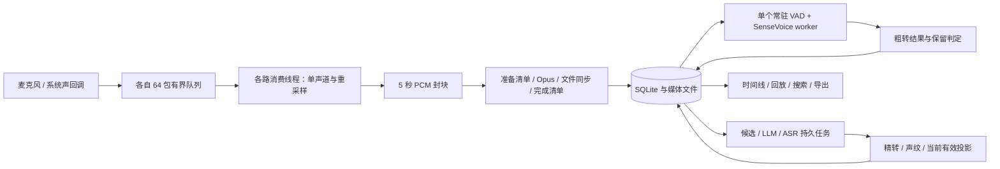
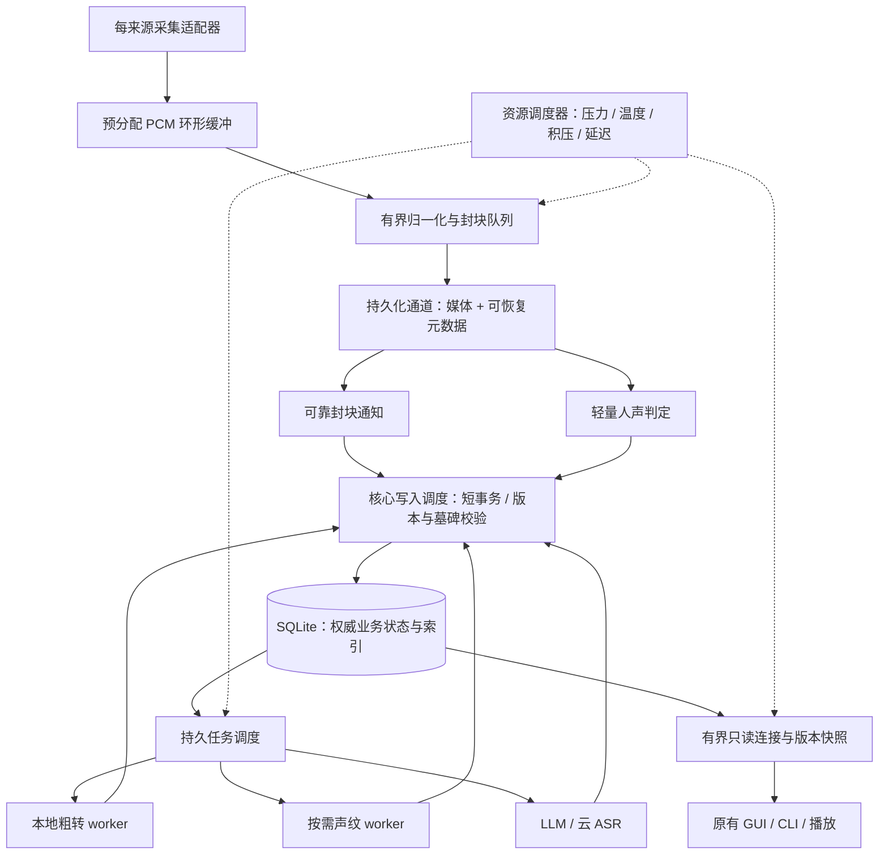

# hear 核心稳定性、有效性与性能优化方案

> 日期：2026-10-16。源码基线：`2c81ebd49601c85d89aa3529555aeddaa98d63f5`，分支 `dev`。
> 目标场景：日常工作中持续记录，事后能够找回、核验和使用。
> 范围：保持现有交互、功能入口、数据语义和用户控制规则，优化底层实现。本报告是架构与优化提案，未实施生产代码改动，也未启动新的录音、云端任务或 24 小时长跑。

## 1. 判断与建议

**下一轮应做一次“持续记录基础设施”的升级。首要目标是：采集和可靠落盘有独立、可预测的运行空间；识别、查询、清理和导出再忙，也不能挤占这条链路。**

当前并非缺少基本架构：独立核心、推理子进程、短音频封块、持久任务、来源与时间映射、版本校验、清理墓碑都有基础。但“模块已经分开”不等于“故障与资源已经隔离”。目前最值得优先解决的是四种耦合：

1. **采集消费线程仍依赖数据库锁、编码和磁盘同步。**线程之外有识别 worker，却没有完全隔离数据库维护和存储长尾对采集的影响。
2. **大量控制与恢复工作随全部历史数据增长。**状态查询反复求和、启动逐文件查表、待处理任务和样本坐标查询缺少对应索引，会让产品越用越重。
3. **人声判定与重型粗转共用串行路径。**粗转变慢时，保留判定也变慢，暂存音频随之堆积；目前没有统一资源调度器协调这些压力。
4. **部分故障的影响范围大于必要范围。**系统声原生接口异常可能结束整个核心；恢复时有全量扫描和阻塞等待；某些临时处理错误会进入终态。

建议顺序是：**先消除已证实的增长成本 → 隔离采集与持久化 → 分离人声判定并治理资源 → 完善故障恢复与质量验收 → 优化读取、播放和云处理吞吐。**不建议先换数据库、全面异步化、增加一堆 worker，或直接更换识别模型。

“超级快”应落实成三件事：**操作迅速响应、内容及时可用、长期使用不退化。**不应以取消持久化同步、漏掉弱声、丢弃积压或缩小识别范围换速度。

## 2. 依据、实测与边界

### 2.1 本轮做了什么

| 证据 | 本轮核查 | 可以得出的结论 |
| --- | --- | --- |
| 源码审查 | 从双路回调、封块、SQLite、VAD/粗转、保留、云队列、声纹、播放、清理、导出一直追到 GUI 刷新 | 可以确认调用顺序、锁范围、数据规模复杂度与已有防护；不能直接推出真实故障率 |
| 本机只读观察 | 只读 schema 与聚合计数，没有读取转录正文、人物资料、音频或密钥 | 当前库有 57,244 条音频块记录，其中 28,471 条带媒体路径，逻辑媒体约 699 MiB；不能把历史失败记录当成本版失败率 |
| SQLite 独立实验 | 34,560 / 100,000 / 1,000,000 行合成数据库，复用源码 SQL，比较索引和计数投影原型 | 可以验证查询随规模增长及消除扫描的收益；不是端到端应用延迟测试 |
| 编码独立实验 | 直接引用未改动的 `media.rs`，release 构建，使用合成 5 秒音调，比较整块输入与逐帧输入 | 可以量化这条编码路径的一项局部优化；不能代表实际双路录音、弱声质量或磁盘压力下的尾延迟 |
| 历史验证 | 核对 Batch 6 阻断看板、算法文档和最近 ASR 修复记录 | 已有短链成功与历史长跑数据，但最新版本的全天可靠性、质量与资源门槛仍未闭环 |
| 官方资料 | Apple 实时音频、内存压力、热状态；SQLite WAL；ONNX Runtime 线程和内存管理 | 支撑机制与方案选择，不能替代 hear 当前版本实测 |

实验机器为 **Apple M5、24 GiB、10 个逻辑 CPU，macOS 26.6.2**。SQL 实验使用 Python 3.14.7 自带 SQLite 3.53.4；产品使用 Rust `rusqlite` 的 bundled SQLite，不能假定二者优化器完全相同。后续开发必须在产品实际链接版本复测。

本轮以仓库源码为主，未使用先前已卸载的旧安装版作为判断依据。现有开发应用与源码也不宣称二进制逐字节一致。正式验收要记录 commit、release 构建、应用签名、模型 hash、OS、机型和数据规模。

可复查材料：[聚合观察](evidence/2026-10-16-reliability/local_aggregate_observation.json)、[SQL 实验代码](evidence/2026-10-16-reliability/sqlite_scaling.py)、[SQL 原始结果与执行计划](evidence/2026-10-16-reliability/sqlite_scaling_results.json)、[编码实验代码](evidence/2026-10-16-reliability/media_seal_bench.rs)、[编码原始结果](evidence/2026-10-16-reliability/media_seal_results.csv)、[复现说明](evidence/2026-10-16-reliability/README.md)。

### 2.2 “24 小时稳定”的准确含义

沿用现有 [PRD](../prd/prd_0.1.md#L36)：电脑已登录、权限可用、用户启用且未主动暂停时持续工作；锁屏、屏幕关闭但电脑未睡眠仍须录制。睡眠、关机和完全退出不承诺采集，醒后依原意图恢复。主动暂停不能被恢复机制覆盖。

因此验收要拆开：

- **24 小时可采集长跑**：双路输入可用、电脑保持清醒、空间足够，实际媒体完整，资源有界。
- **跨一天真实工作流**：包含正常睡眠、唤醒、锁屏、设备变化，缺口真实可解释，恢复符合原意图。
- **长期使用**：30 / 90 / 365 天数据规模下，启动、状态查询、录音和找回不随总历史明显退化。

持续开启不等于无限保留空间，也不等于断电时零尾部损失。10 GiB 音频额度和低磁盘安全暂停仍应保留；应明确最后一次可靠落盘与尚在缓冲中的时间差。

## 3. 现有链路：哪些基础应当保留



值得保留的资产：

- **核心掌握事实，GUI 与 CLI 共享协议。**不要把录音搬进 WebView，也不要让后台 worker 自行改主数据库。
- **短块不可变媒体、写入前准备记录、文件同步后发布。**这是崩溃恢复基础，不应为跑分去掉。[封块](../../crates/loppi-core/src/record.rs#L156)、[媒体写入](../../crates/loppi-core/src/media.rs#L164)
- **零采样静音与 VAD 无人声分开；失败、未完成不直接删除。**这是可靠保留的产品契约。[保留策略](../../crates/loppi-core/src/retention.rs#L22)
- **20 秒主动语音分段、推理独立进程、音频与响应大小边界。**已经解决一部分内存无界问题；不能重新建议一个不存在的“整场 PCM 一次装内存”问题。[worker](../../crates/loppi-worker/src/main.rs#L11)、[ASR 拼接](../../crates/loppi-core/src/events.rs#L3064)
- **云任务先持久化身份、重启查询旧请求、发布前复核版本。**边界变更和清理不能被迟到结果复活。[任务领取](../../crates/loppi-core/src/events.rs#L2138)、[外发与发布](../../crates/loppi-core/src/main.rs#L639)
- **播放已有独立只读连接，导出已经分页处理并另开连接。**优化应扩展已有模式，而不是误判为全部操作都在同一连接完成。[调度](../../crates/loppi-core/src/main.rs#L2260)、[导出](../../crates/loppi-core/src/archive.rs#L293)

现有最核心的架构问题，是这些资产之间仍有阻塞依赖和缺少预算的后台活动，而不是语言、框架或 SQLite 本身选错了。

## 4. 发现与优先级

下面“确认”表示代码或实验可证；“风险”表示存在触发路径，需要压力或故障注入测出实际发生率。

| ID | 发现与用户影响 | 证据强度 | 优先级 |
| --- | --- | --- | --- |
| F01 | 录音消费线程同步等待主库锁、编码和 fsync；拥塞会撑满回调队列并结束该来源 | 调用链确认；当前丢录概率未测 | P0 |
| F02 | 状态循环约每 250 ms 对全部音频块 `sum(bytes)`；无待办时也扫描历史 | 源码、执行计划、合成实测确认 | P0 |
| F03 | 启动恢复遍历媒体目录，每个文件按无索引 `media_path` 查表；全部完成后才启动采集和接收请求 | 源码与执行计划确认；完整启动耗时未测 | P0 |
| F04 | 原生系统声异常可以结束整个 core；supervisor 的串行 `join` 无统一截止时间 | 源码确认；跨路影响和重启行为需真机验证 | P0 |
| F05 | VAD 与粗转串行，保留判定等待完整 worker 结果；重型识别积压也影响空间回收 | 源码确认 | P0 |
| F06 | 没有覆盖 core、推理、声纹、上传、导出和 UI 的统一预算与压力反馈 | 已审查路径未见；现有局部上限不等于整体预算 | P0 |
| F07 | worker 重建只为首次待处理块的来源回放上下文；两路独立恢复与尾句完整性缺少明确契约 | 路径确认；具体丢句需故障夹具验证 | P1，恢复门槛 |
| F08 | 每条声纹观察新起进程并加载模型；临时失败被标为 `unavailable`；全局样例逐条读取计算 | 源码确认；加载成本占比未实测 | P1 |
| F09 | 保留删除任务在持有主库锁时成批删文件并更新；清理碰到最近采集范围会暂停采集 | 源码确认；暂停是已有一致性保护，不能直接删掉 | P1，影响采集时升 P0 |
| F10 | 播放每 5 秒结束后才请求下一段，重复请求、解码和设置音源处于接续路径 | 源码确认；实际听感间隙未测 | P1 |
| F11 | GUI 后台仍每 5 秒刷新上下文；时间线/详情有多次派生查询，短关键词查询不能走 trigram MATCH | 源码确认；大库交互耗时未测 | P1 |
| F12 | 每次云请求新建 HTTP Agent；单条 provider 循环会受慢请求影响；部分响应读取失败不在可重试分类中 | 源码确认；供应商端约束须按接口验证 | P1 |
| F13 | Opus 整块 `push` 对 Vec 头部反复 drain，产生重复搬移和逐帧分配 | 源码与编码实验确认 | P1，小改动 |
| F14 | 现有分钟级资源采样能看趋势，但容易漏短进程与峰值，也不等于真实音频覆盖监测 | 脚本与历史门槛确认 | P0，验收基础 |

### 4.1 F01：采集隔离还差最后一段

麦克风回调中 `collect()`、系统声回调中 `to_vec()` 分配音频包，再 `try_send` 至 64 包队列。后续消费线程完成重采样，积累 5 秒音频，准备清单、编码、文件同步、最终清单写入都在它继续消费下一包之前发生。[麦克风](../../crates/loppi-core/src/microphone.rs#L134)、[系统声回调](../../crates/loppi-core/src/system_audio.rs#L89)、[封块](../../crates/loppi-core/src/record.rs#L156)、[持久化闭包](../../crates/loppi-core/src/main.rs#L898)

这不是“识别直接堵住录音”，而是：

```text
后台长事务 / 文件删除 / 大查询
    → 主库锁等待增长
    → 封块不能完成，消费线程暂停取包
    → 有界队列填满
    → dropped > 0，当前来源停止并重试
```

64 包不是一个可解释的时间或内存预算。若实际回调为 10 ms / 包，它仅容纳约 640 ms；若每包 20 ms，则约 1.28 秒。这里只是容量换算，不是本机实测回调周期。

Apple 明确将音频实时线程中的锁阻塞、内存分配和复杂工作视为可能导致音频故障的操作。因此，`try_send` 不阻塞不能单独证明整个回调满足实时要求，应使用预分配缓冲并实际测量回调截止时间。[Apple 音频性能分析](https://developer.apple.com/documentation/audiotoolbox/analyzing-audio-performance-with-instruments)

### 4.2 F02 / F03：更确定、回报更高的是消除历史扫描

`capture_supervisor` 每次循环调用 `store.state()`，循环末尾休眠 250 ms；`read_state` 每次汇总全体 `audio_blocks.bytes`。每次完成封块的 `storage_available` 又汇总一次。状态 IPC 和部分日志的 revision 读取也会走这条路径。即便用户已暂停，supervisor 仍在运行。[控制循环](../../crates/loppi-core/src/main.rs#L1018)、[容量检查](../../crates/loppi-core/src/main.rs#L3519)、[状态查询](../../crates/loppi-core/src/main.rs#L3997)

此外，当前没有 `audio_blocks(media_path)`、`(session_id, sample_start)` 或针对待分析记录的索引。源码与本机实际 schema 一致。直接后果包括：

- 孤儿媒体恢复对每个文件重复扫描音频块表，整体存在 **文件数 F × 块数 N** 的最坏增长路径。
- 待办领取扫描历史，相关子查询也缺少会话坐标索引。
- 取最近上下文与样本转时间映射需要扫描/排序。

独立实验结果如下。单位为毫秒，9 次暖缓存查询中位数；右列为 100 万行合成库中的索引/计数原型，不是生产改动。

| 操作 | 34,560 行现状 | 100,000 行现状 | 1,000,000 行现状 | 1,000,000 行原型 |
| --- | ---: | ---: | ---: | ---: |
| 汇总全部音频 bytes | 1.040 | 3.239 | 36.341 | 0.0011，读取计数投影 |
| 判断不存在的媒体路径 | 1.284 | 3.926 | 43.129 | 0.0013，路径索引 |
| 取会话最近 6 块上下文 | 3.493 | 5.243 | 36.469 | 0.0048，会话坐标索引 |
| 没有待分析任务时领取一次 | 1.277 | 3.912 | 41.502 | 0.0015，部分索引 |
| 历史末尾只有 1 个待分析任务 | 2.709 | 7.734 | 81.503 | 0.0026，部分索引与会话索引 |

不能据此宣称“产品快了几万倍”：实验没有计入写入维护、业务投影、IPC、UI、真实历史分布和冷缓存。它证明的是：**很多高频操作可以只随待办或当前范围增长，没有必要随全部历史增长。**

启动流程先执行删除恢复、媒体恢复、孤儿扫描等，再启动采集线程和请求接收循环。socket 已创建也不等于服务可用。应把恢复拆为“必须先完成的有限恢复”和“可后台续做的历史巡检”。[启动顺序](../../crates/loppi-core/src/main.rs#L126)、[孤儿扫描](../../crates/loppi-core/src/main.rs#L3229)

还有一项容易漏掉的启动成本：`knowledge::init` 每次执行两条全量 `INSERT OR IGNORE ... SELECT`，从粗转和精转表回填搜索记录。已有触发器承担后续增量更新，这类全量回填应变为版本化、可续跑的一次迁移；“OR IGNORE”避免重复插入，并不会免去遍历原表的成本。[搜索初始化](../../crates/loppi-core/src/knowledge.rs#L149)

### 4.3 F04 / F07：重启能力不等于故障隔离

现有 2/4/8/16/30 秒来源重试、3 秒回调停滞检测、Tap 预检与启动超时值得保留。但仍存在以下边界：

- `SystemAudio::start` 的 Tap 超时，以及 `Drop` 的原生停止失败，会 `process::exit(70)`。这是避免失控采集和悬空回调的保护，却也结束同进程中的麦克风、存储和队列。[系统声生命周期](../../crates/loppi-core/src/system_audio.rs#L174)
- supervisor 对来源线程串行 `join`；线程若卡在不可取消的原生调用或存储操作，另一来源的监督与整个退出过程可能受影响。不能靠普通 Rust 线程“超时后杀线程”解决。[监督循环](../../crates/loppi-core/src/main.rs#L1088)
- 原生 Tap 忽略 `input_time`；CPAL 也没有把输入时间戳传入自己的包，当前采用回调到达时刻减包时长。调度抖动与真实声音时间的偏差需要单独测量，不能只检查数据库时间递增。[Tap 回调](../../crates/loppi-core/native/system_audio_tap.m#L57)、[包定义](../../crates/loppi-core/src/capture.rs#L3)
- 重建本地 worker 时，仅对当前块的来源调用一次 `replay_context`。随后另一来源恢复处理时没有同等回放步骤。共享进程重启必须按每条流分别恢复，而非以进程重建完成为准。[分析循环](../../crates/loppi-core/src/main.rs#L329)
- `started()` 在设备打开后、第一包到来之前设置 active；实际进度需要回调、消费、可靠封块三层心跳证明。现有 UI 可以继续使用原状态，只改判定依据。[录音入口](../../crates/loppi-core/src/record.rs#L305)

### 4.4 F05 / F06：判定、识别与资源治理应各司其职

当前 worker 在 VAD 产出一段语音时立即同步执行 SenseVoice，然后才返回该块的 `speech_active` 和文本；core 在收到完整结果后提交保留判定。两路来源虽然各有 VAD 状态，但共享一个串行请求入口。[worker 处理](../../crates/loppi-worker/src/main.rs#L129)、[发布与保留](../../crates/loppi-core/src/main.rs#L3658)

其影响不是当前必然误删，而是：**复杂识别或某一路很长的语音，会推迟另一来源的检测、粗转和无人声回收。**待办在数据库中，不会把全天 PCM 全装进内存，这是正确的；但磁盘积压、最新内容延迟与模型内存仍需要管理。

历史上 20 秒主动 flush 已明显降低部分长语音资源占用。旧 worker 曾观测 1300.5 MiB 峰值、约 911.8 MiB 平台；后续 10 小时观察的末值约 427.5 MiB，但又观察到 worker 重启。这些属于历史记录，既不能证明当前有泄漏，也不能证明当前已通过全天验收。[Batch 6 看板](../../plan.md#L51)

ONNX Runtime 的 arena 可能保留已申请内存；高平台不自动等于泄漏。需要分别测模型常驻、单次推理峰值、空闲后平台与重复工作负载的增长斜率。共享 allocator、arena shrinkage 和线程 spinning 有官方机制，但当前 sherpa-onnx 1.13.8 Rust 配置并未直接暴露全部能力，不能把最新 ORT 文档中的配置键当作本项目立即可用的开关。[ORT 内存机制](https://onnxruntime.ai/docs/get-started/with-c.html)、[ORT 线程机制](https://onnxruntime.ai/docs/performance/tune-performance/threading.html)

### 4.5 F08 / F12：后台任务有边界，但恢复和吞吐还可改进

声纹每条观察启动 `hear-worker embed` 并创建模型，天然会释放进程内存，但反复支付加载成本。所有提取串行，尚无优先级或闲时复用策略；`worker_timeout` 等临时错误最终进入 `unavailable`，没有与音质不合格区分重试生命周期。[声纹循环](../../crates/loppi-core/src/main.rs#L548)、[错误终态](../../crates/loppi-core/src/knowledge.rs#L1431)

全局人物匹配对每个候选读取全部有效样例并解码向量，且在事务内完成。以当前人数规模无需上向量数据库；应先按 generation 缓存已解码样例、只重算受影响范围，把纯计算移出写事务，发布时重新校验 generation。不能因此降低人工确认优先级或把单句命中扩散到整组。[匹配](../../crates/loppi-core/src/knowledge.rs#L1977)

云端已经有请求大小上限和单 provider 队列，也已有稀疏音频分段与 10 秒 PCM slab，值得保留。问题在于每次重新建连接池、慢请求占用调度机会、读取错误分类不完整、退避没有全局压力感知。例如 `provider_read_failed` 不在 `task_failed` 的 transient 列表，应按“响应未知、查询旧远端 ID、可重试”评估，而非直接制造永久失败。[HTTP](../../crates/loppi-core/src/cloud.rs#L86)、[失败处理](../../crates/loppi-core/src/events.rs#L2368)

### 4.6 F09 / F10 / F11：用户体感也有明确的底层原因

清理已经把重编码准备移出主库锁，并只在清理范围接近录音前沿时暂停采集；不能把它说成“任何清理都停录”。剩余问题是删除队列 `drain_deletions` 一次循环清空任务，并在部分调用点一直持有主库锁，文件系统长尾会被带进采集依赖链。[清理调度](../../crates/loppi-core/src/main.rs#L2306)、[删除队列](../../crates/loppi-core/src/cleanup.rs#L1031)

播放器在当前 5 秒音频触发 `onEnded` 后才获取下一块，随后设置新的 data URL 再播放。即使单块读取很快，链路也没有为接续留提前量。可保持完全相同的播放器交互，增加有界预取与连续调度。[播放器](../../src/DetailDrawer.tsx#L351)、[接续触发](../../src/DetailDrawer.tsx#L702)

GUI 时间线轮询已有前台判断，不能再建议“首次加前台判断”；真正仍需优化的是每 5 秒的全局上下文刷新，以及当前详情逐句计算 revision 的查询成本。CLI 短关键词搜索用 `instr`，若性能不达标，可加辅助候选索引再用原匹配条件复核，不能把“两字搜不到”当作性能优化。[上下文刷新](../../src/App.tsx#L217)、[刷新节奏](../../src/App.tsx#L310)、[详情 revision](../../crates/loppi-core/src/events.rs#L1793)、[搜索](../../crates/loppi-core/src/knowledge.rs#L810)

### 4.7 F13：局部编码优化有收益，但不是主矛盾

`OpusBlock::push` 先把输入追加到 Vec，再每 960 样本从头 drain；录音封块一次传入 240,000 样本，会反复搬移剩余数据。仅计算尾部搬移，约 `960 × (249+…+1) × 4 = 119,520,000` 字节/5 秒块，不等于同等磁盘 IO 或实际 DRAM 流量。[编码](../../crates/loppi-core/src/media.rs#L131)

直接引用生产媒体模块、交替运行两种输入方式，去掉各自第一轮后 15 次中位数：

| 合成 5 秒音频 | 当前整块输入 | 原 writer 逐 960 样本输入 |
| --- | ---: | ---: |
| `push` 编码耗时 | 12.587 ms | 10.895 ms |
| `seal`，含文件和目录同步 | 8.645 ms | 8.644 ms |
| 解码耗时 | 2.554 ms | 2.545 ms |
| 文件大小 / 解码样本数 | 30,864 字节 / 240,000 | 30,864 字节 / 240,000 |

这支持移除头部搬移、复用固定帧缓冲，**不支持声称整体性能倍增**。ASR 拼接目前已经逐 960 样本调用，不应重复改造。同步耗时有必要保留并隔离，不能因 8 ms 就取消可靠落盘。

## 5. 推荐目标架构

### 5.1 保持一个事实核心，划清三个运行边界



**边界一：声音进入到可靠封块。**只做采集必需的工作，有固定容量、明确截止时间，不依赖复杂查询和模型。
**边界二：事实落库与结果发布。**核心仍负责唯一业务真相，事务短、可重放、可校验。
**边界三：可延后的计算与读取。**模型、云处理和维护按资源预算推进，过载时排队，不通过占满 RAM 追赶。

无需引入 Kafka、Redis、独立数据库服务或微服务框架。现有 Rust 模块、SQLite 和少量受监督子进程足够。

### 5.2 采集与持久化具体如何改

1. **预分配回调缓冲。**每路建立按样本数、字节数和可缓冲时长限定的 SPSC 队列；回调仅复制输入、写元数据和更新计数。格式变化先切代次，控制面重新分配；不在音频回调里创建模型、查表、日志格式化或重新分配大缓冲。SPSC 必须满足实际“一生产者一消费者”的线程约束。[Apple 无锁队列说明](https://developer.apple.com/documentation/coremedia/cmsimplequeue-api)
2. **归一化与可靠封块分开。**消费回调的线程不再同步等主库。封块队列建议先以每路最多 2 块为起点，监测最老块年龄。不能只把队列无限放大。
3. **消除等数据库才能继续录音的条件。**先落地索引与短事务，再引入可恢复的媒体元数据记录：至少包含块 ID、来源、session、采集代次、时钟锚、样本位置、真实样本数、路径、格式和完整性信息。持久化 owner 完成媒体与该记录的同步，才发可靠封块通知；核心异步归入数据库。
4. **避免双重事实。**这份记录只解决文件与数据库提交间的恢复窗口，属于核心管理的 ingestion journal，不是第二套可独立编辑的业务库。重复导入以块 ID 幂等，媒体不可变；逻辑事件、人工修订和保留决策仍以核心数据库为准。
5. **发布前检查删除边界。**journal 回放、迟到封块和重启任务都校验 generation 与清理墓碑；不得把已清理范围重新导入。清理临近采集前沿时，先做精确范围屏障，再用可证明的代次切换取代长时间全局暂停。
6. **可靠性定义明确。**正常磁盘条件下，目标是最老未可靠封块音频不超过约 6 秒。缓冲排队与磁盘长尾必须计入，不可只用“块长 5 秒”声称崩溃最多丢 5 秒。已确认块需要通过崩溃恢复测试；断电语义另测，不能等同普通进程退出。
7. **缓存容量有单位。**例如 48 kHz 单声道 float32 的 2 秒原始音频约 375 KiB；实际输入可能高采样率或双声道，必须按输入格式预留，不能把此数值当作所有设备的固定 RAM 上限。

整个改造不改变用户开始、暂停、来源选择、时间线或音频文件对外行为。暂停完成、数据清理完成仍须具有真实含义，不能提前返回一个成功状态而继续后台采集或恢复已删除数据。

### 5.3 数据库与恢复：先做确定收益，再拆连接

**第一步，补访问路径。**候选索引如下，先在真实查询计划和写入负载中验证，再进入迁移：

```sql
CREATE INDEX audio_blocks_media_path
ON audio_blocks(media_path) WHERE media_path IS NOT NULL;

CREATE INDEX audio_blocks_session_sample
ON audio_blocks(session_id, sample_start);

CREATE INDEX audio_blocks_pending
ON audio_blocks(started_ms, id)
WHERE analysis_state='pending'
  AND analysis_attempts<3 AND media_path IS NOT NULL;
```

这些只是本轮实验验证过的起点，不是让每列都加索引。`media_path` 是否可设 UNIQUE 要先审核旧数据、清理重写和迁移过程，不直接假定。

同时确认实际产品构建中 SQLite 的版本、编译选项与查询计划；合成实验所用的 Python SQLite 只能提供方向证据。索引创建有一次性 IO 与锁成本，大库升级要有恢复点和失败重试，不能把迁移本身放到正在封块的线程里。

**第二步，把状态从历史聚合变成增量投影。**维护容量计数，随新增、恢复、清理、删除完成在同一事务更新；控制循环读取常量规模的状态快照。低频分批对账负责发现漂移，不能每次读状态都重扫历史。

容量至少分开：已登记媒体、已可靠封块但未归库、待物理删除、孤儿媒体、临时处理文件。当前逻辑 bytes 清零早于物理删除成功，只看 `sum(audio_blocks.bytes)` 会低估实际空间压力。空间额度仍按原产品规则，资源治理内部需有预留与实际占用口径。

**第三步，缩短写入临界区。**保留一个核心写入调度 owner，给采集元数据和用户控制保留服务机会；模型计算、音频解码、文件删除、导出 IO 不在主库锁中做。低优先级写工作按批次和耗时让出，不要把一笔必须原子的业务变更随意拆散。

读连接使用有限池或固定读线程，短快照、超时和取消，避免打开一个连接就长时间占住读事务。沿用播放已有只读模式；导出业务记录仍经核心写入边界管理。连接分开不能解除 SQLite 同时只有一个 writer 的限制。[SQLite WAL](https://www.sqlite.org/wal.html)

**第四步，分层启动。**必须先修复未完成封块、打开会话、当前清理屏障和任务领取状态；历史孤儿扫描、物理垃圾回收、完整性巡检改成有界批次和持久游标。后台扫描期间，新封块、清理和恢复必须能安全并发；“先服务”不能靠忽略未完成删除实现。

搜索回填等历史迁移单独记版本；候选重建保留当前增量游标，但迟到粗转可能把游标推回较早历史，追赶要分批并保持跨窗事件延续语义。[候选刷新](../../crates/loppi-core/src/events.rs#L433)

**第五步，测 WAL 后再调。**设置可观测的 WAL 大小、checkpoint 耗时和最老读事务；必要时用独立维护连接做 PASSIVE checkpoint，低负载时再尝试收缩。不能在采集热路径强制 TRUNCATE，也不应直接关闭自动 checkpoint 却没有替代调度。WAL 默认 checkpoint 可能由触发提交的线程执行；降低 `synchronous` 会改变掉电耐久性，本文不建议以此换跑分。[SQLite checkpoint 与耐久性](https://www.sqlite.org/wal.html)

### 5.4 人声判定与粗转分开，但不改变保留标准

建议把轻量 VAD 作为优先级高、顺序明确的独立处理通道；SenseVoice 从持久语音片段队列取任务。

- VAD 继续使用已经选定的模型与待验证阈值；每个来源、session、generation 各自维护时序。
- 检测结果先发布：确定的人声区间、尚未闭合区间、确定无人声区间。未闭合的跨块语音必须继续保护，不能因为块尾暂时无语音就提前删掉句首。
- “无人声可删”的条件不再依赖粗转是否成功；“有语音但无文字”仍必须保留。
- 粗转失败只影响文字加工，不回写为无人声。VAD 异常进入待处理/失败保留，空间不足依已有规则暂停并说明。
- 粗转领取支持来源公平与最新内容时效，但同一语音流的 VAD 必须顺序消费。不能把正在维护连续状态的同一来源块任意并行分发。
- 重建 worker 时，每个来源独立恢复连续上下文；结果有稳定的任务与片段身份，重复回放不重复发布。20 秒硬上限保留，句首、句尾和跨分段文字必须回归。

分离优先级不等于必然多开两个大模型进程。VAD 独立轻量通道和最多一个重型粗转进程是合理起点；进程边界与参数通过资源数据决定。

### 5.5 原生采集的故障域

建议先把来源 lifecycle 状态机、停止截止时间、心跳和重试规则整理清楚，然后**优先把不可取消的系统声原生调用移入受监督采集子进程**。麦克风是否也独立进程，依据原生阻塞与两路隔离实测决定。

这样，系统声卡死时可以终止该来源的进程，保留麦克风与核心业务。它比在核心中直接 `exit(70)` 更符合“单路故障不影响另一路”的目标，也比在进程内强杀线程安全。

这项改造必须重新验证签名包、父子应用权限归属、登录项、退出后的子进程清理、单实例排他、旧代次数据拒收、macOS 13 fallback 和 14.2+ Tap 路径。不能只在终端中跑通就合并；也不能顺手把最低系统版本抬到 26。[现有最低版本](../../src-tauri/native/HearCore-Info.plist#L12)

重试采用“明确系统事件触发的即时重连 + 有上限退避 + 稳定后重置”，同时统计恢复时间和真实媒体缺口。完整 core 的异常退出是否会被当前 SMAppService 登录项可靠拉起，要用最终包独立验证，不能从代码注释推定 launchd 的重启承诺。

## 6. 动态资源控制

### 6.1 调度的依据

增加一个核心内部 ResourceGovernor，输出各类工作的准入和并发预算，而不是让每个循环自行 sleep。至少输入：

- 每路回调/消费/可靠封块进度、缓冲使用量、最老未封块年龄。
- 各进程物理内存足迹、最近峰值、模型忙闲；进程树中属于本应用的 UI/WebView 子进程也要统计。
- OS 内存压力、thermal state、低电量模式、电源状态。
- VAD/粗转待办音频秒数、最老任务年龄、近期处理速度、磁盘剩余和待删除 bytes。
- 用户交互请求延迟、写入排队延迟、云端错误与限流。

macOS 提供内存压力事件和热状态信号，可用于主动调度；不要仅凭“还剩多少空闲内存”判断是否安全。[Apple memory pressure](https://developer.apple.com/documentation/dispatch/dispatchsourcememorypressure)、[Apple thermalState](https://developer.apple.com/documentation/foundation/processinfo/thermalstate-swift.property)

### 6.2 四档内部策略

以下是初始设计，不增加设置入口；进入/退出阈值在基线测试后冻结。

| 状态 | 触发示例 | 采集与人声判定 | 重型计算 / 维护 |
| --- | --- | --- | --- |
| 正常 | 压力正常，队列低，温度正常 | 固定优先级持续处理 | 单粗转；声纹按需复用；云队列受限并发 |
| 受压 | 缓冲升高、内存 warning、温度升高、交互延迟超标 | 保留采集与可靠封块资源，优先赶上 VAD | 暂停新声纹/大导出，限制重型任务准入，缩小可重建缓存 |
| 严重 | 内存 critical、温度 serious/critical、持久化明显落后 | 继续采集到安全容量；不能靠丢音频消压 | 在可恢复边界卸载重型模型，停止启动新重任务；必要时中断超预算 worker 并持久延期 |
| 恢复 / 追赶 | 压力持续降低且采集健康 | 先确认采集稳定 | 逐级恢复，限制追赶占用，避免一次放开所有任务 |

采用滞回，例如持续 10 秒受压进入降载、连续 60 秒健康再逐级恢复；critical 信号立即响应。这些时间属于待测初值。低电量/电池模式优先影响可延后处理，不擅自暂停用户已开启的录音，也不改变人声保存规则。

必须有公平性与最长等待监测。永远把历史任务压在队尾，只能让当前看起来快，不能算完成了功能。

### 6.3 建议内存预算

这些是**待验证的工程目标，不是当前性能事实或已保证的产品参数**。先建立 8 GiB 和 ≥16 GiB 两档；本机 24 GiB 不能代表低配机。

| 范围 | 初始软预算 | 超额策略 |
| --- | ---: | --- |
| core：控制、SQLite、采集缓冲、轻量 VAD | 128–192 MiB | 先定位持续增长；减缓存和非关键工作，不能靠反复重启录音 core 掩盖泄漏 |
| 单本地粗转进程 | 约 512 MiB；约 768 MiB 作为初始严重水位 | 限输入、观测峰值、空闲边界回收；若单任务必须超额，先优化模型运行方式再冻结上限 |
| 声纹进程 | 约 128–256 MiB，实际以冷启动峰值确认 | 最多一个，短批次复用，空闲 30–60 秒释放；受压不启动 |
| PCM、解码与播放缓存 | 逐项配置，合计先控制在 32–64 MiB 内 | 按字节而非条数淘汰；临时大对象准入前预留 |
| 后台总量，8 GiB 设备 | 软目标 768 MiB；严重水位 1 GiB | 重型工作互斥/延期，不默认同时驻留所有模型 |
| 后台总量，≥16 GiB 设备 | 软目标 1 GiB；严重水位 1.5 GiB | 额外内存优先换稳定余量，不默认扩大并发 |
| GUI 与其专属 WebView 进程 | 单独建立前台/后台预算，初始观察目标 256–384 MiB | 图片缓存、播放预取有界；后台停止不必要数据刷新 |

表中各模块预算不是允许同时相加到总预算之外。ResourceGovernor 按当前驻留与预计峰值做准入；预取、base64、HTTP JSON、解码 PCM 同时存在时要一起计费。软件水位也不是 OS 强制的绝对上限：单次分配可能先于采样发生，因此还需要输入上限和最坏峰值测量。

ORT 配置优化优先 A/B 测试 1/2 个推理线程、实际可用的 spinning 配置和空闲释放；只有证明收益超过维护成本，才考虑扩展 sherpa 绑定或更换执行后端。CPU、CoreML/ANE/GPU 路径的模型支持、拷贝成本和识别差异须分别验证，不能默认硬件加速更省电。

### 6.4 积压不能只靠“加大队列”解决

以“来源音频秒”为单位计算：双路全天输入速度 `λ = 2 音频秒 / 墙钟秒`。若单 worker 每 1 秒音频需要 `r` 秒处理，则理想服务率 `μ = 1/r`；双路稳定要求 `μ > 2`，即 `r < 0.5`，还要预留重启、磁盘和其他负载的余量。

建议正常模式的处理容量至少留约 30%–50% 余量，再用实测冻结。模型线程数变化时，要同时看墙钟处理率与 CPU 成本，不能把二者混为一谈。

积压 `B` 的追赶时间约为 `B / (μ - λ)`。例如积压 3,600 来源音频秒、持续输入为 2、服务率为 4，仍需约 30 分钟追平。不能承诺在固定低 CPU 下任何积压都瞬间消失。

粗转/VAD 队列按音频秒、磁盘 bytes、最老年龄设监测；云端按任务数、请求大小、付费请求身份与供应商限流控制。后台 task 的“因资源暂停”不能消耗失败重试次数，防止一次内存压力耗尽三次本地尝试。

### 6.5 磁盘与元数据的长期预算

在两路都持续产生 5 秒块、没有删除元数据的估算下：

- 34,560 条块记录/天；约 103.7 万条/月；约 1,261 万条/年。数字静音不产生音频文件，但当前仍生成块记录。
- 两路均以 48 kbps 持续保留，编码载荷约 1.04 GB/天，约 0.97 GiB/天，另有容器与文件系统开销。默认 10 GiB 不可能无限维持；实际取决于人声比例和用户清理。
- 两路 48 kHz float32 PCM 若全天堆在内存约 30.9 GiB；采用固定短缓冲应让这一部分与录音时长无关。

因此第一阶段解决索引、计数与分批恢复；第二阶段测 90/365 天规模再决定是否压缩连续静音元数据、按日期分目录或把冷媒体打包。不能先做全量媒体格式迁移：现有路径验证、清理裁切、导出和恢复都依赖单块文件，贸然改格式扩大风险。

原声音频配额之外，还需监测 DB、WAL、截图、临时导出和垃圾回收滞留，保留磁盘应急空间。不得为了达标默默清掉历史人声。

## 7. 有效性：优化不能让结果更差

“录到了”至少有四层：采样进入、可恢复保存、该保留的人声确实留下、事后能正确定位。文本出现不是唯一证据，识别准确也不能弥补原声丢失。

| 层次 | 验收重点 | 应使用的证据 |
| --- | --- | --- |
| 采集完整性 | 每路有效声音覆盖、丢包、无解释缺口、句首句尾 | 已知标记音 + 已标注语音；独立参考时间；解码后的真实媒体 |
| 人声保留 | 弱声、远场、短句、连续句、噪音中的人声不能误删 | 按场景分层的留出集，语音时长召回与整段误删事件；不能仅看平均 VAD 分数 |
| 文字可用 | 粗转/精转质量、时间锚定、无音频处不造时间 | 中文 CER、混合语言分层、句段起止偏差、跨 20 秒/5 秒边界测试 |
| 人物与整理 | 错名率、漏认率、同场误并/误拆、人工修正不被覆盖 | 逐句人工标注；按来源/设备拆分；不能只比较最终人数 |
| 数据一致性 | 重试、重转、改边界、清理后不重复、不复活、不丢人工修正 | 状态机与故障夹具、当前有效投影、导出内容对照 |

性能改造的第一轮原则是**同输入、同模型、同产品策略，结果不退化**。若改变 VAD 分段、重采样持续状态或模型后端，必须做质量非劣比较；不把“吞吐更高”当作可直接发布的理由。

保留策略尤其需要独立门槛：把数据集分成调参集与留出验收集，覆盖耳机/外放、麦克风/系统声、弱声/噪音、双路重叠与空白识别。建议至少 500 个标注片段、累计 10 小时作为第一轮质量集起点，再根据失败分布补样；数量本身不代表统计充分。整段可辨识语音被删除应作为阻断项，场景召回率和置信区间另报。

本轮不调整人物匹配阈值，不因提速减少识别来源，不改“有声无字仍保留”，不自动把按需操作扩展为更多云端外发。

## 8. 性能与可靠性验收目标

以下为建议验收草案，先在最终 release 包建立基线，再冻结；不是当前达成值。分别测当前 M5 与最低支持设备，不能拿开发模式结果代表发布包。

| 指标 | 建议目标 / 判定方式 |
| --- | --- |
| 正常 24h 双路采集 | 无来源意外退出、无无法解释的媒体缺口、无 callback overflow；已知参考声音逐段核验；不能用“自动恢复了”抵消正常场景丢录 |
| 实时回调 | 无堆分配、无业务锁/IO；P99.9 耗时小于实际回调周期的 10%；记录最大值与 deadline miss |
| 可靠封块年龄 | 正常磁盘负载下 P99 ≤6 秒；另报 fsync 与队列最坏值；磁盘故障单列，不能剔除后宣称普遍零丢失 |
| 已确认块恢复 | 进程崩溃后无确认块丢失、无重复导入、无已清理范围复活；断电/强制重启另设测试 |
| 设备恢复 | 设备重新可用后，初始目标 P95 ≤5 秒、P99 ≤15 秒；原生超时等极端路径目标 ≤30 秒；用真实媒体恢复时刻计时 |
| 单路故障隔离 | 系统声挂起、重启、权限失败时，麦克风继续记录；反向同样测；不能仅核对两条线程仍在 |
| 暂停与恢复控制 | 请求接受 P95 ≤100 ms；正常停止采集与封尾目标 ≤2 秒；卡死来源按受控终止机制结束，主动暂停不可被自动重试覆盖 |
| 状态 / 时间线 / 详情 | 状态 P95 ≤50 ms；典型日时间线 P95 ≤150 ms；100 句详情 P95 ≤200 ms；另测 100 万/1,000 万块历史规模 |
| 播放 | 首声 P95 ≤200 ms；连续片段接续没有实现造成的可闻中断；真实素材缺口照实保留 |
| 本地粗转 | 在已完成语句上，句尾至文字可见 P95 初始目标 ≤10 秒；长连续语音按约 20 秒分段，更新目标 ≤25 秒；分别测排队与推理耗时 |
| 云处理 | 分开报告“候选等待、排队、拼音频、上传、供应商处理、拉取、发布”；本地可处理任务入调度 P95 ≤2 秒；不对外部服务承诺统一秒级完成 |
| 内存 | 24h 不越过冻结后的预算；预热后重复负载的空闲平台与活跃峰值无持续正向增长；同时报告每进程与应用总量 |
| 积压 | 正常负载下最老任务年龄不持续增长；降载后按实测 μ−λ 给出恢复曲线；pending/failed 必须可区分 |
| 启动 | 当前基准库服务可查询目标 ≤1 秒，已满足前置条件时恢复采集目标 ≤3 秒；百万/千万历史块不要求等待全库巡检，首次迁移单列 |
| 功耗 | 无语音、连续语音、前台播放、后台闲置分别测 CPU/能耗；初始目标为明显降低空闲轮询成本，不能在未测基线前承诺固定百分比降幅 |

注意：当前事件候选本身有静默切分与最长计算窗口规则，精转也受供应商处理时间影响。保持交互与产品行为不变，就不应靠修改事件形成规则伪造更短延迟；应先缩短满足原条件后的等待和处理成本。

24 小时一次成功也不是统计意义上的永不故障证明。可以把“多个代表场景的 24h 无阻断 + 更长连续运行 + 故障矩阵通过”作为发布证据，并持续记录真实运行指标。

## 9. 验证方案：先短测定位，再长跑证实

### 9.1 四层验证

1. **算法与状态机**：用合成音频、固定时间和模拟任务验证边界；不依赖真实录音才能查到数据库或幂等错误。
2. **组件压力**：编码、持久化、SQLite、worker、播放分别测时间、内存和资源释放；明确暖/冷缓存与构建版本。
3. **签名包真机组合态**：权限、设备、锁屏、关屏、睡眠/唤醒、进程隔离必须用最终包。GUI/CLI 保持同一行为。
4. **长期验收**：先 2 小时无故障，再 8 小时工作负载，再多个 24 小时样本，最后 72 小时验证趋势；每层发现问题先修复，不靠重复相同长跑等待偶然通过。

### 9.2 必须覆盖的故障矩阵

| 注入点 | 必查结果 |
| --- | --- |
| 双路同时持续讲话；一侧静音/另一侧短句 | 公平性、VAD 时序、短句不被重任务饿死 |
| 录音中大量查询、10 万行导出、成批清理 | 采集不等待业务长操作；删除范围与导出结果仍一致 |
| 慢磁盘、fsync 延迟、磁盘额度/剩余空间触线 | 缓冲有界、压力先降后台任务、真实安全暂停、无伪成功 |
| 在 preparing / rename / 可靠记录 / DB 归库各节点 kill | 逐步恢复、已确认块不丢、重复处理幂等、遗留文件可核算 |
| worker 挂起、崩溃、模型加载失败、内存峰值 | 捕获继续；每路上下文恢复；资源暂停不耗尽失败重试；无重复句段 |
| 系统声 HAL 卡住、麦克风路由改变、蓝牙反复连接 | 限时恢复、另一路不受牵连、时间坐标与真实声音一致 |
| 网络断开 30 分钟、响应丢失、429/5xx、慢响应体 | 查询既有请求身份、无盲目重复付费提交、重试公平、积压恢复 |
| 清理与结果回传/回放/导出/封块并发 | 迟到结果无法恢复已删内容；旧 generation 不得发布 |
| 墙钟调整、跨午夜、睡眠唤醒、锁屏、关闭显示器 | 样本时间不倒退；可解释缺口；用户暂停意图不被覆盖 |
| 内存压力与高热状态后解除 | 有界降载、滞回恢复、无模型反复装卸风暴、积压可以追平 |

### 9.3 采样与证据

复用现有 [资源采样](../../scripts/measure_macos.sh) 和 [报告工具](../../scripts/report_macos_resources.py)，补齐：

- 正常 1 秒资源采样，峰值实验短时 100–250 ms；长期汇总降采样，避免日志自己无界增长。
- 全部受监督进程的创建/退出/重启、失败原因与父子关系；分钟采样会漏掉每句新建的声纹进程。
- `callback_frames / dropped_frames / ring_high_water / last_consumed / last_durable`，以及锁等待、事务、封块、checkpoint 的直方图。
- VAD 与粗转的队列音频秒数、任务年龄、输入长度、处理时间和峰值；日志不记音频或转录正文。
- 真实参考声音的覆盖与误删审计。已知 tone 可证明采集和时间，不能代替人声保留与文本质量测试。
- 每次切换或重启标记构建/模型版本；同一幅内存图中不同 PID 不能拼成一条“持续下降”曲线。

CoreAudio/CPAL 实时回调与 ScreenCaptureKit 的样本交付队列分别测量；后者不应被误当成相同的硬实时执行环境。采样器自身的 CPU、写盘和缓冲也必须有上限。

长跑输出应包括一页验收结论、资源曲线、媒体覆盖核查、故障恢复表、质量差异与原始机器可读数据。本报告没有执行这些长跑，也不把本轮小实验写成已通过。

## 10. 交付顺序与每步完成条件

### 阶段 A：消除已确认的增长成本，建立基线

**优先级 P0，最先做。**

- 加入已验证的路径/会话/待办索引；增量容量投影与对账；控制状态快照；删除任务分批并移出主库长锁。
- 加锁等待、持久化延迟、队列年龄、内存与重启监测；补 release 基准，区分当前库与规模库。
- 编码移除头部搬移与不必要分配，保留同步与文件格式；HTTP 连接复用作为小范围配套。

完成条件：百万行高频控制/领取操作不再扫描整个历史；采集元数据写入临界区可测且有上界目标；旧数据迁移与容量一致性验证通过；相同音频结果无退化。

### 阶段 B：让采集与持久化独立承受压力

**优先级 P0，24h 的结构前提。**

- 预分配回调缓冲、采集消费与编码落盘拆开、有界队列和三层心跳。
- 引入最小可恢复元数据与幂等导入，分层启动，保持删除与版本屏障。
- 明确来源生命周期与停止截止时间；系统声故障域抽取完成签名包纵向验证后，再进入主链路。

完成条件：数据库重读/清理/导出压力不制造采集缺口；注入进程崩溃可恢复；单路原生故障不拖停另一路；普通暂停与退出真实停止。

### 阶段 C：资源治理与分析解耦

**优先级 P0 / P1，是全天内存与积压可控的关键。**

- VAD 与粗转分离，按来源恢复，保持保留语义和时间轴。
- 统一资源准入、压力降载、任务延期与公平追赶；冻结机器分档预算。
- 声纹短批次复用/空闲退出；区分临时失败和不可处理；纯匹配计算移出写事务。
- 把超时改为贯穿一次操作的绝对 deadline；当前分析 stdin、响应长度、响应体分别给 30 秒，不能将其理解为整次操作最多 30 秒。[分析 IPC](../../crates/loppi-core/src/analysis.rs#L93)

完成条件：模型慢/挂/超预算时采集持续，内存稳定，VAD 与粗转都可恢复，受压后的积压有可解释且足够的追赶速度，留出质量集不退化。

### 阶段 D：读取与播放提速，关闭长时验收

**优先级 P1；长跑验收是发布门槛。**

- 有界读连接、事务版本快照、批量 revision 计算、按版本失效的当前页投影缓存。
- 播放提前 1–2 块预取，按真实样本时间连续调度；切来源、seek、删除和关闭详情时立即失效，禁止把全天音频缓存到 WebView。
- GUI 上下文刷新合并、无重叠请求、后台降频/事件通知；必要时保留低频兜底，不变更现有页面。
- 云调度统一 deadline、错误归类、退避与限流；并发由基线决定。不能简单给当前 provider 大锁换成并发执行而破坏配置切换和清理屏障。
- 完成 2h → 8h → 24h → 72h 与 30/90/365 天规模验证；记录未达到的机器和场景，不把单台 M5 结果推广到全部支持设备。

完成条件：上一节冻结的指标通过，GUI/CLI 交互与结果一致，最新签名包具备媒体、资源和质量证据。公证与安装分发继续遵循既有发行门槛，不混入性能改造的实现范围。

### 变更与回退规则

每阶段按独立可验收的交付闭环实施。数据库先用可回退的添加式迁移；容量投影可影子对账，但正式状态只有一个权威。采集新旧路径不得同时录同一来源；切换前确认上一代退出。任务、VAD 与处理策略版本化，拒绝不兼容旧结果。

音频 journal 和新的保留状态一旦引入，旧版本是否能正确理解要明确检查；不能只回退二进制而让旧代码扫描、删除新格式文件。发生任何原声误删、未解释缺口、人工修订丢失或清理数据复活，立即停止放量并修复根因。

在缺少低配机、最终采集子进程权限验证和质量基线前，不给精确日历工期。A 属于收益确定、风险较低的局部改造；B/C 是主要工程投入；D 的长跑至少需要真实时间窗口。应先做 A，同时用短实验验证 B 的权限与故障隔离，再形成原子开发 PRD。

## 11. 本轮不建议投入的方向

| 方向 | 暂不优先的原因 |
| --- | --- |
| 换 PostgreSQL / 向量数据库 / 全量服务化 | 当前主要瓶颈是扫描、临界区和调度，增加服务会提高安装、运维和故障复杂度 |
| 全面迁移 Tokio、追求“全异步” | 异步 IO 不能让原生音频调用可取消，也不能消除长事务和 CPU 推理成本；只在有收益的网络/调度边界使用 |
| 直接加到多路粗转并发 | 容易放大模型内存、热量与线程竞争；先证明吞吐瓶颈与预算，且不破坏每路 VAD 顺序 |
| 用更激进 VAD、降采样或少保留来省资源 | 涉及有效性与保留契约，需要独立质量收益证据，不能作为这一轮捷径 |
| 固定每小时重启整个 core | 掩盖资源问题，主动制造采集恢复窗口；应在安全边界回收可重放 worker |
| 直接缩短事件窗口、增加云端精转 | 会改变现有产品行为、花费和结果，超出“不改变交互功能”的本轮边界 |
| 先把全部历史媒体重打包 | 迁移范围和清理复杂度太大；先解决索引、扫描和目录恢复，再用规模测试决定必要性 |

## 12. 决策建议

建议将下一轮定义为：**在现有产品功能与交互上，交付可验证的全天记录内核。**

立项重点按顺序锁定：

1. **P0：采集不被历史数据和后台维护拖慢。**先做索引、增量状态与短事务，获得立即可测的改善。
2. **P0：采集、可靠落盘、来源故障彼此有明确边界。**解决实际丢录和恢复扩大化的结构风险。
3. **P0：人声判定及时、资源有预算、积压可恢复。**使“持续开启”不依赖无限内存和磁盘。
4. **P1：保持识别有效性，提升读取、播放和处理速度。**让用户事后找回时确实能快而准确地用起来。
5. **发布门槛：最终包完成真实 24h 与长期规模验收。**没有媒体覆盖、故障恢复和质量证据，就不能只凭一条平稳内存曲线宣布完成。

这轮最重要的交付不应是一份“做了很多重构”的清单，而应是：**同样的使用方式下，用户可以放心一直开着，声音留下来，结果能找回，电脑负担可预测。**
