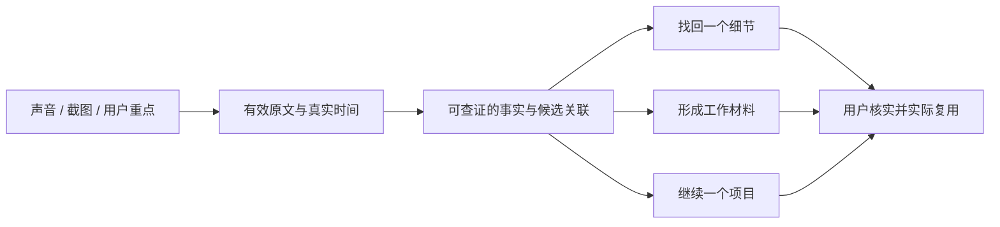

# hear 下一步：让持续声音记录成为可以继续工作的上下文

研究日期：**2026-10-23（Asia/Shanghai）**。定位：产品方向研究与建议，**不是已经收敛或获准开发的 PRD**。

后续讨论已明确优先「团队管理、项目推进与复盘」，并进一步强调用户不主动操作时的自动价值。对应的[场景化深度分析](2026-10-23-hear-scenario-intelligence.md)建议优先验证“项目变化、本人需要介入的事项、下次沟通与复盘的续接材料”。下文保留首轮较通用的方向判断；具体管理场景以新分析为准。

## 先给判断

**hear 值得走向“有依据的工作记忆”：让用户不必提前决定录什么，也能在需要时找回事实、产出工作材料、接着推进同一件事。**

“24 小时录音”解决的是遗漏输入；下一步应该减少用户寻找、筛选、核实和重新讲背景的工作。录音多、摘要多、聊天轮数多，都不能直接证明价值增加。

我建议围绕三个场景投入，按下面的顺序验证：

1. **讨论之后，直接得到可以继续工作的交接稿。** 从一次真实讨论整理出已决定、未决定、明确承诺、约束和来源，复制到用户正在写的文档或正在使用的 AI。这是我建议的首个完整产品切口。
2. **忘记细节时，有依据地找回来。** 支持按意思、人物和时间找回原话，短答案直接连到文字与原声。它既是独立价值，也为长期记忆建立信任。
3. **隔几天继续一个项目时，知道事情变到了哪里。** 聚合跨次讨论，呈现新增决定、被推翻的约束和仍待确认的问题。它最能发挥连续采集的优势，但需要跨日证据验证。

明确承诺的确认清单、少量个人输出格式、会前人物回顾，可以围绕这三件事发展。当前不建议把泛化“人生教练”、长篇全天日报、大型模板市场或自动执行所有事情作为主线。

这个排序是**基于公开证据和 hear 当前能力的产品判断**，不是用户行为数据已经验证的结论。如果早期用户真正频繁发生的是“忘了找一句话”，而非“讨论后要交付材料”，应让第二项先行；下面给出了验证和改判条件。

## 资料导航与研究边界

| 材料 | 内容 |
|---|---|
| [Plaud 深度材料](2026-10-23-hear-context-consumption/plaud.md) | 25 项核心来源；4.0 与旧版区别、LLM 工作流、具体用户产物与反例 |
| [心力球深度材料](2026-10-23-hear-context-consumption/xinliqiu.md) | 12 项来源账本，含降权/不可读材料；先行者状态、真实使用、界面核对及未知项 |
| [Granola 深度材料](2026-10-23-hear-context-consumption/granola.md) | 22 项来源登记；笔记、Chat、Briefs、跟进、MCP 与用户体验 |
| [hear 能力基线](2026-10-23-hear-context-consumption/hear-baseline.md) | 当前代码与交付记录；哪些已有、哪些缺失、历史文档冲突 |
| [邻近产品补充](2026-10-23-hear-context-consumption/adjacent-products.md) | Omi、Screenpipe、Limitless；检验差异化和长期记忆失败路径 |
| [方法与验证计划](2026-10-23-hear-context-consumption/method-and-validation.md) | 证据口径、偏差、候选实验、指标及停止条件 |

本次查阅官方帮助/更新记录、独立长评、Reddit、HN、App Store 及中文公开社媒，并对心力球媒体实图做了核对。**没有购买或登录三款产品实测**；官方已文档化、作者自述、厂商演示和我们的推断严格分开。没有用转载数量、赞数或模板数量推断使用频率。小红书、部分视频/公众号内容无法完整读取，已把失败路径和原链记录下来。

## 1. 从 hear 的真实起点出发

hear 现在已经有一组很适合构建消费层的材料：麦克风与电脑声音双路采集、真实时间线、事件归组、精转、人物、Mark、评论、主动截图理解，以及可以回听的原声。

但有三处断点：

- **普通用户还没有直接搜索入口。** Core/CLI 已有关键词、时间、人物搜索，GUI 主要依靠日期和事件浏览；它不是现成的语义问答。
- **现有摘要主要服务浏览。** 已实现的事件短摘要来自粗转，没有等同于基于当前精转、人工修正和具体证据的决定/承诺提取。
- **能导出存档，不等于能继续工作。** 目前的范围归档包含结构化数据和可选媒体，但用户仍要选材、解释背景、重写成别人或另一个 AI 能接手的材料。

以上已对当前代码核验，详见[能力基线与源码入口](2026-10-23-hear-context-consumption/hear-baseline.md)。旧 BACKLOG 的“摘要尚未做”已部分过时，本研究没有据此重复建议从零做摘要。

hear 的另一个关键边界是：**电脑可用时持续记录，覆盖的是桌面附近和电脑播放的声音。** 它没有完整人生视角。离开电脑的谈话、实际执行工作和对方的后续行动可能都没被记录。所以，“没有听到完成”不能变成“这件事没完成”，“听到一段播客”不能变成“这是用户自己的观点”。

## 2. 三款产品分别在解决什么

### Plaud：让一次记录反复产出不同工作材料

Plaud 的成熟使用线索不只在硬件。记者把采访变成 Q&A 或口述文章，教师把现场提问整理成课后材料，管理者按职责提取行动项。这些用途的共同点是有具体交付物，用户可以判断成品能不能用。[记者实测](https://www.tomsguide.com/ai/plaud-note-review)；[管理者自述](https://www.reddit.com/r/PLAUDAI/comments/1q5aoox/it_feels_like_my_meeting_insights_are_now_in_3d/)；其余案例及利益披露见 [Plaud 材料第 4 节](2026-10-23-hear-context-consumption/plaud.md)。

这轮研究正好遇到版本变化：**2026-10-22 发布的 Plaud Intelligence / 4.0** 已把 Chat、Work、Artifacts、Routines、Connectors 和 Memory 放入产品，仍在分批推出。对我们有用的设计是：选择相关资料 → 生成实际文件 → 修改 → 把满意做法保存复用，而不是“再加一个问答框”。[官方发布](https://sea.plaud.ai/en-th/blogs/news/meet-new-plaud-intelligence)；[上下文选择](https://support.plaud.ai/hc/en-us/articles/63429922328217-Choose-the-right-context-for-an-Agent-task-for-v4-0-x-or-later)。

同时出现一条很有价值的反例：首批用户投诉原来固定的模板、邮件与附件流程在升级后变得复杂。这不能说明新版失败，但提醒 hear：**稳定重复做一件小事，本身就是用户购买的价值。** 不应让已经明确的动作每次重新变成一次 Agent 探索。[升级初期讨论](https://www.reddit.com/r/PlaudNoteUsers/comments/1xbjrll/plaud_40_is_a_major_downgrade_autoflow_removed/)。

还要纠正竞争认知：Plaud 已有 Desktop 和 MCP，不能再用“只有硬件”“数据导不出”概括它。Desktop 自动化围绕可检测会议，不能等同全天环境采集。[Desktop FAQ](https://support.plaud.ai/hc/en-us/articles/58739679361305-Before-you-start-Plaud-Desktop-FAQ)；[MCP](https://support.plaud.ai/hc/en-us/articles/57751078986265-Plaud-MCP)。

### 心力球：把没有专门开始的一段谈话重新接起来

心力球和 hear 最接近之处，是取消“这次要不要开始记录”的反复决定。爱范儿作者约两周使用后，给出的具体价值是重新发现不同日子聊过的选题与遗忘细节；作者也明确没有足够时间判断成长教练是否称职。[两周体验](https://tech.ifeng.com/c/8xHDYgu1b5J)。

极客公园描述了跨次项目归集、觉察和外部 AI 接入，但其中成长建议明确包含厂商示例。我们核对了图片：能看到时间线、IM/MCP 设置；正文所说的「今日 / 项目 / 觉察」没有相符的完整三栏截图，部分图注与图片不对应。因此应把“连续项目记忆”当成值得研究的方向，不能当成已经得到广泛验证的成品。[体验原文](https://www.geekpark.net/news/372428)；[逐项证据边界](2026-10-23-hear-context-consumption/xinliqiu.md)。

它对 hear 最重要的启发是：**随手标一下为什么重要，之后再把这段内容交回给用户。** hear 已有 Mark 和评论，下一步要验证的是这些信号能否改善找回和输出，而不是再发明一次标记功能。

### Granola：人在会中给少量重点，产品在下一步工作出现

Granola 的核心交互是保留用户的粗笔记，再结合转写增强。官方提供来源定位和编辑；独立作者也具体描述了“只记自己在意的点”的价值。人的轻量输入帮助定义结果重点，而不用事后审阅整份逐字稿。[增强笔记帮助](https://docs.granola.ai/help-center/taking-notes/ai-enhanced-notes)；[Celine Wee 的体验](https://celinewee.medium.com/granola-ai-notepad-177e86eb8d3c)。

它已经扩展到多种消费时机：跨会议 Chat、Recipes、会前 Briefs、合适会议后的跟进邮件草稿，以及对外部 AI 的 MCP。Briefs 在打开下一场会议笔记时出现；跟进草稿在会后进入编辑确认路径。这些是官方当前能力，独立长期使用证据比基础笔记少。[Briefs](https://docs.granola.ai/help-center/taking-notes/pre-meeting-briefs)；[Follow-up](https://docs.granola.ai/help-center/taking-notes/follow-up-emails)；[MCP](https://docs.granola.ai/help-center/sharing/integrations/mcp)。

hear 可借鉴的是**入口跟着任务走**。但输入机制不同：Granola 要打开笔记启动，且不保存可回放原音。hear 可以接住未计划的讨论，并提供原声查证；这应体现在消费体验里。[转写工作方式](https://docs.granola.ai/help-center/taking-notes/transcription)。

## 3. 功能对照：重要的是价值闭环

“文档确认”不代表我们测过效果；“媒体描述”不代表正式稳定交付。具体条件与套餐见各 dossier。

| 维度 | Plaud | 心力球 | Granola | hear 当前与机会 |
|---|---|---|---|---|
| 输入触发 | 硬件录音；Desktop 检测会议 | 全天佩戴，先行者体验 | 主动打开会议笔记 | 电脑可用时持续采集，可接住未计划讨论 |
| 用户意图 | Highlight、文字、照片 | 短按重点、长按输入 | raw notes、模板 | 已有 Mark/评论/主动截图；应进入结果排序与选材 |
| 单次结果 | 多模板；新版工作产物 | 日期摘要，媒体描述重点与待办 | 增强笔记、来源、编辑 | 浏览短摘要之外，缺少可交付工作材料 |
| 跨次消费 | 全库问答、文件夹范围；新版 Agent | 媒体描述项目与长期记忆 | 跨会 Chat、人物/公司、Briefs | 机会是有证据的找回和项目变化，而非只把摘要拼接 |
| 回查依据 | 转写、来源及音频路径 | 厂商称转写后不留原音 | 转写/原笔记；无原音回放 | 已有真实时刻与原声，是核对重要事实的资产 |
| 结果出口 | 工作文件、连接器、MCP/CLI | IM/MCP 入口有图，实际工具效果未知 | 草稿、集成、MCP、导出 | 已有 CLI/归档；缺少面向具体用途的简洁交接 |
| 实际使用证据 | 会后格式化与复用较具体；4.0 尚新 | 仅少量早期持续体验 | 基础笔记体验较具体；新工作流证据较少 | 需要用真实任务检验消费，而非只验证生成成功 |

“全天采集 + AI + MCP”也不是空白市场。Omi、Screenpipe 已覆盖其中多项能力。因此 hear 的优势不能只写成一组技术名词，而要具体到**哪类工作的哪一次衔接，比用户现有做法更省事、更可信**。[补充对照与官方来源](2026-10-23-hear-context-consumption/adjacent-products.md)。

## 4. 用户口碑里真正值得带回来的东西

### 4.1 注意力被释放，比多一份纪要更根本

Granola 用户提到在讨论中保留自己的思考，只记少量 cues；心力球作者提到不用反复摘戴、开关。这支持“降低记录时的操作负担”的方向。对 hear 而言，消费功能也不能反过来要求用户给每段音频填项目、选模板、写目的。[Granola 体验](https://celinewee.medium.com/granola-ai-notepad-177e86eb8d3c)；[心力球体验](https://tech.ifeng.com/c/8xHDYgu1b5J)。

设计推论：默认结果应有用；Mark、评论和项目关联用来让结果更好，不能成为获得结果的前提。

### 4.2 固定产物与出口，比“任意问我”更容易形成习惯

一位 Plaud 用户把全天记录转成自己的行动项，经邮件审阅后进入 Things3；另一位 Granola 用户则抱怨在 Granola、Bear 和 Asana 间搬运。两者都指向同一个缺口：生成笔记之后，真正的工作还没完成。[Plaud 工作流自述](https://www.reddit.com/r/PlaudNoteUsers/comments/1lhkumt/what_if_plaud_note_could_record_your_whole_day/)；[Granola 搬运痛点](https://www.reddit.com/r/productivity/comments/1p9ohzy/streamlining_platforms_notes_and_actions/)。

设计推论：先服务几种重复交付物，让用户能带走；不必立即做自己的任务管理器、邮件客户端或万能聊天首页。

### 4.3 重要的事实找回，可能低频但非常有价值

“忘了约定的时间”“上次为什么否决方案”不一定每天发生，却会决定用户是否信任长期记录。Plaud 有跨日查询漏掉已知片段的用户反例；有来源的漂亮回答，并不能证明检索完整。[跨日使用反馈](https://www.reddit.com/r/PLAUDAI/comments/1rk48nb/thoughts_on_the_future_of_plaud/)。

设计推论：找回不是只加一个问答框。必须测“明明有记录却没找到”，并给用户扩大范围、查看候选、回到原话的入口。

### 4.4 人的几秒钟输入，可以远胜系统多写几百字

三家都给人表达重点的路径：Plaud 的高亮/补充、心力球按键、Granola 原笔记。这是反复出现的设计机制；目前不能把它写成已量化的准确率增益。[Plaud 高亮文档](https://support.plaud.ai/hc/en-us/articles/63429919023385-Highlight-a-moment-while-recording-for-v4-0-x-or-later)；另两家见上述来源。

对 hear 的含义：重点时刻应在找回、交接稿和项目变化里获得更高可见性；“用户补充的背景”与“音频里实际说过”要区分展示。

### 4.5 越接近人格、情绪和承诺，越需要限制推断

Limitless 的一则使用帖报告，系统把播放视频、音乐或识别故障解释为用户的行为特点。这个历史个案不代表当前所有产品，却揭示了全天音频消费的特殊风险：输入并不是全部属于用户本人。[原帖](https://www.reddit.com/r/RewindAI/comments/1lfzpyv/honest_review_after_daily_use_the_gap_between/)。

设计推论：先提取可检查的事实，再给可拒绝的建议；“你是一个怎样的人”应远晚于“这里有一句你可能想确认的承诺”。

**证据总判断：** 多来源支持的是低干扰、少量人工重点、工作格式、查回依据和下游复用。项目长期状态、主动教练、全自动跟进的想象空间更大，但本轮没有足够频次与成效证据。高价值不自动等于高频，高频输入也不自动等于高频消费。

## 5. hear 先服务谁

| 人群与实际工作 | 场景频率假设 | hear 的适配 | 建议 |
|---|---|---|---|
| 产品/研发负责人、独立开发者、创始人 | 反复讨论方案、改约束、交接给同事/AI | 桌面双路音频、截图和持续背景都能用上 | **优先验证**：讨论→交接稿→继续项目 |
| 研究、访谈、咨询及内容工作者 | 访谈后要引用、归纳、成稿 | 原声与证据很有价值；跨访谈也可复用 | 第二组验证样本；保持观点与受访者原话分开 |
| 销售/客户成功 | 会前准备、会后跟进、CRM 更新重复 | 有价值，但需要日历、客户库、团队权限等新范围 | 暂以草稿和出口服务，不先建完整垂直系统 |
| 学生/知识输入密集者 | 看课/听播客后整理与复习 | 系统音频和截图适配；“听过”与“掌握”有距离 | 作为独立用途验证，不自动生成所有音频的学习笔记 |
| 希望记录完整生活、获得成长指导的人 | 不确定 | 离电脑覆盖不足，生活选择与执行不可见 | 暂不把此类承诺作为主定位 |

这是对产品适配的推断，尚没有 hear 用户访谈支持市场比例。优先人群的关键条件不是职位名称，而是：**每周反复经历“讨论过 → 必须据此写东西或继续决策”，并且大部分发生在电脑附近。**

## 6. 具体功能建议与优先级

### A. 第一推荐：讨论 → 工作交接稿

**用户要完成的事：** 刚和同事聊完一个功能，不想再把来龙去脉重新讲给文档、同事或正在使用的 AI。

**建议的完整体验：**

1. 从已形成的事件进入「整理成工作材料」，也允许选定片段；系统显示本次范围和资料状态。
2. 默认生成一份短交接稿：讨论目标、已确认决定、约束/关键数字、明确承诺、未决问题。没有证据的字段留空或标未确认。
3. 每个关键事实可展开原话、时刻和可用原声；关联截图/评论可由用户选择补入，并保留来源类别。
4. 用户修正或剔除内容，复制为易读 Markdown，带足够背景和来源定位；进入他已经使用的 AI 或文档继续工作。

**最小成品边界：** 一场讨论的有效文字与用户线索 → 可审查的交接稿 → 可带走的结果。暂不要求跨月项目图谱、连接所有工具或直接执行任务。这应是一项能独立完成工作的交付，而非“先做一个摘要页面，出口以后再补”。

把它放在第一位，主要是**验证成本与范围可控**：需要的事件/时间/原音/截图已经存在，当日即可用真实任务验证，单事件也更容易检查遗漏与归属。本轮证据支持“会后加工有价值”，但尚未证明研发人群更需要这种交接稿，也未证明其使用频率高于找回。

这项功能是否成立，要看三件具体结果：依据当前有效精转与用户线索，正确保留决定/备选/未决的区别；关键事实有可检查出处；用户能从可编辑出口直接继续当前工作。**如果用户只多看了一份摘要，或者复制后仍要重写大段背景，这个切口就没有成立，应优先验证全局找回。** 对重度 AI 用户，可以用同一份范围明确的材料先测上下文读取；当手动选材/复制反复阻断任务时，再产品化 MCP。

**容易做错：** 自动写出一份看似完整的 PRD，把没讨论的实现方案、负责人和截止日补齐。产品应给“忠实的讨论交接”，允许外部 AI 或用户在此基础上继续设计。

### B. 近期重点：有依据的全局找回

**场景例子：** “上周跟小林聊登录流程时，为什么没用短信？”用户只记得意思，不记得日期和原词。

入口可以是全局搜索，也可以从人物/事件发问。结果先给短回答，再列支持它的片段：日期、事件、人物归属状态、关键原话、播放/打开来源。日期和人物范围应可收窄或扩大。

必须有三种诚实结果：“在这些记录里找到了”“只找到部分依据”“没有找到足够依据”。不能把第三种说成事情没发生，也不能偷偷只查一小段历史却称检索全部。

hear 可直接复用现有关键词与时间/人物搜索作为基础，但语义表达、候选召回、答案引用和覆盖呈现是新增产品能力。最终答案回查有效原文，不能只读取事件短摘要。

**价值与频率：** 每次成功可能很有价值，但使用可能是间歇性的。因此不能只靠聊天 DAU 判断成败，应该看真实找回任务的成功率与用时。

### C. 战略方向：项目续接页与变化记忆

**场景例子：** 一项需求经过三次会议、两段临时讨论才定下来。周一重新开始时，用户想知道当前决定和这周要确认什么。

建议的产品对象是用户主动关注的“正在做的事”。先允许选几条相关事件建立集合，之后系统推荐新关联，用户可以移入/移出。主题相似不自动等于同一项目，**同一事件也可能同时涉及两个项目**。

项目页优先展示：当前有依据的决定、相较上次查看的变化、被推翻的旧说法、未决问题和最近相关片段。每项都能追溯，不覆盖历史成一段无法审计的“长期记忆”。

例如，周二提出周五上线，周四因为依赖未就绪改成下周二：应显示“计划变更及原因”，保留两次出处，而不是把两个日期各生成一个待办。这是概念示例，不是本轮测试结果。

**为什么是长期方向：** 它直接利用连续记录中那些没有被安排成正式会议的小段信息。但正确归集、时间变化、否定与撤回都比摘要难；需要真实跨周项目证明收益后再扩大自动化。

### D. 辅助功能：今天值得确认的几件事

把可能属于用户的明确承诺、被标重点但未处理的片段、重要决定变化放在一个很短的待确认区。用户可确认、忽略、纠正或复制到自己的任务系统。

不把整天内容重新写成报告，不凭“没听到完成”宣布逾期；默认不为每段对话推送。只有用户确实反复使用，才考虑其选择的提醒时间与外部目标。

这类功能有潜在日常频率，也最容易变成清理负担。价值指标必须包含误报、忽略和人工检查成本。

### E. 辅助功能：按人/事项准备下一次对话

从人物或项目进入「上次停在哪」：最近结论、需要确认的事、自己标过的重点。先由用户主动打开，不必为了会前卡立刻加入日历、邮箱和网页采集。

它是 B、C 的一个自然消费入口。后续若用户真的需要“马上开会时主动出现”，再单独验证日历接入及触发契约。人物识别不确定时按事件选材，不冒充已确认本人关系。

### F. 选择性用途：学习摘记与访谈素材

学习场景应由用户标记“这是学习材料”，把听到的观点、相关图表、自己的问题分开；可生成提纲、概念问答或复习卡，但不把所有系统音频自动加入个人事实。

访谈场景可以生成“需求判断 + 支持原话 + 反例/不确定”，保留原声片段供核对；不能把几个受访者都说过的泛词当成统一需求。两类功能可以通过少量输出格式服务，暂时不需要各自扩成独立知识管理系统。

## 7. 投入顺序与不急着做的事

以下是独立产品候选的排序，不是同一 PRD 拆成几个半成品版本，也不是已经承诺的发布时间。

| 方向 | 需求证据 | 与 hear 适配 | 新增难点 | 判断 |
|---|---|---|---|---|
| 一场讨论的工作交接稿 | 多来源具体产物案例；频率未测 | 很高：现有材料可复用 | 忠实提取、引用、实际出口 | **首个完整切口** |
| 全局有依据找回 | 有具体找回价值与漏项反例；频率未测 | 很高：历史/人物/原声已在 | 语义召回、跨源去重、缺口呈现 | **近期重点** |
| 项目续接与变化 | 中等：已有产品方向及少量场景反馈 | 很高：持续碎片是优势 | 归属、撤回、状态演化 | **战略验证** |
| 今天的待确认事项 | 中等：行动项有价值，全天误报未知 | 高 | 本人归属、承诺判断、检查负担 | 围绕上述场景，小范围验证 |
| 会前/再见人物简报 | 官方能力强，独立成效证据有限 | 中高 | 时机、身份；主动触发可能需新输入 | 先用主动入口 |
| 个人常用格式、受限 MCP | 有具体工作流与迁出诉求 | 高，尤其重度 AI 用户 | 范围、引用、稳定读取与授权 | 服务已证实的重复任务 |
| 每天长篇全量总结 | 频率与收益不足 | 输入多，但注意力成本高 | 噪声、重复、读完无行动 | 不作为默认主产品 |
| 泛化人格/情绪/成长教练 | 主要是愿景、模板和少量体验 | 低于表面想象：采样不完整 | 错误归因、不可证伪、长期评价 | 暂缓 |
| 完整 CRM/任务系统/全能 Agent | 确有市场，但非 hear 已验证边界 | 中低 | 新对象、权限、同步、执行责任 | 不作为下一步主线 |

值得抵抗的三个诱惑：

1. **“加个聊天框，所有场景自然出现。”** 用户未必知道该问什么；选一段讨论后给明确的工作入口更容易验证。
2. **“先建完整知识图谱，之后一定有价值。”** 项目归属与状态可以先从用户关注的少数事项验证；图谱规模不是用户收益。
3. **“把所有工具接齐，就完成闭环。”** 用户最终仍要检查错误材料；先让一份可复制交接稿有效，再判断接口究竟省了哪一步。

## 8. 这些方向需要共同遵守的产品规则

**记录事实和模型推断分开。** 提议、决定、承诺、模型建议是四种不同东西；“我”还必须有可靠身份归属。数字、期限、责任人不能靠常识补齐。

**允许没有结果。** 一段闲聊或背景节目不需要强制长摘要。没找到可靠证据，可以给候选和未知，而不是制造结论。

**用户重点影响选择，不篡改历史。** 评论能补背景，但不能被展示成原话；Mark 能提升优先级，但没 Mark 的重要决定仍要有机会被找到。

**保持可回查、可修正、可删除。** 更改发言人、修正文句、重转、调整边界、清理数据后，高层结果要失效或更新；原音删除与全部删除的行为应不同。已经复制到外部的文件无法自动收回，应讲清楚。

**主动程度跟着可信度和任务走。** 推荐先做“建议归集、待确认、生成草稿”，等用户实际使用和纠错数据支持，再考虑更主动的动作。音频中出现的指令不自动成为用户授权。

**用有限上下文做明确工作。** 保留原有 Core 的事实归属和读取规则；不要在 GUI、外部 AI 或长期摘要里制造第二套权威状态。具体索引、模型与协议选择留到独立 PRD 的技术核实，本轮不提前拍定。

## 9. 如何证明值得做，而不是只证明能生成

建议用 10–12 位目标用户、10 个工作日的自然任务观察，记录他们实际需要交付什么。在获准使用的材料上，对照当前时间线与候选原型；不每天提醒用户来问 AI。

首要指标是：**每位持续记录用户每周实际复用的有证据结果数。** 点击、复制、生成只是过程信号；最好观察或抽样确认它是否真的进入需求稿、跟进、决策或已有 AI 工作。

预先建议三条继续投入条件：

- 工作交接稿：有相关讨论的用户中，至少一半在第二周不经提醒复用至少三次，且修改负担低于重新写背景。
- 找回：代表性真实任务至少 80% 能在 60 秒内找到足够依据，并明显优于当前时间线。系统性漏项应先修检索，而不是润色答案。
- 项目续接：至少五个真实项目跨三次以上沟通，用户准备继续工作时主动使用；若大部分时间都在改归类，就降低自动归集程度。

这些是**待验证的建议门槛，不是已有测量结果或市场平均值**。成本也应按一次有效复用计算；不要因为全天产生了大量音频，就对每段不断生成不同报告。

另需单独评测否定/改期、身份不明、中英混说、背景媒体、粗转错误、删除/修改后传播，以及“有记录但没有检索到”。详细实验和改判条件见[验证计划](2026-10-23-hear-context-consumption/method-and-validation.md)。

## 10. 当前最值得保留的产品主张

可以把下一步的价值表达为：

> **聊过的事，找得回来，也接得下去。**

记录仍然安静地自动发生。用户需要时，hear 提供一段可以确认的事实、一份可以拿去用的材料，或一个项目当前有依据的前情。长期优势来自这条链路持续可靠，而不来自默认生成更多内容。

下一份需求如果现在只选一项，我会建议收敛 **「一次讨论 → 有来源的工作交接稿 → 在已有工具里继续」**。全局找回紧随其后，项目续接作为跨日验证主线；其余功能依据真实复用结果再选择。
