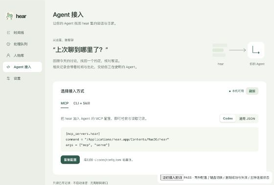
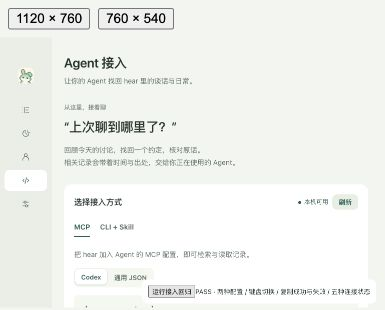

# Agent Context 交付验收

2026-10-26。全部录音/内容测试使用隔离数据，无真实采集或云模型调用。

| 范围 | 结果 |
| --- | --- |
| Rust workspace check/build | 通过，包含 GUI / Core / CLI / worker |
| 前端 typecheck / lint / production build | 通过；Vite 原有单包体积提醒保留 |
| Rust workspace 回归 | 367 passed / 15 ignored；排除下述 1 条已有失败。之后定向增加 4 条回归并通过 |
| 最新 Context / 日期协议 | 8 + 3 passed：正文续读、修正/身份、索引删除、分页、截图、来源、DST |
| 共享 knowledge 回归 | 21 passed |
| 最终 CLI / protocol 全部测试 | 2 + 12 passed |
| 前端 / Python | 53 / 6 passed；rabbit assets 与原生入口策略通过 |
| 真实 Core / CLI / MCP | `scripts/smoke_agent_context.py` 通过：existing-only、JSON 错误、六工具发现、两入口一致、并发只读、安装保留 |
| 现有 Core / diagnostics smoke | 通过，采集意图与来源状态未被读取更改 |
| 旧版本兼容 | 实际已安装 protocol20 Core 使用临时数据；CLI status/search 返回退出码3、core_incompatible；MCP 同语义，无重试提示 |
| 页面 | 1120×760 与 760×540 的真实 React fixture PASS：两种配置、tab 焦点/激活、复制成功与失败、在线/离线/不兼容/缺 CLI/读取失败 |
| 性能观察 | debug 内存库 4200 条模拟记录，受24KiB预算分为200页，最终一次 P95 34ms；不代表真实全历史规模 |

原有失败：`events::tests::prompt_output_examples_follow_event_contract` 断言提示词中有2个示例，开工时既有修改后的 fit_prompt.txt 只有1个。与开工快照比对相同，本次未改提示词或该断言。全量第一次执行确认失败；排除此一条后 workspace 回归通过。另两条旧库迁移夹具需要清除本次新增索引后再删列，各补一行，无其余修改。

审查：requirements 与 adversarial fresh context 发现5个独立 blocker（DST重合）；全部定向修复并复核通过。architecture 最终 PASS。具体裁决在 devplan。采集权限/休眠与签名安装不属于本次离线验收范围。

复现：`cargo test --workspace --locked -- --skip events::tests::prompt_output_examples_follow_event_contract`；`python3 scripts/smoke_agent_context.py`；启动 Vite 后打开 `/scripts/test_agent_viewports.html`。截图在浏览器中按0.5倍展示实际 iframe 尺寸，图片已裁去外部留白，未重绘页面。

