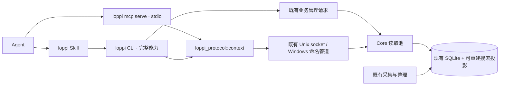

# Agent Context v1

2026-11-02。同一 macOS/Windows 用户下，loppi 保持运行，其他 Agent 通过随包 CLI 或 stdio MCP 消费已有记录。侧栏「Agent 接入」展示实际路径、连接状态与复制入口。

## 架构与边界

Core 是数据、有效性和查询的唯一 owner。只读 context/MCP 入口只用 `send_existing`，不启动 Core、采集、精转或云任务；没有网络监听、独立 daemon 或客户端内容缓存。内部 IPC 版本为 26；对外结果版本为 `loppi.context.v1`。同 UID 的 socket 检查沿用现有实现。读取能力不意味着云端 Agent 的模型推理离线。

GUI 日期导航使用只读 `CalendarAdjacent {from_ms,to_ms}`：输入为客户端本地日界（23–25 小时），输出 `newer_ms`/`older_ms` 为两侧最近可用材料的时间点或 `null`。GUI 以本地日界归日，不把时间点当 UTC 日期。投影与 `CalendarDays` 共用音频、粗转、未删除事件、现场记录及可见人工范围的可用性规则，排除 gap 与未来材料；一次查询覆盖全历史，无日期枚举或历史截断。协议 26 与 GUI/CLI/Core/worker 同步发布；旧组件按既有版本不匹配路径拒绝请求，无存储迁移或新增业务状态。

CLI/MCP 的默认参数、校验、描述、schema 和执行入口共用 `crates/loppi-protocol/src/context.rs`。MCP 是有限的 JSON-RPC stdio 适配层，支持 initialize / initialized / ping / tools/list / tools/call，协商 2025-11-25、2025-06-18；不声明可选 prompts、resources、通知或异步任务能力。每行请求最多 1 MiB，stdout 只写协议。

## 能力

| CLI | MCP | 用途 |
| --- | --- | --- |
| `context status` | `loppi_status` | 当前在线状态、时区、采集和处理状态 |
| `context list` | `loppi_list_context` | 日期/范围内事件卡片、未整理区间、独立现场记录 |
| `context search` | `loppi_search_context` | 词法短语，搜索转录、笔记、截图文字、事件标题/摘要/话题/要点/对象 |
| `context event ID --section …` | `loppi_get_event` | overview、summary、topics、key_points、mentioned_objects、moments |
| `context read` | `loppi_read_context` | 按 event_id、time、refs 三选一展开证据 |
| `context digest` | `loppi_digest` | 按日或范围读取概览，默认 compact，可进一步展开事件与证据 |
| `context people` | `loppi_list_people` | 已知发言人姓名到 person_id；不推断提及者身份 |

完整输入 schema 可离线读取 `context schema OPERATION`，短说明见 `context guide cli|mcp|evidence|workflows|troubleshooting`。所有查询默认 JSON；参数错误也只输出一份机器可读 JSON。CLI 退出码：0 成功（含空结果及离线 status），2 参数，3 后台不可用/不兼容，4 读取忙/超时，5 引用或其他查询失败。安装/配置辅助返回独立 JSON。

## 证据与分页契约

- 时间使用 `[from,to)`；date 为 today、yesterday 或 YYYY-MM-DD，from/to 为带偏移 RFC3339。IANA 时区默认本机，日期按当地日历处理夏令时。list 默认今天，search 默认全部历史。list 和按 time 读取最多 31×24 小时。
- 所有内容读取经既有两个只读连接与 3 秒 SQL 截止时间，不持有跨请求快照。每页 JSON ≤24 KiB；正文按 2,000 Unicode 字符分片，返回 fragment 起止与 has_more。metadata 超出预算时报 `record_too_large`，不悄悄省略。
- 默认 list/search/event/people 20 条，read 50 条；上限分别 100 / 200。必须原样带回 cursor 和原筛选参数；limit 可改。游标包含查询身份、解析后的时间范围、稳定顺序位置和 30 分钟有效期。分页一致性为 live；新数据可能在已经读过的位置出现，重新检索才能获得最新全貌。
- 旧 Core 无法解析新请求时，用现有稳定 Lifecycle Inspect 核对协议版本并返回 core_incompatible；不以 Status 成功推断版本兼容。
- event 分页绑定内容版本，跨页发生文本或身份变化返回 `cursor_stale`。分片续读绑定该条内容，变化或消失也返回 stale；不拼接两版文字。
- ref 编码记录类型、ID 和内容版本；按 ref 读取严格保留原证据，旧记录更正为 `available:false, reason:stale`，删除或不可见为 unavailable，不映射到另一段转录。
- best_available 优先有效精转（包含人工修正）。只有完整被某精转句覆盖的粗句才省略；部分覆盖保留粗句并标注 overlaps_precise。相同时间、来源、文字和身份的重复精转优先事件版本。来源、人物 ID / 名称、身份来源、音频可用性与事件关联随证据返回。
- 事件理解是 derived，历史理解引用保持 coarse 身份。结构或引用不再成立时不返回该理解正文；搜索定位保留 unavailable 提示。当前理解的要点搜索命中携带可读 evidence_refs。
- 截图的检索文本是既有 OCR / 图像摘要与逐字稿投影，标注 screenshot_text；不能把图像摘要当逐字原话。音频是否保留与文本是否可读分别表达。
- quality 是记录覆盖说明，包含已知缺口、处理状态、粗/精转数量和音频保留数量；不能代表现实活动的完整覆盖。未命中不等于没发生。

事件字段索引 `context_event_search` / FTS 由同库触发器随事件插入、更正、失效和删除更新；不是第二事实源。`context_visible` 复用原搜索的精转发布有效性条件，`context_preferred` 去除等价精转副本。原始内容仍来自既有修正维护的 `search_records`。原有清理/修正事务会同步移除派生结果。

## 渐进式披露与安装

`resources/agent/loppi-context/SKILL.md` 是覆盖完整 CLI 的薄入口：产品心智、适用场景、核心能力和独立 Skill 版本。`agent_assets` 维护同一模板/版本，在数据目录的 `skills/loppi/SKILL.md` 生成可复制副本，原子替换且相同内容不重写。源副本可重新生成，不是业务事实或用户自定义文件。新安装提示词提供这个本机目录，由接收 Agent 按当前工作区的技能约定复制；应用不扫描外部项目。Skill 要求每任务首次运行 `loppi readme`，发现新版主动更新副本、保留自定义内容并重新读取。

`loppi readme` 离线输出当前完整 Agent 指南、Skill 版本、官方来源与真实 CLI 路径；具体参数和语义来自逐级 `--help`。原有五个 references 通过 `context guide` 保留。CLI 的完整管理能力与只读 MCP 的边界不同，调用仍以用户当前请求为准；MCP `serverInfo.name/title` 和配置名均为 `loppi`，工具接口不变。

`integrations inspect` 提供真实路径、MCP 配置、Skill 版本、来源和安装提示词；`configure --target codex|generic` 只输出配置；`doctor` existing-only 自检。上述接入入口准备官方 Skill 来源时可能返回文件错误，不能将不存在/陈旧来源当成功。旧 `install-skill --destination PATH` 保留显式安装：同内容幂等、自定义副本拒绝覆盖；`install-cli --directory DIR` 创建符号链接或 Windows 启动器，不改 PATH、不覆盖无关命令。

配置依据实际安装路径，应用移动后需要重新生成；GUI 不自动修改所有 Agent 配置。Codex 使用 `[mcp_servers.loppi]`，通用 JSON 使用 `mcpServers.loppi`。

## 验证

`context::tests` 覆盖索引、引用、修正/身份/删除、粗精转覆盖、重复结果、长文本完整续读、游标、迁移、4200 条记录有界分页。协议与 CLI 测试验证日期、参数、MCP 握手及发现。`scripts/smoke_agent_context.py` 在临时数据目录启动真实 Core/CLI/MCP，验证 existing-only、结果一致、并发和安装保留。`scripts/test_agent_viewports.html` 运行真实页面的两种尺寸与交互回归，不接触真实录音数据。

配置依据：[MCP 2025-11-25](https://modelcontextprotocol.io/specification/2025-11-25)、[Codex MCP](https://learn.chatgpt.com/docs/extend/mcp?surface=cli)、[Skills](https://learn.chatgpt.com/docs/build-skills)。
