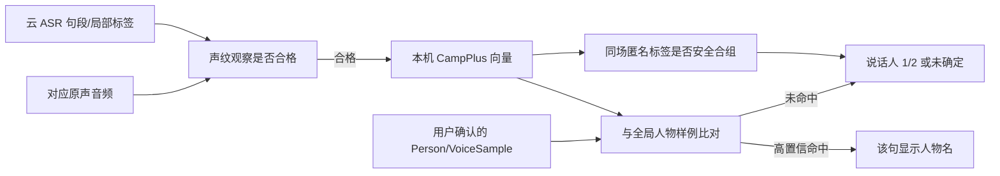

# 说话人分段、声纹与全局人物

> 本文解释“为什么新事件又显示说话人 1/2，明明人物库已经有名字”。口径为 2026-09-30 工作树当前实现；跨事件人物识别仍是 Batch 6 质量阻断。整体处理链见[核心算法](algorithms.md)，产品承诺见 [PRD 6.4](../prd/prd_0.1.md)。

## 1. 三个 ID，不可互换

| 名称 | 来源/作用域 | 含义 |
| --- | --- | --- |
| `speaker_label` | 火山 ASR 单个物理请求 | 供应商认为这些句子属于同一匿名声音。即使另一请求也叫 `1`，也不能直接视为同一人。 |
| `speaker_group` | hear 的当前目标事件/来源/版本 | 本机对一场活动中云标签做可重算的匿名合组；界面据此按出现顺序显示“说话人 1/2”。组数不证明真实人数。 |
| `person_id` | 本机全局人物库 | 用户创建/确认的稳定身份。仅人工指定或本机声纹可信匹配时，句段才与此 ID 关联并显示姓名。 |

云端 ASR 接收获准精转的音频，返回文字、时间和临时 speaker 标签；**不接收本机人物库和声纹向量**，也不认识已有姓名。跨事件比对目前全在本机。LLM 事件拟合也不推断人物身份。[供应商适配](../../crates/hear-core/src/cloud.rs)；[本机身份投影](../../crates/hear-core/src/knowledge.rs)。



## 2. 本地模型与样例

当前用 sherpa-onnx 的 **3D-Speaker CAMPPlus 中文 16 kHz** ONNX 权重：`3dspeaker_speech_campplus_sv_zh-cn_16k-common.onnx`。模型由[模型包管理](../../crates/hear-core/src/model_pack.rs)按固定 SHA-256 下载校验，位于私有目录 `models/speaker-v1/model.onnx`；[`hear-worker embed`](../../crates/hear-worker/src/main.rs)以 CPU、单线程运行。输出经过归一化后存为 **192 维 float 向量**，内部版本为 `campplus-zh-v1`。[向量编码与策略常量](../../crates/hear-core/src/knowledge.rs)。

### 从精转句段取得“观察”

`publish_asr` 对有云 speaker 标签的精转句段尝试登记 `voice_observation`。当前只给 **2–15 秒**句段排本地提取任务；这是一项可调的资源/质量策略，短句并非被云端丢弃，而是仍有精转文字却没有足够本机身份声音证据。取得原声后还检查来源、区间、重叠说话、音量过低/削波、模型可用性等。成功为 `ready`，不合格/失败为 `unavailable` 并带原因码；待处理与处理中分别有持久状态。[`enqueue_voice_observation`、`take_voice`、`publish_voice`](../../crates/hear-core/src/knowledge.rs)；[原声组装与音质检查](../../crates/hear-core/src/events.rs)。

`audio_quality` 表示长度/电平/削波等无法作可靠声纹；`audio_unavailable` 才表示对应原声区间缺失或不可读；`overlapping_speakers` 是检测到同请求不同标签发言重叠。旧版本写出的笼统错误码不自动当作新口径的实测结果。已存 `ready` 向量可在模型暂时不可用时重放匹配；提取新的向量仍需要模型文件。[`voice_loop`](../../crates/hear-core/src/main.rs)。

### 用户建档和样例

用户创建人物、把某句或明确选择的整组绑定到已有/新人物，形成 `speaker_bindings(origin='manual')`。人物记录与有效声音样例是两回事：**名字可以存在但没有合格样例**。绑定时已准备好的该人清晰句段可入 `voice_samples`；若声纹观察稍后才完成，发布向量时也会检查已有人工绑定并补入。自动样例要求 `ready` 且至少 **3 秒**；用户还可显式追加合格片段。[`bind_speaker`、`maybe_add_sample`、`publish_voice`、`add_voice_sample`](../../crates/hear-core/src/knowledge.rs)。

样例与 Person ID、来源、真实时刻和模型版本关联，可逐条撤销。一个人的多个有效样例参与匹配；原始音频被默认清理后，**已经提取的特征继续保留**，但不能凭被删原声再提取新特征。全数据清理按所选范围撤销相应样例和归属。[人物/样例](../../crates/hear-core/src/knowledge.rs)、[清理](../../crates/hear-core/src/cleanup.rs)。

## 3. 同一场活动的匿名合组

云端标签是线索，不是声纹证据。hear 在当前 `target_kind + target_id + target_version + source` 内，比对 `ready` 观察的归一化向量，用余弦相似度尝试合并被云端拆开的匿名标签。**跨来源、跨事件、跨版本不因编号相同而合组。**当前同场跨请求原型门槛为相似度至少 `0.66`、相对第二候选领先 `0.15`；同一云请求内不同标签原本表示不同声音，合并要求更强证据：候选分数至少 `0.74`、另一次直接证据至少 `0.70`，并要求领先间隔 `0.12`。[`reconcile_session_speaker`、`safe_session_merge`](../../crates/hear-core/src/knowledge.rs)。

合并之前还检查：两组在同一来源上不能有重叠发言；不能已有两个不同的有效人物归属；合并组内**每一对**来自同一云请求的不同标签都要有直接声音证据，避免 A≈B、B≈C 便把实际不同的 A/C 传递性误并。`speaker_groups` 只是可重建投影；样例、人工归属、音频或任务版本改变时撤销旧自动结果并重放当前证据。[`rebuild_speaker_groups`](../../crates/hear-core/src/knowledge.rs)。

极短、占比很低的云端标签不强行当作一位确定新人。当前 `precise_speaker_projection` 对某标签要求该请求累计至少 15 秒，或占请求发言时长至少 5%，否则显示“未确定”。这是一项显示层保守策略，不代表这段文字或音频被删除。[投影视图](../../crates/hear-core/src/knowledge.rs)。

## 4. 跨事件匹配已有人物

对一条 `ready` 句段，匹配器取**相同模型版本**的全部有效全局样例，计算归一化向量点积。每位人物取其最高样例分，排序后只有同时满足以下条件才自动绑定：

```text
第一名分数 ≥ 0.72
且（不存在第二名，或第一名分数 − 第二名分数 ≥ 0.15）
且该句未被用户否定过此人物
且没有有效的人工句段归属与之冲突
```

当前实现见 [`match_one_ready`](../../crates/hear-core/src/knowledge.rs)。参数是原型阈值，尚缺麦克风/系统声道、耳机、远场、语言切换的留出集验证。没有命中可以是：没有样例、句子太短/音质不合格、模型版本不同、分数不够、第一/第二名过于接近、用户否定、人工归属冲突，或任务尚未处理；不能简单显示成“声纹库没有连接”。

**自动命名只落到实际提供合格向量且命中人物的句段。**火山同一个临时 speaker 标签可能误并两个人，因此一个句段命中不能自动把整组句子全改成人名。用户明确勾选“应用于本场同一说话人”是人工整组决定，可以按该操作传播；单句人工纠错只影响该句。2026-09-29 的 `speaker_policy_version=3` 迁移撤销了早期整组自动扩散并逐句重放已存向量。[版本迁移、身份视图与匹配](../../crates/hear-core/src/knowledge.rs)。

样例库增加/撤销、人工否定或事件重转会推动 `identity_state.generation`，旧 `ready` 观察逐步重算；已无证据的自动姓名应撤销。人工确认优先且不因自动重算消失。重新精转后若旧人物归属无法唯一对上新句段，留待核对；不凭新云 speaker 数字复制旧身份。[重放与待核对](../../crates/hear-core/src/knowledge.rs)。

## 5. 用户最终看到什么

[`DetailDrawer`](../../src/DetailDrawer.tsx) 先看当前句段的 `person_name`；无名字才把当前事件里首次出现的匿名 `speaker_group` 依序显示为“说话人 1/2”；组也不足以确定时显示“未确定”。“自动匹配”和“已确认”分别表示本机自动绑定和人工确认。人物库中的一张声纹卡片，只证明已有可用样例，**不保证每个后续句段都会自动认出**。

目前 GUI 对“本场标签已出、但本机声纹为何没命中”缺少逐句可见原因。这是可诊断性和用户体验缺口；识别质量也未完成验收。开发/测试时应分别统计：

| 指标 | 应回答的问题 |
| --- | --- |
| 可提取覆盖率 | 云端精转句段中有多少进入 `ready`？未进入的长度、重叠、音质、原声缺失各占多少？ |
| 同场分组 | 同一真人被拆成几组？不同真人是否被误并？逐句归属是否正确，不能只比“组数”。 |
| 全局误认/漏认 | 有身份的句段有多少错名、多少未命中？按麦克风/系统声、距离、设备、语言拆开。 |
| 人工纠错稳定性 | 改身份、撤样例、重转、改边界、清理后，旧自动名是否正确撤销和重算？ |
| 资源成本 | 提取覆盖率提高后，对持续采集的 CPU、内存、耗电和积压有何影响？ |

先前小样本公开数据与单场实录只能证明路径可运行，不能证明声纹模型或阈值已经足够准确。AMI 四人反例还显示固定云端参数可误并多人；本机合组只修部分误拆，不能凭同一云标签自动拆开混在一起的声音。具体证据和待做验收记录在 [RFC 第 5 节](../prd/tech_rfc_0.1.md)与 [plan.md](../../plan.md)。
