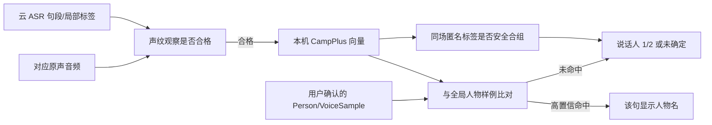

# 说话人分段、声纹与全局人物

> 本文解释“为什么新事件又显示说话人 1/2，明明人物库已经有名字”。口径为 2026-10-18 工作树当前实现；跨事件人物识别仍是 Batch 6 质量阻断。整体处理链见[核心算法](algorithms.md)，产品承诺见 [PRD 6.4](../prd/prd_0.1.md)。

## 1. 三个 ID，不可互换

| 名称 | 来源/作用域 | 含义 |
| --- | --- | --- |
| `speaker_label` | 火山 ASR 单个物理请求 | 供应商认为这些句子属于同一匿名声音。即使另一请求也叫 `1`，也不能直接视为同一人。 |
| `speaker_group` | hear 的当前目标事件/来源/版本 | 本机对一场活动中云标签做可重算的匿名合组；界面据此按出现顺序显示“说话人 1/2”。组数不证明真实人数。 |
| `person_id` | 本机全局人物库 | 用户创建/确认的稳定身份。仅人工指定或本机声纹可信匹配时，句段才与此 ID 关联并显示姓名。 |

云端 ASR 接收获准精转的音频，返回文字、时间和临时 speaker 标签；**不接收本机人物库和声纹向量**，也不认识已有姓名。跨事件比对目前全在本机。LLM 事件拟合也不推断人物身份。[供应商适配](../../crates/hear-core/src/cloud.rs)；[本机身份投影](../../crates/hear-core/src/knowledge.rs)。



## 2. 本地模型与样例

当前用 sherpa-onnx 的 **3D-Speaker CAMPPlus 中文 16 kHz** ONNX 权重：`3dspeaker_speech_campplus_sv_zh-cn_16k-common.onnx`。模型由[模型包管理](../../crates/hear-core/src/model_pack.rs)按固定 SHA-256 下载校验，位于私有目录 `models/speaker-v1/model.onnx`；[`hear-worker embed`](../../crates/hear-worker/src/main.rs)以 CPU、单线程运行。输出经过归一化后存为 **192 维 float 向量**，内部版本为 `campplus-zh-v1`。[向量编码与策略常量](../../crates/hear-core/src/knowledge.rs)。

### 从精转句段取得“观察”

`publish_asr` 对有云 speaker 标签的精转句段尝试登记 `voice_observation`。当前只给 **2–15 秒**句段排本地提取任务；这是一项可调的资源/质量策略，短句并非被云端丢弃，而是仍有精转文字却没有足够本机身份声音证据。取得原声后还检查来源、区间、重叠说话、音量过低/削波、模型可用性等。成功为 `ready`，不合格/失败为 `unavailable` 并带原因码；待处理与处理中分别有持久状态。[`enqueue_voice_observation`、`take_voice`、`publish_voice`](../../crates/hear-core/src/knowledge.rs)；[原声组装与音质检查](../../crates/hear-core/src/events.rs)。

`audio_quality` 表示长度/电平/削波等无法作可靠声纹；`audio_unavailable` 才表示对应原声区间缺失或不可读；`overlapping_speakers` 是检测到同请求不同标签发言重叠。旧版本写出的笼统错误码不自动当作新口径的实测结果。已存 `ready` 向量可在模型暂时不可用时重放匹配；提取新的向量仍需要模型文件。[`voice_loop`](../../crates/hear-core/src/main.rs)。

### 用户建档和样例

人物详情通过 `VoiceSamples` 的增量字段 `parts` 取得实际样例成员时间段，`audio_available` 按既有原音保留索引检查。组合样例不能用包围范围代替成员范围。原音不可用时特征仍保留，GUI 禁用试听；运行时文件缺失和清理继续由 `playback_chunk` / `playback_valid` 校验。`SamplePlayback` 复用有界 `ContinuousPlayback`，逐片段播放而不播放间隔；切人、离页或删除时停止并释放。没有新增音频副本或声纹特征回传。

用户新建或选择已有 Person，只有明确的 `speaker_bindings(origin='manual')` 可以授权补充声纹；自动命名不产生训练样本。姓名归属和声纹入库独立：无合格样例仍保存名字，显示“待补充声纹”。已有 `ready` 向量且带实测音质的数据立即提交后台筛选，尚未提取的在 `publish_voice` 时提交。姓名确认不等待全库比对；只有筛选通过才增加样例数。显式追加样例也不能绕过质量、去重、容量与人工证据检查。实现集中于 [`knowledge/enrollment.rs`](../../crates/hear-core/src/knowledge/enrollment.rs)。

#### 短句组合与音质

- “仅这句话”不借用相邻发言；“本场该说话人的全部发言”只使用这次明确确认的句段集合。
- 400 ms 至不足 3 秒的短句，可在同一 target/version、音源、有效说话人组内按时间组合。最大间隔 1.5 秒；有其他句段插话、重叠或来源变化即断开。最多 12 句、目标累计 6 秒、硬上限 12 秒，尾组至少 3 秒。
- 组合输入只拼接各句原声，不含间隔音频；沿用 Opus 解码、16 kHz 重采样与 CampPlus。不会改动原始音频、逐句转录或云 ASR 请求。每次每人物/场次/音源最多生成 12 个组合候选，进入既有 `voice_loop` 的资源门控与持久重试。
- 新样本需至少 3 秒达到电平门槛的 10 ms 帧、有效帧占比至少 65%、削波采样不超过 1%；原有缺失音频、低电平与重叠检查继续生效。质量排序为 `min(有效毫秒, 10000) × 有效帧占比`。这是电平/时长代理指标，**不等价于 SNR、可靠 VAD 或校准识别置信度**。
- 历史 `ready` 观察没有实测质量记录时，新的人工确认会安排重新提取；原声已丢失则保留姓名，不凭旧向量虚构音质。

#### 去重、限额与防污染

- 近似重复阈值为同模型归一化向量余弦相似度 ≥ 0.96；同音源时间重叠也视为重复。只有新样本评分更高才替换，平分保留旧样本。
- 每人物/模型/本场 target version/音源最多 **3** 份有效样例；每人物/模型合计最多 **24** 份。达到上限时，只允许更高分候选替换低分样例。保留多个不相似样例来覆盖录音条件，不无限增加数量。
- 对已有声纹的人物，新候选与其最高匹配分需 ≥ 0.72；如果与另一个人物分数也 ≥ 0.72，必须比该人物至少领先 0.15。不能满足就不入库，人工姓名仍有效。阈值复用当前匹配策略，属于保守原型参数，仍需跨设备留出集验证；不能保证阻止错误的首次人工标注。
- `voice_sample_parts` 记录每份样例所有来源句段及人工绑定 ID。发布事务重新验证人物、绑定 ID、有效句段、target version、当前有效分组、音源、重叠和间隔插话；撤销/改变任意成员归属会同步撤销整份样例，并推进匹配 generation。删人物、重转或清理不能被迟到任务恢复。
- 手动删除样例或被优选替换后，同一批人工确认的候选不会自动复活该样例；用户重新明确确认属于新的授权。

组合任务与各成员保存在 Core 的 `voice_enrollments` / `voice_enrollment_parts`，沿用 pending/processing、退避、恢复及 `voice_outbound` 清理屏障；组合向量只用于人物样例，不伪装成某一条句子的独立观察去重建匿名分组。`voice_observation_quality` 与 `voice_sample_quality` 保存实测或历史评分以及场次归属。Core 仍是唯一持久 owner，没有新服务、外部接口或云调用。

单句也复用候选表暂存向量和评分。全库筛选复用 `VoiceMatcher` 的有界分页与缓存，在 Store 锁外计算；最终事务核对 `identity_state.generation`、候选向量和人工证据。库变化则重取快照，不重复音频提取。事务内只比较该人物最多 24 份样例以择优替换。已经提取的待筛选候选在原音清理或模型不可用时仍能完成筛选。

一次性迁移为历史样例关联可验证的人工归属、去重并收紧数量；缺少有效人工证据的旧样例退出匹配，人物名称保留。历史评分只按原片段时长作保守排序，不宣称已通过新 PCM 门槛。原音清理后保留已经入库的特征；清除全部数据会删除相交样例及组合任务。每份样例保留来源、真实时间与模型版本，可逐条撤销。迁移及撤销、重启、清理、迟到发布测试见 [`enrollment/tests.rs`](../../crates/hear-core/src/knowledge/enrollment/tests.rs)。

`embed` 模型按需常驻复用，空闲 30 秒或资源压力下卸载；统一有界 RPC 可取消、超时后回收。`worker_failed`/`worker_timeout` 按持久退避重试，资源延期不计错误次数；输入音质和永久模型错误仍区别处理。全局样例按 generation 缓存已解码向量，最多 4096 条；更大库逐 256 条分页评分且不截断候选。解码/余弦评分在 Store 锁外进行，发布事务复核 generation、原向量与当前人工归属；同场合组规则和全部匹配阈值保持不变。

## 3. 同一场活动的匿名合组

云端标签是线索，不是声纹证据。hear 在当前 `target_kind + target_id + target_version + source` 内，比对 `ready` 观察的归一化向量，用余弦相似度尝试合并被云端拆开的匿名标签。**跨来源、跨事件、跨版本不因编号相同而合组。**当前同场跨请求原型门槛为相似度至少 `0.66`、相对第二候选领先 `0.15`；同一云请求内不同标签原本表示不同声音，合并要求更强证据：候选分数至少 `0.74`、另一次直接证据至少 `0.70`，并要求领先间隔 `0.12`。[`reconcile_session_speaker`、`safe_session_merge`](../../crates/hear-core/src/knowledge.rs)。

合并之前还检查：两组在同一来源上不能有重叠发言；不能已有两个不同的有效人物归属；合并组内**每一对**来自同一云请求的不同标签都要有直接声音证据，避免 A≈B、B≈C 便把实际不同的 A/C 传递性误并。`speaker_groups` 只是可重建投影；样例、人工归属、音频或任务版本改变时撤销旧自动结果并重放当前证据。[`rebuild_speaker_groups`](../../crates/hear-core/src/knowledge.rs)。

极短、占比很低的云端标签不强行当作一位确定新人。当前 `precise_speaker_projection` 对某标签要求该请求累计至少 15 秒，或占请求发言时长至少 5%，否则显示“未确定”。这是一项显示层保守策略，不代表这段文字或音频被删除。[投影视图](../../crates/hear-core/src/knowledge.rs)。

### 人工归并本场匿名说话人

人物面板按“已有全局人物 → 新建人物并建立声纹 → 本场匿名说话人”排列。无有效样例的人物显示“待补充声纹”，状态从 `PersonView.sample_count` 派生；创建及绑定在同一事务完成，并返回实际样例数。声音太短、原声不可用或样例尚未就绪不会丢失姓名和本场归属，后续合格观察仍沿已有入口补样例。

`SessionSpeakers` 从 Core 查询同一 target kind/id/version 的全部当前分组并按首次出现编号，不依赖详情页已加载的句段。已有姓名的分组不作为匿名归并目标。`AssignLocalSpeaker` 在事务中验证源操作范围及目标整组的 revision，再按“仅这句话 / 本场该说话人的全部发言”归并。

人工归并存于 `local_speaker_assignments(segment_id,group_id,updated_ms)`；将选中的源句段与目标组成员固定到同一个本场匿名 ID。`precise_group_membership` 统一提供人工覆盖优先的有效分组，供范围选择、版本检查和后续人物绑定使用；`precise_speaker_projection` 展示同一覆盖。自动 `speaker_groups` 重建不删除这些人工决定，也不会借人工覆盖向原云标签中的其他句子扩散姓名。

这项归并不创建 Person，也不凭归并本身建立 VoiceSample；若源句段原有姓名，选定范围先经过既有取消归属入口撤销姓名及相应样例。归并可跨本场两路音源，但不能跨事件、手动范围或精转版本。记录绑定到本次精转的具体句段 ID：**重新精转生成新句段时不按云编号继承匿名归并**，需要重新核对。删除句段时触发器同步清理覆盖，清理预览签名包含人工归并状态。

## 4. 跨事件匹配已有人物

对一条 `ready` 句段，匹配器取**相同模型版本**的全部有效全局样例，计算归一化向量点积。每位人物取其最高样例分，排序后只有同时满足以下条件才自动绑定：

```text
第一名分数 ≥ 0.72
且（不存在第二名，或第一名分数 − 第二名分数 ≥ 0.15）
且该句未被用户否定过此人物
且没有有效的人工句段归属与之冲突
```

当前实现见 [`prepare_match` / `VoiceMatcher` / `publish_match`](../../crates/hear-core/src/knowledge.rs)。参数是原型阈值，尚缺麦克风/系统声道、耳机、远场、语言切换的留出集验证。没有命中可以是：没有样例、句子太短/音质不合格、模型版本不同、分数不够、第一/第二名过于接近、用户否定、人工归属冲突，或任务尚未处理；不能简单显示成“声纹库没有连接”。

**自动命名只落到实际提供合格向量且命中人物的句段。**火山同一个临时 speaker 标签可能误并两个人，因此一个句段命中不能自动把整组句子全改成人名。用户明确勾选“应用于本场同一说话人”是人工整组决定，可以按该操作传播；单句人工纠错只影响该句。2026-09-29 的 `speaker_policy_version=3` 迁移撤销了早期整组自动扩散并逐句重放已存向量。[版本迁移、身份视图与匹配](../../crates/hear-core/src/knowledge.rs)。

样例库增加/撤销、人工否定或事件重转会推动 `identity_state.generation`，旧 `ready` 观察逐步重算；已无证据的自动姓名应撤销。人工确认优先且不因自动重算消失。重新精转后若旧人物归属无法唯一对上新句段，留待核对；不凭新云 speaker 数字复制旧身份。[重放与待核对](../../crates/hear-core/src/knowledge.rs)。

## 5. 用户最终看到什么

[`DetailDrawer`](../../src/DetailDrawer.tsx) 先看当前句段的 `person_name`；无名字才用 Core 对当前完整事件分组按首次出现编号的“说话人 1/2”；组也不足以确定时显示“未确定”。“自动匹配”和“已确认”分别表示本机自动绑定和人工确认。人物库中的一张声纹卡片，只证明已有可用样例，**不保证每个后续句段都会自动认出**。

目前 GUI 对“本场标签已出、但本机声纹为何没命中”缺少逐句可见原因。这是可诊断性和用户体验缺口；识别质量也未完成验收。开发/测试时应分别统计：

| 指标 | 应回答的问题 |
| --- | --- |
| 可提取覆盖率 | 云端精转句段中有多少进入 `ready`？未进入的长度、重叠、音质、原声缺失各占多少？ |
| 同场分组 | 同一真人被拆成几组？不同真人是否被误并？逐句归属是否正确，不能只比“组数”。 |
| 全局误认/漏认 | 有身份的句段有多少错名、多少未命中？按麦克风/系统声、距离、设备、语言拆开。 |
| 人工纠错稳定性 | 改身份、撤样例、重转、改边界、清理后，旧自动名是否正确撤销和重算？ |
| 资源成本 | 提取覆盖率提高后，对持续采集的 CPU、内存、耗电和积压有何影响？ |

先前小样本公开数据与单场实录只能证明路径可运行，不能证明声纹模型或阈值已经足够准确。AMI 四人反例还显示固定云端参数可误并多人；本机合组只修部分误拆，不能凭同一云标签自动拆开混在一起的声音。具体证据和待做验收记录在 [RFC 第 5 节](../prd/tech_rfc_0.1.md)与 [plan.md](../../plan.md)。
